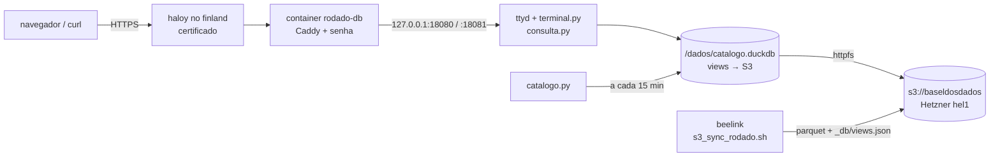

# db.rodado.xyz — terminal SQL e endpoint para curl

O espelho acessível pela web, com senha (HTTP basic auth), só leitura. Desde 2026-10-11 lê do
bucket `s3://baseldosdados` (Hetzner, Helsinque), a cópia que o beelink sincroniza — sem túnel
nem dependência do beelink ligado.

- `https://db.rodado.xyz/` — terminal SQL no navegador (ttyd em `/tty/`) com a árvore
  dos datasets à direita e um editor de SQL embaixo (digitação local, Enter executa):
  busca, tabelas com nº de linhas, colunas ao abrir, ▶ ou duplo clique põe
  `FROM dataset.tabela LIMIT 10;` no editor, clique na coluna insere o nome.
  Ao abrir a tabela: linhas exatas, data de atualização e fonte, atalhos para amostra,
  `DESCRIBE` e `SUMMARIZE`, aviso acima de 50 milhões de linhas e as colunas de partição
  ou de filtro recomendado (`ano`, `mes`, `sigla_uf`)
- `https://db.rodado.xyz/?query=<base64 do SQL>` — link que abre o terminal e já executa a
  consulta (base64 ou base64url, com ou sem `=`, texto em UTF-8; espera o prompt `rodado>`
  antes de colar). `?z=` é o mesmo com o SQL comprimido em deflate cru antes do base64url,
  25–60% mais curto (a página descomprime com `DecompressionStream`); `db/link.py -z` gera.
  `?q=<id>` abre no terminal o SQL de um link curto
- `https://db.rodado.xyz/q/<id>` — **link curto público**, sem senha nem token: uma página
  só de leitura com o SQL e o resultado dele (até 1.000 linhas, guardado por 10 min, com
  CSV). O botão de link à esquerda do ▶ no editor salva a consulta escrita (ou a última
  executada) com `POST /q` e copia o link; pelo terminal, `db/link.py consulta.sql`. O id
  são os 8 primeiros caracteres base64url do sha256 do SQL (o mesmo SQL dá o mesmo link) e o
  SQL fica em `/dados/q/<id>.sql`, no volume. Salvar exige senha ou token e só aceita um
  comando de leitura; sem senha, o Caddy libera apenas `GET /q/<id>`, `/q/<id>/sql` e
  `/q/<id>/dados` — quem recebe o link não roda nenhuma outra consulta (`q.html`)
- `?token=<token>` em qualquer URL dispensa a senha: `https://db.rodado.xyz/?token=…&query=…`
  é um link que um terceiro abre e já vê o resultado. O token fica em
  `/root/rodado-db/.token` no finland (nunca no repositório); o primeiro acesso o grava num
  cookie `HttpOnly` de 30 dias, porque o iframe do terminal, o websocket e os `fetch` da
  página não carregam o `?token`. O Caddy tira o `token` da URL antes do app e manda
  `Referrer-Policy: same-origin`. Sem `DB_TOKEN` no deploy, o token fica desligado.
- `https://db.rodado.xyz/query` — SQL por HTTP:

```bash
curl -u rodado:SENHA --data-binary 'FROM br_bd_diretorios_brasil.uf' https://db.rodado.xyz/query
curl -u rodado:SENHA 'https://db.rodado.xyz/query?formato=csv&limite=100000' --data-binary @consulta.sql
curl -u rodado:SENHA -G https://db.rodado.xyz/query --data-urlencode 'q=DESCRIBE br_me_cnpj.empresas'
```

`formato` = `json` (padrão, lista de objetos), `csv`, `tsv` ou `parquet`; `limite` = linhas
devolvidas (padrão 10.000, máx. 1.000.000). Os cabeçalhos `X-Linhas`, `X-Truncado` e
`X-Segundos` trazem quantas linhas vieram, se o limite cortou e quanto levou. Um comando
por requisição, 300 s no máximo, 4 consultas simultâneas.

### Do DuckDB local

Não existe protocolo de servidor no DuckDB; o CLI local lê o resultado em parquet por
HTTP (colunas tipadas). Uma vez por sessão:

```sql
CREATE SECRET rodado (TYPE http, SCOPE 'https://db.rodado.xyz',
  EXTRA_HTTP_HEADERS MAP {'Authorization': 'Basic ' || to_base64('rodado:SENHA'::BLOB)});
SET force_download = true;  -- uma requisição só; sem isso, cada leitura por faixa reexecutaria a consulta
CREATE MACRO rodado(q) AS TABLE
  FROM read_parquet('https://db.rodado.xyz/query?formato=parquet&limite=1000000&q=' || url_encode(q));

FROM rodado('SELECT ano, count(*) FROM br_rodado_eleicoes.secao_setor GROUP BY 1');
CREATE TABLE uf AS FROM rodado('FROM br_bd_diretorios_brasil.uf');  -- e junta com dado local
```

A consulta roda no finland, lendo do bucket; só o resultado atravessa (agregue lá, não traga tabela bruta).

## Como funciona



| Peça | Onde | Arquivo |
|---|---|---|
| Conexão travada (núcleo) | container | `rodado_sql.py` |
| Terminal (via ttyd): SQL colorido ao digitar, Enter envia no `;`, Tab completa dataset/tabela/coluna | container, até 4 abas | `terminal.py` |
| Página com a árvore, `/catalogo.json` (cache 10 min), `/colunas`, `/query`, `/ping` | container, `127.0.0.1:18081` | `consulta.py`, `index.html` |
| Catálogo: as views do beelink com os caminhos trocados para o bucket | container, volume `rodado-db-dados` | `catalogo.py` |
| Exporta o SQL das views para `~/rodado/_db/views.json` | beelink, antes de cada `s3_sync_rodado.sh` | `exporta_views.py` |
| Sobe tudo, cada peça reiniciando sozinha; Caddy em primeiro plano | container | `inicia.sh`, `Dockerfile` |
| Senha, token e roteamento | finland, app haloy `rodado-db` | `proxy/Caddyfile`, `haloy.yml` |
| Prévia de link (og:title/og:image) sem senha, só para robôs de pré-visualização (WhatsApp, Slack, Telegram…) em `/` | mesmo container | `proxy/og.html` |

**Catálogo.** As views do beelink citam cada parquet pelo caminho (`/home/polo/rodado/...`).
`exporta_views.py` grava o SQL delas em `~/rodado/_db/views.json` e a sincronização com o S3 o
leva para o bucket junto com os parquet. `catalogo.py` confere o arquivo a cada 15 min e, quando
muda, recria as views num `.duckdb` novo com `s3://baseldosdados/` no lugar do caminho local, e o
troca por rename atômico; a próxima consulta já abre o novo. Criar uma view lê o rodapé de cada
parquet que ela cita (79 mil arquivos): a montagem leva perto de meia hora, por isso o catálogo
mora num volume e sobrevive ao redeploy. A sincronização apaga do bucket os arquivos órfãos
só no fim; se um parquet foi renomeado no beelink, o catálogo do finland ainda cita o nome
antigo até a remontagem terminar, e uma consulta nesse intervalo pode falhar por arquivo
ausente. Fora do catálogo: as 6 views do SIPNI (bucket
`healthbr-data`, sem segredo aqui) e a tabela nativa `main.cpf_lookup`, que vive dentro do
`.duckdb` do beelink e não tem parquet.

**Não é o CLI do DuckDB, de propósito.** O `-safe` do CLI trava a configuração antes de
qualquer `-cmd`, então não dá para liberar só os prefixos das tabelas; sem ele, `.shell` é um
shell no container. O núcleo abre uma instância `read_only` do catálogo por processo, carrega o
httpfs e o segredo do bucket, desliga o acesso externo, trava a configuração e só aceita o que o
parser do DuckDB classifica como SELECT (inclui DESCRIBE, SHOW, SUMMARIZE e FROM primeiro). Cada
consulta é um cursor dessa instância: o cache de rodapés de parquet e de metadados HTTP
sobrevive entre consultas. A chave vai num `SECRET` (nunca em `SET s3_*`, que `current_setting()`
mostraria), e `duckdb_secrets()` está entre as funções recusadas.

**Nenhum arquivo é lido direto, só as views.** O bucket espelha `~/rodado` inteiro: tem também
scripts, logs, docs, o `.duckdb` do beelink e sobras de staging. Duas camadas independentes:

1. `allowed_directories` é a lista exata dos prefixos de tabela que as views leem
   (`s3://baseldosdados/<dataset>/<tabela>/`), tirada do corpo delas (`duckdb_views()`) a cada
   instância — não o bucket inteiro.
2. Antes de executar, a árvore do parser (`json_serialize_sql`, que enxerga CTE, LATERAL,
   UNION e nome entre aspas) é percorrida e a consulta é recusada se chamar função de
   arquivo (`read_*`, `parquet_*`, `*_scan`, `glob`, `sniff_csv`, `st_read`…), função que
   executa SQL embutido (`query`, `query_table`, `json_execute_serialized_sql`) ou
   `FROM '<caminho>'`. Se a consulta não serializa, não roda.

Além disso, `autoload_known_extensions` e `autoinstall_known_extensions` ficam desligados:
citar `st_read` não carrega o spatial (o httpfs vem instalado na imagem e é carregado antes da trava).

Recursos: o finland tem 4 núcleos e 7 GB, divididos com gitea, opengist e uqt. Cada processo
(endpoint, cada aba do terminal) tem uma instância de até 1,5 GB, 16 threads — ler do S3 é
esperar rede, não CPU: a mesma consulta caiu de 23 s para 4 s de 4 para 16 threads — e despejo
em `/tmp/duckdb` até 3 GB. Terminal: até 4 abas, sessão fecha após 30 min parada.

**Desempenho.** Medido em 2026-10-11 com a consulta de despesas de candidatos com a Meta
(257 arquivos): 0,6 s no disco do beelink, 4–15 s pelo bucket. Varredura de tabela grande é
proporcionalmente mais lenta — filtre por partição (`ano`, `mes`, `sigla_uf`) e agregue.

O túnel SSH reverso do beelink foi desligado na mesma data, e removidos o usuário `tunel` e o bloco `Match User tunel` do `sshd_config` no finland e a chave `~/.ssh/rodado_tunel` no beelink.

## Operação

```bash
# logs (catálogo, endpoint, terminal e Caddy saem todos no log do container)
ssh finland 'docker logs --tail 50 $(docker ps -qf name=rodado-db)'

# deploy: código para o finland e haloy deploy (o S3_KEY/S3_SECRET vêm de /root/rodado-db/.s3)
scp db/{Dockerfile,haloy.yml,inicia.sh,rodado_sql.py,consulta.py,terminal.py,catalogo.py,index.html} finland:/root/rodado-db/
scp db/proxy/{Caddyfile,og.html} finland:/root/rodado-db/proxy/
ssh finland 'cd /root/rodado-db && set -a && . /etc/haloy/.env && . ./.s3 && set +a &&
  DB_USUARIO=rodado DB_SENHA_HASH="$(cat .senha_hash)" DB_TOKEN="$(cat .token)" haloy deploy -c haloy.yml'

# catálogo: depois de uma sincronização, forçar a remontagem sem esperar os 15 min
ssh finland 'docker exec $(docker ps -qf name=rodado-db) python3 catalogo.py --uma-vez'
```

No beelink, `~/scripts/s3_sync_rodado.sh` chama `python3 ~/rodado_db/exporta_views.py` antes
de subir os arquivos (atualizar com `scp db/exporta_views.py beelink:rodado_db/`).

Trocar a senha: gravar a nova em `/root/rodado-db/.senha`, refazer o hash com
`docker run --rm -i caddy:2.10.2-alpine caddy hash-password < .senha > .senha_hash` e
redeploy.
Trocar o token (revoga todos os links e cookies já entregues): `openssl rand -hex 24 > .token` e
redeploy.
Trocar a chave do bucket: `/root/rodado-db/.s3` (`S3_KEY=`, `S3_SECRET=`) e redeploy.

## Latência ao digitar

- `PROMPT_TOOLKIT_NO_CPR=1`: sem isso cada prompt pede a posição do cursor e espera a
  resposta atravessar a rede.
- A completação nunca espera consulta: as colunas de uma tabela citada são lidas numa
  thread e entram na sugestão seguinte.
- O que resolveu de vez (2026-10-11): o editor de SQL embaixo do terminal. A consulta é
  escrita no navegador, com realce e autocompletar a partir do `/catalogo.json` e do
  `/colunas`, e só o Enter a manda ao terminal (colada inteira, com `;` no fim se faltar).
  Shift+Enter quebra a linha, Tab aceita a sugestão, ↑ na primeira linha traz a consulta
  anterior (histórico no `localStorage`), Ctrl-C sem seleção interrompe a consulta. A
  árvore à direita passou a escrever no editor. No celular não há editor: a digitação
  segue no terminal, com a barra de teclas.
- Duas conexões vivas no mesmo processo dividem a mesma instância do DuckDB: a segunda
  falhava com `configuration has been locked` quando a thread de colunas do autocompletar
  ainda estava aberta (bastava colar e dar Enter rápido). `rodado_sql.conecta()` agora
  configura sob uma trava de processo e, na instância já configurada, só confere que o
  acesso externo segue desligado e a configuração travada.

## Testes de UI e UX

`db/testes/` roda 52 testes contra o site no ar (Bun + `playwright-core` com o Chrome
instalado, nada é baixado), com a régua da auditoria de acessibilidade do swissviz:

- **API:** 401 sem senha em toda rota, formatos, limite, recusa de escrita e de qualquer
  leitura direta de arquivo (scripts e `.duckdb` em `~/rodado`, despejo alheio, LATERAL,
  CTE, nome entre aspas, `FROM '<caminho>'`, `query()`, `st_read`), e um número conhecido (156.454.011 eleitores em 2022).
- **Desktop:** zero controles sem nome acessível, contraste WCAG AA em todo texto do
  painel, `:focus-visible`, `aria-live` na busca, árvore navegável por teclado (↓ da busca,
  ↑ ↓ → ← Esc, Shift+Enter cola), colunas, ▶ colando e executando, SQL colorido,
  autocompletar, recusa de escrita, divisor por mouse e teclado com largura lembrada,
  moldura, sem rolagem horizontal; e o editor (digitação sem ida ao servidor, realce,
  Tab em tabela e coluna, várias linhas, histórico).
- **Celular (iPhone 14):** terminal em tela cheia, alvos de toque de 36 px ou mais, busca
  com 16 px, bottom sheet que fecha tocando fora, no ✕ e com Esc, ▶ visível sem hover,
  barra de teclas (`;`, ⏎, Ctrl-C) e contraste AA.
- **Link `?query=` / `?z=`:** base64 padrão com `+` cru na URL (desktop, entra no histórico),
  base64url no celular, acento e ✓ no SQL, `?z=` comprimido, botão de link copiando um `?z=` que executa, e base64 ou deflate inválido
  avisa e não executa.

```bash
db/testes/roda.sh            # busca a senha no finland
db/testes/roda.sh -t celular # só um bloco
```
