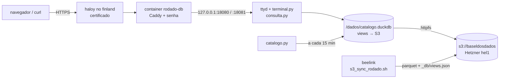

# db.rodado.xyz — terminal SQL e endpoint para curl

O espelho acessível pela web, com senha (HTTP basic auth), só leitura. Desde 2026-10-11 lê do
bucket `s3://baseldosdados` (Hetzner, Helsinque), a cópia que o beelink sincroniza — sem túnel
nem dependência do beelink ligado.

- `https://db.rodado.xyz/` — terminal SQL no navegador (ttyd em `/tty/`) com a árvore
  dos datasets à direita e um editor de SQL embaixo (digitação local, Enter executa):
  busca, tabelas com nº de linhas, colunas ao abrir, ▶ ou duplo clique põe
  `FROM dataset.tabela LIMIT 10;` no editor, clique na coluna insere o nome.
  Ao abrir a tabela: linhas exatas, data de atualização e fonte, atalhos para amostra,
  `DESCRIBE` e `SUMMARIZE`, aviso acima de 50 milhões de linhas e as colunas de partição
  ou de filtro recomendado (`ano`, `mes`, `sigla_uf`)
- `https://db.rodado.xyz/?query=<base64 do SQL>` — link que abre o terminal e já executa a
  consulta (base64 ou base64url, com ou sem `=`, texto em UTF-8; espera o prompt `rodado>`
  antes de colar). `?z=` é o mesmo com o SQL comprimido em deflate cru antes do base64url,
  25–60% mais curto (a página descomprime com `DecompressionStream`); `db/link.py -z` gera.
  `?q=<id>` abre no terminal o SQL de um link curto
- `https://db.rodado.xyz/q/<id>` — **link curto**: abre o terminal normal e executa o SQL
  salvo. O botão de link à esquerda do ▶ no editor salva a consulta escrita (ou a última
  executada) com `POST /q` e copia o link; pelo terminal, `db/link.py consulta.sql`. O id são
  os 8 primeiros caracteres base64url do sha256 do SQL (o mesmo SQL dá o mesmo link) e o SQL
  fica em `/dados/q/<id>.sql`, no volume. Salvar exige senha ou token e só aceita um comando
  de leitura. **Quem abre um link que existe entra sem senha e, a pedido, com o acesso de
  quem tem o token** (o Caddy grava o cookie do token): o link curto é um convite para o
  espelho inteiro, não só para aquela consulta. O Caddy confere o arquivo do id antes
  (`file` em `/dados/q`); um id que não existe cai na senha
- `https://db.rodado.xyz/index` — **todos os links curtos**, do mais novo para o mais
  antigo: descrição (o bloco de comentários `--` que abre o SQL), criação, cliques (aberturas de
  `/q/<id>`) e tempo de execução; `?formato=json` para agentes. Fica atrás da senha, ao contrário
  do `/llm`: cada link da lista abre o espelho inteiro. Os números vivem em `/dados/q/<id>.json`;
  o tempo é medido por uma fila de um consumidor só no `consulta.py` (uma das consultas
  simultâneas, até 10.000 linhas) logo depois de salvar e na subida, para os links ainda sem
  medida, e é refeito por todo `/query` com o mesmo texto de um link. Cliques contam só a partir
  do deploy (os de antes estavam só no log do container)
- **Até 26/10/2026 inclusive o site inteiro está aberto, sem senha nem token** (a pedido):
  `@aberto` no `proxy/Caddyfile` compara `{time.now.unix}` com 1793070000 (2026-10-27 00:00
  -03:00). Passada a hora, a senha e o token voltam sozinhos, sem deploy; o aviso em `llm.md`
  e o bloco `@aberto` podem sair depois
- `?token=<token>` em qualquer URL dispensa a senha: `https://db.rodado.xyz/?token=…&query=…`
  é um link que um terceiro abre e já vê o resultado. O token fica em
  `/root/rodado-db/.token` no finland (nunca no repositório); o primeiro acesso o grava num
  cookie `HttpOnly` de 30 dias, porque o iframe do terminal, o websocket e os `fetch` da
  página não carregam o `?token`. O Caddy tira o `token` da URL antes do app e manda
  `Referrer-Policy: same-origin`. Sem `DB_TOKEN` no deploy, o token fica desligado.
- `https://db.rodado.xyz/query` — SQL por HTTP:

```bash
curl -u rodado:SENHA --data-binary 'FROM br_bd_diretorios_brasil.uf' https://db.rodado.xyz/query
curl -u rodado:SENHA 'https://db.rodado.xyz/query?formato=csv' --data-binary @consulta.sql
curl -u rodado:SENHA -G https://db.rodado.xyz/query --data-urlencode 'q=DESCRIBE br_me_cnpj.empresas'
```

Sem `formato`, o corpo é `{"linhas": [...], "avisos": [...], "contexto": [...], "truncado": ...}`,
com as armadilhas medidas das tabelas citadas junto do resultado; `formato` = `json` (só a lista
de objetos, como era o padrão até 2026-10-20), `csv`, `tsv` ou `parquet`; `limite` = linhas
devolvidas (padrão e máximo 10.000). Os cabeçalhos `X-Linhas`, `X-Truncado` e
`X-Segundos` trazem quantas linhas vieram, se o limite cortou e quanto levou. Um comando
por requisição, 300 s no máximo, 4 consultas simultâneas.

- `https://db.rodado.xyz/mcp` — o servidor MCP (`mcp/mcp_server.py`, *streamable HTTP*), atrás
  da mesma senha/token: `claude mcp add --transport http rodado https://db.rodado.xyz/mcp`
  (depois de 26/10, com `?token=` na URL ou HTTP Basic no cabeçalho). Roda no container em
  127.0.0.1:18082 e consulta o `consulta.py` daqui de dentro (`RODADO_URL=http://127.0.0.1:18081`),
  sem Bearer próprio (`MCP_HTTP_BEHIND_AUTH=1`). Ver `mcp/MCP.md`, seção 6

### Do DuckDB local

Não existe protocolo de servidor no DuckDB; o CLI local lê o resultado em parquet por
HTTP (colunas tipadas). Uma vez por sessão:

```sql
CREATE SECRET rodado (TYPE http, SCOPE 'https://db.rodado.xyz',
  EXTRA_HTTP_HEADERS MAP {'Authorization': 'Basic ' || to_base64('rodado:SENHA'::BLOB)});
SET force_download = true;  -- uma requisição só; sem isso, cada leitura por faixa reexecutaria a consulta
CREATE MACRO rodado(q) AS TABLE
  FROM read_parquet('https://db.rodado.xyz/query?formato=parquet&limite=10000&q=' || url_encode(q));

FROM rodado('SELECT ano, count(*) FROM br_rodado_eleicoes.secao_setor GROUP BY 1');
CREATE TABLE uf AS FROM rodado('FROM br_bd_diretorios_brasil.uf');  -- e junta com dado local
```

A consulta roda no finland, lendo do bucket; só o resultado atravessa (agregue lá, não traga tabela bruta).

## Como funciona



| Peça | Onde | Arquivo |
|---|---|---|
| Conexão travada (núcleo) | container | `rodado_sql.py` |
| Terminal (via ttyd): SQL colorido ao digitar, Enter envia no `;`, Tab completa dataset/tabela/coluna | container, até 4 abas | `terminal.py` |
| Página com a árvore, `/catalogo.json` (cache 10 min), `/tabelas` (o catálogo enxuto do `/llm`, filtrável por `tema`, `busca`, `dataset`), `/contexto`, `/colunas`, `/query`, `/ping` | container, `127.0.0.1:18081` | `consulta.py`, `index.html` |
| Guia público para agentes em `/llm` (também `/llms.txt`, `/.well-known/llms.txt` e `/` pedido com `Accept: text/markdown`); o 401 e o cabeçalho `Link` de toda resposta apontam para ele | container, sem senha | `llm.md`, `proxy/Caddyfile` |
| `/contexto?dataset=X[&tabela=Y]`: armadilhas medidas, códigos de coluna, pontes de join e métricas do dataset, em markdown; `/contexto` sozinho traz as regras gerais. Vem de `contexto.json`, que `scripts/gera_contexto_db.py` gera de `docs/context/` (nunca de `privado/`) — regerar e redistribuir depois de editar gotchas, `bridges.yaml`, `metrics.yaml`, `column_codes.yaml` ou o atlas | container | `contexto.json`, `consulta.py` |
| `POST /confere` (ou `GET ?q=`): ensaia a SQL sem executar — tabelas que existem, linhas, partição filtrada ou não (e aviso de tabela grande sem partição), colunas não achadas e os avisos medidos. Consulta que cita coluna de gotcha `[erro]` é recusada pelo `/query` com 400 e a armadilha no corpo, até vir `?ciente=1` (o CSV do terminal já manda). O `/query` devolve os mesmos avisos no cabeçalho `X-Avisos` (sem acento, `\|\|` entre eles) e `X-Contexto`; erro 400/504 traz `dica` e `avisos` no corpo | container | `consulta.py` |
| `/exemplos?busca=`: os resultados conferidos de `docs/pesquisa/hipoteses/respostas.md` e as perguntas diretas de treino do harness mais parecidos com a busca (radicais + IDF). Os holdouts ficam fora: são a régua de `scripts/avalia_agente_cego.ts` | container | `contexto.json`, `consulta.py` |
| Catálogo: as views do beelink com os caminhos trocados para o bucket | container, volume `rodado-db-dados` | `catalogo.py` |
| Exporta o SQL das views para `~/rodado/_db/views.json` | beelink, antes de cada `s3_sync_rodado.sh` | `exporta_views.py` |
| Sobe tudo, cada peça reiniciando sozinha; Caddy em primeiro plano | container | `inicia.sh`, `Dockerfile` |
| Servidor MCP em `/mcp` (17 ferramentas, consulta o endpoint daqui de dentro) | container, 127.0.0.1:18082 | `mcp/mcp_server.py`, `inicia.sh` |
| Senha, token e roteamento | finland, app haloy `rodado-db` | `proxy/Caddyfile`, `haloy.yml` |
| Prévia de link (og:title/og:image) sem senha, só para robôs de pré-visualização (WhatsApp, Slack, Telegram…) em `/` | mesmo container | `proxy/og.html` |

**Catálogo.** As views do beelink citam cada parquet pelo caminho (`/home/polo/rodado/...`).
`exporta_views.py` grava o SQL delas em `~/rodado/_db/views.json` e a sincronização com o S3 o
leva para o bucket junto com os parquet. `catalogo.py` confere o arquivo a cada 15 min e, quando
muda, monta um `.duckdb` novo com `s3://baseldosdados/` no lugar do caminho local e o troca por
rename atômico; a próxima consulta já abre o novo. Criar uma view lê o rodapé de cada parquet
que ela cita (79 mil arquivos): do zero, a montagem leva ~25 min. Por isso ela é **incremental**
desde 2026-10-13. Copia o catálogo atual e recria só as views cujo SQL final mudou (com o
caminho do bucket ou do SSD já trocado), cria as novas e apaga as que sumiram.
`catalogo.duckdb.fontes.json` guarda o hash do SQL de cada view criada. Uma view que falha fica
fora dele e é tentada de novo na montagem seguinte; quando a falha é timeout do bucket, a marca
não é gravada e a montagem seguinte vem na próxima volta. Medido: tirar uma tabela do SSD e
devolver levou 2 s cada (4 views recriadas), contra 22 min da montagem completa.
`--completo` monta tudo do zero. Uma trava de arquivo impede dois montadores ao mesmo tempo (o
laço do container e um `--uma-vez` manual). O catálogo mora num volume e sobrevive ao redeploy. A sincronização apaga do bucket os arquivos órfãos
só no fim; se um parquet foi renomeado no beelink, o catálogo do finland ainda cita o nome
antigo até a remontagem terminar, e uma consulta nesse intervalo pode falhar por arquivo
ausente. Fora do catálogo: as 6 views do SIPNI (bucket
`healthbr-data`, sem segredo aqui) e a tabela nativa `main.cpf_lookup`, que vive dentro do
`.duckdb` do beelink e não tem parquet.

**SSD.** Parte das tabelas é lida do disco do finland, não do bucket: todo parquet que existir em
`/dados/local/<dataset>/<tabela>/` (volume `rodado-db-dados`), com o mesmo caminho relativo do
bucket, entra na view no lugar do `s3://`. A troca é arquivo por arquivo, então uma tabela pode
ficar parte no SSD e parte no S3. A marca do catálogo inclui a lista de cópias: copiar ou apagar um
parquet ali remonta o catálogo (só as views afetadas) na volta seguinte dos 15 min, sem passo
manual, ou na hora com `catalogo.py --uma-vez`. Desde 2026-10-13 o
SSD tem `br_rodado_indicadores_municipais`, `br_rodado_eleicoes`, `br_tse_filiacao_partidaria` e
`br_tse_eleicoes` menos `resultados_candidato_secao` e `perfil_eleitorado_secao` (6 GB juntas):
29 tabelas, 7,3 GB, num disco de 75 GB com ~8 GB livres. A consulta do link do 2º turno
(`/q/14QDGArQ`) caiu de 41 s para 0,9 s. Na árvore, ● verde = SSD e ● amarelo = S3. A legenda
filtra, e `onde:ssd` / `onde:s3` na busca fazem o mesmo.

`ssd_copia.sh` (no finland, em `/root/rodado-db`) baixa do bucket os arquivos de `ssd_lista.txt`
e baixa de novo os que mudaram de tamanho. Isso cobre o arquivo reescrito com o mesmo nome no
beelink, como as receitas de 2026; uma reescrita com o mesmo tamanho exato passaria despercebida.
O `aws` CLI cortou sempre no mesmo ponto um arquivo de 24 MB
(`perfil_eleitorado_local_votacao/000000000007.parquet`, `IncompleteRead` na troca do pedaço de
8 MB); esse veio do beelink por `scp`, com o sha256 conferido.

**Não é o CLI do DuckDB, de propósito.** O `-safe` do CLI trava a configuração antes de
qualquer `-cmd`, então não dá para liberar só os prefixos das tabelas; sem ele, `.shell` é um
shell no container. O núcleo abre uma instância `read_only` do catálogo por processo, carrega o
httpfs e o segredo do bucket, desliga o acesso externo, trava a configuração e só aceita o que o
parser do DuckDB classifica como SELECT (inclui DESCRIBE, SHOW, SUMMARIZE e FROM primeiro). Cada
consulta é um cursor dessa instância: o cache de rodapés de parquet e de metadados HTTP
sobrevive entre consultas. A chave vai num `SECRET` (nunca em `SET s3_*`, que `current_setting()`
mostraria), e `duckdb_secrets()` está entre as funções recusadas.

**Nenhum arquivo é lido direto, só as views.** O bucket espelha `~/rodado` inteiro: tem também
scripts, logs, docs, o `.duckdb` do beelink e sobras de staging. Duas camadas independentes:

1. `allowed_directories` é a lista exata dos prefixos de tabela que as views leem
   (`s3://baseldosdados/<dataset>/<tabela>/`), tirada do corpo delas (`duckdb_views()`) a cada
   instância — não o bucket inteiro.
2. Antes de executar, a árvore do parser (`json_serialize_sql`, que enxerga CTE, LATERAL,
   UNION e nome entre aspas) é percorrida e a consulta é recusada se chamar função de
   arquivo (`read_*`, `parquet_*`, `*_scan`, `glob`, `sniff_csv`, `st_read`…), função que
   executa SQL embutido (`query`, `query_table`, `json_execute_serialized_sql`) ou
   `FROM '<caminho>'`. Se a consulta não serializa, não roda.

Além disso, `autoload_known_extensions` e `autoinstall_known_extensions` ficam desligados:
citar `st_read` não carrega o spatial (o httpfs vem instalado na imagem e é carregado antes da trava).

Recursos: o finland tem 4 núcleos e 7 GB, divididos com gitea, opengist e uqt. Cada processo
(endpoint, cada aba do terminal) tem uma instância de até 1,5 GB, 16 threads — ler do S3 é
esperar rede, não CPU: a mesma consulta caiu de 23 s para 4 s de 4 para 16 threads — e despejo
em `/tmp/duckdb` até 3 GB. Terminal: até 4 abas, sessão fecha após 30 min parada.

**Desempenho.** Medido em 2026-10-11 com a consulta de despesas de candidatos com a Meta
(257 arquivos): 0,6 s no disco do beelink, 4–15 s pelo bucket. Varredura de tabela grande é
proporcionalmente mais lenta — filtre por partição (`ano`, `mes`, `sigla_uf`) e agregue.

O túnel SSH reverso do beelink foi desligado na mesma data, e removidos o usuário `tunel` e o bloco `Match User tunel` do `sshd_config` no finland e a chave `~/.ssh/rodado_tunel` no beelink.

## Operação

```bash
# logs (catálogo, endpoint, terminal, MCP e Caddy saem todos no log do container)
ssh finland 'docker logs --tail 50 $(docker ps -qf name=rodado-db)'

# deploy: código para o finland e haloy deploy (o S3_KEY/S3_SECRET vêm de /root/rodado-db/.s3)
scp db/{Dockerfile,haloy.yml,inicia.sh,rodado_sql.py,consulta.py,terminal.py,catalogo.py,index.html,llm.md,contexto.json} finland:/root/rodado-db/
scp db/proxy/{Caddyfile,og.html} finland:/root/rodado-db/proxy/
# o MCP de /mcp: o servidor e a camada semântica que ele lê, arquivo por arquivo
# (nunca docs/context/privado/); rodado-schema.json fica fora do git, gere antes
ssh finland 'mkdir -p /root/rodado-db/mcp/context/gotchas && rm -f /root/rodado-db/mcp/context/gotchas/*'
scp mcp/mcp_server.py finland:/root/rodado-db/mcp/
scp docs/context/{rodado-schema.json,join_keys.md,bridges.yaml,metrics.yaml,hierarchies.yaml,dicionario_coverage.json,schema_dict_status.json,column_codes.yaml} finland:/root/rodado-db/mcp/context/
scp docs/context/gotchas/* finland:/root/rodado-db/mcp/context/gotchas/
ssh finland 'cd /root/rodado-db && set -a && . /etc/haloy/.env && . ./.s3 && set +a &&
  DB_USUARIO=rodado DB_SENHA_HASH="$(cat .senha_hash)" DB_TOKEN="$(cat .token)" haloy deploy -c haloy.yml'

# catálogo: depois de uma sincronização ou de uma cópia no SSD, remontar sem esperar os 15 min
# (incremental: segundos; com --completo, do zero: ~25 min)
ssh finland 'docker exec $(docker ps -qf name=rodado-db) python3 catalogo.py --uma-vez'

# SSD: acrescente a ssd_lista.txt os caminhos relativos ao bucket (dataset/tabela/arquivo.parquet)
# que as views citam: os literais 's3://baseldosdados/...' de duckdb_views() em /dados/catalogo.duckdb
scp db/ssd_copia.sh finland:/root/rodado-db/
ssh finland 'cd /root/rodado-db && nohup ./ssd_copia.sh > ssd_copia.log 2>&1 &'   # o catálogo remonta sozinho depois
```

No beelink, `~/scripts/s3_sync_rodado.sh` chama `python3 ~/rodado_db/exporta_views.py` antes
de subir os arquivos (atualizar com `scp db/exporta_views.py beelink:rodado_db/`).

### Bucket em zstd 19 (desde 2026-10-22)

O bucket e o SSD **não são cópia byte a byte do beelink**. O `compacta.py` roda no finland pelo
cron, de hora em hora, sob `flock`. Ele regrava cada parquet do bucket em zstd 19 (o beelink
grava em 3 a 9), confere linhas, hash de todas as linhas e tipos, e sobe no mesmo nome. A cópia
do SSD é trocada junto. O espelho fica ~20% menor, e a leitura não muda: o zstd descomprime na
mesma velocidade em qualquer nível. O progresso fica em `s3://baseldosdados/_db/compactados.json`.

- O `s3_sync_check.py` do beelink lê esse manifesto e não reenvia arquivo comprimido.
- Arquivo que mudou no beelink sobe de novo no tamanho original e é recomprimido na hora seguinte.
- Ficam de fora `br_tse_eleicoes`, `br_ms_sia` e `br_ibge_pnadc`, que encolhem ~4%. Também fica de
  fora o arquivo com metadado próprio (GeoParquet...).

O que a conferência de 2026-10-26 achou:

- **Erro (`!`) no `compacta.log` não deixa arquivo inconsistente.** Foram 133 `CalledProcessError`
  do `aws s3 cp` em 17,8 mil arquivos, cada um num arquivo diferente e tentado de novo na passada
  seguinte. Em 131 o bucket seguia com o tamanho do beelink. Nos outros 2 o upload tinha caído
  antes do erro: o arquivo ficou em z19 no bucket, mas fora do manifesto. Conferido linha a linha
  (contagem e hash), sem diferença. O `s3_sync_check.py` os põe em `a_subir`; o sync sobe o
  original e a passada seguinte recomprime.
- **Comprimido em `a_subir` sem mudança no beelink é a janela do manifesto.** O manifesto vai ao
  bucket a cada 5 minutos, e o que foi comprimido nessa janela aparece como "a subir". Em
  2026-10-26 foram 7 assim, mais os 2 do item acima; os outros 564 tinham mudado no beelink.
- **OOM com `memory_limit='2GB'`** em arquivo grande (`microdados_pessoa_2022/35_SP`, Querido
  Diário 3304557, SISDEPEN): falha de novo a cada passada. Enquanto ninguém os marcar como
  `pulado`, a fila não chega a zero. O que pesa é a largura, não o tamanho: o SISDEPEN tem 14 MB
  e mais de 3 mil colunas. Com 3 GB e 1 thread, passou de 15 min sem terminar (2,6 GB de RSS,
  712 MB de despejo). No finland, mais memória não resolve.
- **O despejo do DuckDB (`compacta_tmp/spill/`) só é apagado no fim da passada.** Em 2026-10-23,
  um arquivo encheu o disco ("No space left on device"). Os 4,3 GB de despejo dele ficaram
  presos no processo, que roda desde 22/10, e o finland passou dias a 92–95%.
- **Tabela com mais de ~1.000 arquivos só no bucket pode estourar o timeout, comprimida ou não.**
  Às vezes o bucket da Hetzner trava uma requisição por até 100 s: 16 downloads em paralelo
  deram 0,8 MiB/s, e meia hora depois os mesmos 32 voltaram a 1–5 s. O `http_timeout` de 10 s
  com 8 tentativas não aguenta isso. O `count(*)` do `br_bcb_sicor.saldo` (1.711 arquivos) caiu
  três vezes e passou na quarta. A `br_bcb_estban.agencia`, nunca comprimida, falhou igual.
  Para conferir conteúdo, use uma amostra de arquivos ou baixe com `aws s3 cp`, que tenta de novo.

```bash
scp db/compacta.py finland:/root/rodado-db/
ssh finland 'cd /root/rodado-db && python3 compacta.py --status; tail compacta.log'
# cron: 0 * * * * cd /root/rodado-db && flock -n compacta.lock nice -n 19 ionice -c3 python3 compacta.py >> compacta.log 2>&1
```

**Reiniciar o Docker derruba o proxy.** O `haloyd.service` tem `Requires=docker.service`:
`systemctl stop docker` o para junto, e `systemctl start docker` não o sobe de volta. Em
2026-10-26 os 4 sites ficaram 3 min fora do ar até um `systemctl start haloyd`. Depois de mexer
no dockerd, rode sempre `systemctl start haloyd` e teste os domínios. Desde esse dia o
`/etc/docker/daemon.json` traz `max-size` 50m e `max-file` 3, para o log do gitea não voltar a
1,3 GB. Os 4 containers que estavam no ar receberam a mesma configuração direto no
`hostconfig.json`, com o dockerd parado e sem recriar nada.

Trocar a senha: gravar a nova em `/root/rodado-db/.senha`, refazer o hash com
`docker run --rm -i caddy:2.10.2-alpine caddy hash-password < .senha > .senha_hash` e
redeploy.
Trocar o token (revoga todos os links e cookies já entregues): `openssl rand -hex 24 > .token` e
redeploy.
Trocar a chave do bucket: `/root/rodado-db/.s3` (`S3_KEY=`, `S3_SECRET=`) e redeploy.

## Latência ao digitar

- `PROMPT_TOOLKIT_NO_CPR=1`: sem isso cada prompt pede a posição do cursor e espera a
  resposta atravessar a rede.
- A completação nunca espera consulta: as colunas de uma tabela citada são lidas numa
  thread e entram na sugestão seguinte.
- O que resolveu de vez (2026-10-11): o editor de SQL embaixo do terminal. A consulta é
  escrita no navegador, com realce e autocompletar a partir do `/catalogo.json` e do
  `/colunas`, e só o Enter a manda ao terminal (colada inteira, com `;` no fim se faltar).
  Shift+Enter quebra a linha, Tab aceita a sugestão, ↑ na primeira linha traz a consulta
  anterior (histórico no `localStorage`), Ctrl-C sem seleção interrompe a consulta. A
  árvore à direita passou a escrever no editor. No celular não há editor: a digitação
  segue no terminal, com a barra de teclas.
- Duas conexões vivas no mesmo processo dividem a mesma instância do DuckDB: a segunda
  falhava com `configuration has been locked` quando a thread de colunas do autocompletar
  ainda estava aberta (bastava colar e dar Enter rápido). `rodado_sql.conecta()` agora
  configura sob uma trava de processo e, na instância já configurada, só confere que o
  acesso externo segue desligado e a configuração travada.

## Testes de UI e UX

`db/testes/` roda 52 testes contra o site no ar (Bun + `playwright-core` com o Chrome
instalado, nada é baixado), com a régua da auditoria de acessibilidade do swissviz:

- **API:** 401 sem senha em toda rota, formatos, limite, recusa de escrita e de qualquer
  leitura direta de arquivo (scripts e `.duckdb` em `~/rodado`, despejo alheio, LATERAL,
  CTE, nome entre aspas, `FROM '<caminho>'`, `query()`, `st_read`), e um número conhecido (156.454.011 eleitores em 2022).
- **Desktop:** zero controles sem nome acessível, contraste WCAG AA em todo texto do
  painel, `:focus-visible`, `aria-live` na busca, árvore navegável por teclado (↓ da busca,
  ↑ ↓ → ← Esc, Shift+Enter cola), colunas, ▶ colando e executando, SQL colorido,
  autocompletar, recusa de escrita, divisor por mouse e teclado com largura lembrada,
  moldura, sem rolagem horizontal; e o editor (digitação sem ida ao servidor, realce,
  Tab em tabela e coluna, várias linhas, histórico).
- **Celular (iPhone 14):** terminal em tela cheia, alvos de toque de 36 px ou mais, busca
  com 16 px, bottom sheet que fecha tocando fora, no ✕ e com Esc, ▶ visível sem hover,
  barra de teclas (`;`, ⏎, Ctrl-C) e contraste AA.
- **Link `?query=` / `?z=`:** base64 padrão com `+` cru na URL (desktop, entra no histórico),
  base64url no celular, acento e ✓ no SQL, `?z=` comprimido, botão de link copiando um `?z=` que executa, e base64 ou deflate inválido
  avisa e não executa.

```bash
db/testes/roda.sh            # busca a senha no finland
db/testes/roda.sh -t celular # só um bloco
```
