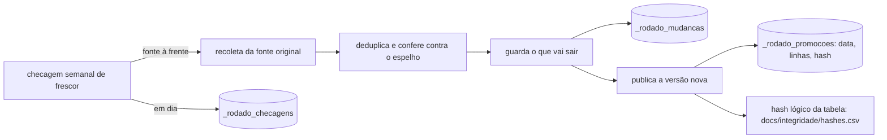

# Governança das atualizações: fonte, hash e histórico de mudanças

Resumo para quem usa o espelho e quer saber **de onde veio cada tabela, quando mudou, o que
mudou e como conferir**. O detalhe do hash está em [`README.md`](README.md).

## Em uma frase

Toda vez que uma tabela é publicada ou atualizada, guardamos **quando**, **quantas linhas
entraram e saíram**, o **hash do conteúdo publicado** e o **hash dos arquivos originais
baixados**; e, antes de trocar, guardamos **as linhas antigas que a fonte apagou ou alterou**.
Nada some calado.

## As três camadas de metadado

| Pergunta | Onde está (consultável no DuckDB do espelho) | O que tem |
|---|---|---|
| **De onde vem esta tabela?** | catálogo `_rodado_metadata` (colunas `source_name`, `source_url`) | o órgão e o endereço da fonte original de cada tabela |
| **Quando foi atualizada e com o quê?** | view `_rodado_promocoes` | uma linha por publicação: data, origem (primeira carga, atualização, recarga), linhas antes e depois, linhas novas, `hash_baixado` (hash lógico do que foi publicado) e, nas cargas novas, o sha256 de cada arquivo original baixado |
| **O que a fonte apagou ou mudou?** | view `_rodado_mudancas` (+ arquivos em `_historico/`) | as linhas antigas que saíram em cada troca, com o motivo (`removida`, `alterada`, `saiu`) e a data |

Uma quarta view, `_rodado_checagens`, registra **cada verificação de frescor**: a data mais
recente na fonte, a do espelho, se está em dia ou atrasada.

## O ciclo de uma atualização



1. **Checagem de frescor** (toda segunda-feira): compara a data mais nova da fonte com a do
   espelho, tabela a tabela. Só lê; grava o resultado em `_rodado_checagens`. Fontes que não
   informam data (geoserviços, páginas sem carimbo) têm um prazo de validade: vencido o prazo, a
   tabela é recoletada inteira e o hash diz se algo mudou.
2. **Recoleta**: o que está atrasado é baixado de novo **da fonte original**, deduplicado e
   conferido contra a cópia atual (contagem, colunas, tipos). Se a fonte encolheu (perdeu
   colunas, meses, linhas), a troca é recusada e investigada: o espelho pode ser o único lugar
   que ainda tem aquele dado.
3. **Antes de trocar**, as linhas antigas que não existem na versão nova vão para o histórico
   (`_rodado_mudancas`). Linha igual não é guardada de novo.
4. **Publicação**: a versão nova entra e ganha uma linha em `_rodado_promocoes` com o hash.
5. **Hash lógico de todas as tabelas** é exportado para [`hashes.csv`](hashes.csv) e
   [`particoes.csv`](particoes.csv) neste repositório: o histórico do git desses arquivos mostra
   quando cada tabela mudou.

## Dois hashes, para duas perguntas

| Hash | Responde | Como é feito |
|---|---|---|
| **sha256 dos arquivos originais** | "O arquivo que vocês baixaram é este?" | sha256 de cada arquivo como veio da fonte (ZIP, CSV, planilha, GeoJSON), guardado antes de apagar o bruto |
| **hash lógico da tabela** (`adh120-v1`) | "O conteúdo publicado mudou?" / "A minha cópia é igual à de vocês?" | soma de sha256 por linha; não depende de ordem, compressão nem divisão em arquivos ([detalhe](README.md)) |

Hash igual entre duas publicações = nada mudou. Hash diferente = olhe `_rodado_mudancas`
naquela data para ver o quê.

## Perguntas frequentes

**Vocês fazem hash a cada atualização?** Sim. Cada publicação grava o hash lógico do que foi
publicado em `_rodado_promocoes`, e a exportação periódica atualiza `hashes.csv` neste repositório.
As cargas novas guardam também o sha256 dos arquivos originais.

**Se a fonte apaga ou corrige um dado, vocês perdem a versão antiga?** Não. Antes da troca, as
linhas que saem vão para `_rodado_mudancas`, com a data e o motivo. A versão de uma data passada
se reconstrói pela tabela atual menos o que entrou depois, mais o que saiu.

**Vocês alteram o dado da fonte?** Só no formato: tipos (data, número), nomes de coluna sem
acento, texto aparado, linhas idênticas repetidas removidas. Valores não são corrigidos em
silêncio; quando a fonte tem um problema conhecido (unidade errada, código trocado, nome
duplicado), ele vai para `docs/context/gotchas/<dataset>.yml`, e a tabela continua como a fonte
publicou.

**Como sei se uma tabela está atrasada?** `_rodado_checagens` traz a última checagem de cada
tabela, com a data na fonte e no espelho. No catálogo, `ultima_promocao` diz quando ela foi
atualizada pela última vez.

**Toda tabela tem esse histórico?** O registro de publicações existe desde 26/11/2026 (com
retroativo de datas desde 07/10/2026). Tabelas publicadas por rotinas que ainda não gravam o
registro aparecem sem linha; isso não quer dizer que não foram atualizadas. A lista do que ainda
falta ligar é acompanhada internamente.

**Posso conferir a minha cópia sem confiar em vocês?** Sim: calcule o hash lógico da sua cópia
como descrito em [`README.md`](README.md) e compare com `hashes.csv`. O hash serve para conferir
cópias, não como prova contra quem quer forjar uma; para isso está prevista uma versão com hash
de reticulado.

**Por que o endereço exato de coleta não está aqui?** O catálogo diz a fonte (o órgão e a página
pública). Detalhes operacionais de coleta ficam fora do repositório público.

## Consultas de exemplo

```sql
-- quando cada tabela de um dataset foi publicada, com quantas linhas e que hash
SELECT em, tabela, origem, linhas_antes, linhas_baixadas, hash_baixado
FROM _rodado_promocoes WHERE dataset = 'br_anp_geo' ORDER BY em DESC;

-- o que a fonte apagou ou mudou num dataset, por troca
SELECT em, tabela, motivo, saiu, removidas, alteradas
FROM _rodado_mudancas WHERE dataset = 'br_tse_eleicoes' ORDER BY em DESC LIMIT 20;

-- tabelas atrasadas na última checagem de frescor
SELECT dataset, tabela, data_fonte, data_espelho, atraso_dias
FROM _rodado_checagens
QUALIFY row_number() OVER (PARTITION BY dataset, tabela ORDER BY em DESC) = 1 AND estado = 'atrasada'
ORDER BY atraso_dias DESC;
```
