# Ontologia do espelho

Gerado por `scripts/gera_ontologia.ts` a partir de `docs/context/ontologia.yaml` — não edite.
Versão navegável: o modo Ontologia do atlas, [rodado.xyz/atlas/?mode=ontologia](https://rodado.xyz/atlas/?mode=ontologia).

66 classes (22 delas fatos, em círculo duplo), 97 relações; os 68 conceitos de `bridges.yaml` cabem nelas, e 1316 das 1751 tabelas tocam alguma.
Linha tracejada: a ligação existe no mundo, mas o espelho não consegue fazê-la (CPF mascarado, microdado desidentificado, texto livre).

```mermaid
%%{init: {"layout": "elk", "elk": {"nodePlacementStrategy": "NETWORK_SIMPLEX"}, "flowchart": {"curve": "basis"}}}%%
flowchart LR
  subgraph dom_territorio["Território"]
    municipio(("Município"))
    uf(("UF"))
    regiao(("Grande região"))
    regiao_ibge(("Região geográfica"))
    regiao_metropolitana(("Região metropolitana"))
    regiao_saude(("Região de saúde"))
    distrito(("Distrito"))
    setor_censitario(("Setor censitário"))
    cep(("CEP"))
    pais(("País"))
    imovel_rural(("Imóvel rural"))
  end
  subgraph dom_pessoa["Pessoas"]
    pessoa(("Pessoa"))
    vinculo((("Vínculo de emprego")))
    beneficio((("Benefício social")))
  end
  subgraph dom_empresa["Empresas"]
    empresa(("Empresa"))
    estabelecimento(("Estabelecimento"))
    companhia_aberta(("Companhia aberta"))
    fundo(("Fundo de investimento"))
    credito((("Crédito e financiamento")))
    reclamacao((("Reclamação de consumidor")))
  end
  subgraph dom_titular["CPF ou CNPJ"]
    titular(("CPF ou CNPJ"))
  end
  subgraph dom_classificacao["Classificações"]
    cnae(("CNAE"))
    cbo(("CBO"))
    cid(("CID-10"))
    ncm(("NCM"))
    sh(("Sistema Harmonizado"))
    natureza_juridica(("Natureza jurídica"))
  end
  subgraph dom_educacao["Educação"]
    escola(("Escola"))
    turma(("Turma"))
    aluno(("Aluno"))
    ies(("Instituição de ensino superior"))
    curso(("Curso superior"))
    enem(("Participante do ENEM"))
    avaliacao((("Nota de avaliação")))
  end
  subgraph dom_saude["Saúde"]
    cnes(("Estabelecimento de saúde"))
    equipe(("Equipe de saúde"))
    obito((("Óbito")))
    nascimento((("Nascimento")))
    internacao((("Internação")))
    atendimento((("Atendimento no SUS")))
    notificacao((("Notificação de agravo")))
    vacinacao((("Vacinação")))
  end
  subgraph dom_estado["Estado e compras"]
    orgao(("Órgão público"))
    unidade_gestora(("Unidade gestora"))
    licitacao(("Licitação"))
    contrato(("Contrato"))
    empenho(("Empenho"))
    contratacao_pncp(("Contratação no PNCP"))
    processo(("Processo administrativo"))
    acordao_tcu(("Acórdão do TCU"))
    sancao((("Sanção")))
    divida((("Dívida ativa")))
    despesa((("Despesa pública")))
  end
  subgraph dom_seguranca["Segurança"]
    ocorrencia((("Ocorrência criminal")))
    acidente((("Acidente de trânsito")))
    prisao((("Pessoa presa ou procurada")))
  end
  subgraph dom_meio_ambiente["Meio ambiente"]
    infracao_ambiental((("Infração ambiental")))
    desmatamento((("Desmatamento e queimada")))
  end
  subgraph dom_politica["Política"]
    partido(("Partido"))
    candidatura(("Candidatura"))
    parlamentar(("Parlamentar"))
    voto((("Resultado eleitoral")))
    doacao((("Doação de campanha")))
    votacao((("Votação no Congresso")))
  end
  subgraph dom_infraestrutura["Infraestrutura"]
    usina(("Usina de energia"))
    obra(("Obra"))
  end
  municipio -- FICA_EM --> uf
  uf -- FICA_EM --> regiao
  municipio -- PERTENCE_A --> regiao_ibge
  municipio -- PERTENCE_A --> regiao_metropolitana
  municipio -- PERTENCE_A --> regiao_saude
  regiao_ibge -- FICA_EM --> uf
  distrito -- FICA_EM --> municipio
  setor_censitario -- FICA_EM --> distrito
  cep -- FICA_EM --> municipio
  imovel_rural -- FICA_EM --> municipio
  estabelecimento -- FILIAL_DE --> empresa
  estabelecimento -- FICA_EM --> municipio
  estabelecimento -- ATIVIDADE --> cnae
  empresa -- NATUREZA --> natureza_juridica
  pessoa -. SOCIO_DE .-> empresa
  pessoa -. TRABALHA_EM .-> estabelecimento
  pessoa -- OCUPACAO --> cbo
  titular -- E_UM --> pessoa
  titular -- E_UM --> estabelecimento
  companhia_aberta -- E_UMA --> empresa
  fundo -- ADMINISTRADO_POR --> estabelecimento
  ncm -- SUBCLASSE_DE --> sh
  municipio -- EXPORTA --> ncm
  municipio -- COMERCIA_COM --> pais
  pessoa -. DIAGNOSTICO .-> cid
  escola -- FICA_EM --> municipio
  turma -- DA_ESCOLA --> escola
  aluno -- MATRICULADO_EM --> turma
  curso -- OFERECIDO_POR --> ies
  ies -- MANTIDA_POR --> estabelecimento
  enem -- FEZ_PROVA_EM --> municipio
  enem -- ESTUDOU_EM --> escola
  cnes -- FICA_EM --> municipio
  cnes -- E_UM --> estabelecimento
  equipe -- ATUA_EM --> cnes
  orgao -- SUBORDINADO_A --> orgao
  orgao -- E_UM --> estabelecimento
  unidade_gestora -- VINCULADA_A --> orgao
  licitacao -- REALIZADA_POR --> unidade_gestora
  licitacao -- PARTICIPANTE --> titular
  contrato -- RESULTA_DE --> licitacao
  contrato -- CONTRATADO --> titular
  empenho -- EMPENHA --> licitacao
  empenho -- FAVORECE --> titular
  processo -. ORIGINA .-> licitacao
  contratacao_pncp -- CONTRATANTE --> orgao
  contratacao_pncp -- CONTRATADO --> titular
  acordao_tcu -- SANCIONA --> titular
  candidatura -- DE --> pessoa
  candidatura -- FILIADA_A --> partido
  candidatura -- DISPUTA_EM --> municipio
  titular -- DOOU_PARA --> candidatura
  titular -- FORNECEU_PARA --> candidatura
  parlamentar -- FILIADO_A --> partido
  parlamentar -- ELEITO_POR --> uf
  usina -- FICA_EM --> municipio
  usina -- PERTENCE_A --> estabelecimento
  obra -- FICA_EM --> municipio
  obra -- RESPONSAVEL --> estabelecimento
  obito -- OCORRE_EM --> municipio
  obito -- CAUSA --> cid
  nascimento -- OCORRE_EM --> municipio
  nascimento -- EM --> cnes
  internacao -- EM --> cnes
  internacao -- DIAGNOSTICO --> cid
  atendimento -- EM --> cnes
  notificacao -- AGRAVO --> cid
  notificacao -- OCORRE_EM --> municipio
  vacinacao -- OCORRE_EM --> municipio
  ocorrencia -- OCORRE_EM --> municipio
  acidente -- OCORRE_EM --> municipio
  prisao -- OCORRE_EM --> uf
  prisao -. DE .-> pessoa
  avaliacao -- DE --> enem
  avaliacao -- DA_ESCOLA --> escola
  avaliacao -- OCORRE_EM --> municipio
  vinculo -- EM --> estabelecimento
  vinculo -. DE .-> pessoa
  vinculo -- OCUPACAO --> cbo
  beneficio -- PAGO_A --> pessoa
  beneficio -- OCORRE_EM --> municipio
  credito -- TOMADO_POR --> titular
  credito -- OCORRE_EM --> municipio
  reclamacao -- CONTRA --> estabelecimento
  sancao -- SANCIONA --> titular
  acordao_tcu -- ORIGINA --> sancao
  divida -- DEVIDA_POR --> titular
  despesa -- FAVORECE --> titular
  despesa -- PAGA_POR --> orgao
  voto -- EM --> candidatura
  voto -- OCORRE_EM --> municipio
  doacao -- PARA --> candidatura
  doacao -- DE --> titular
  votacao -- DE --> parlamentar
  infracao_ambiental -- AUTUA --> titular
  infracao_ambiental -- OCORRE_EM --> municipio
  desmatamento -- OCORRE_EM --> municipio
  classDef c_territorio fill:#d55181,stroke:#d55181,color:#fff
  class municipio,uf,regiao,regiao_ibge,regiao_metropolitana,regiao_saude,distrito,setor_censitario,cep,pais,imovel_rural c_territorio
  classDef c_empresa fill:#199e70,stroke:#199e70,color:#fff
  class empresa,estabelecimento,companhia_aberta,fundo,credito,reclamacao c_empresa
  classDef c_pessoa fill:#d95926,stroke:#d95926,color:#fff
  class pessoa,vinculo,beneficio c_pessoa
  classDef c_titular fill:#5d6675,stroke:#5d6675,color:#fff
  class titular c_titular
  classDef c_classificacao fill:#c063c7,stroke:#c063c7,color:#fff
  class cnae,cbo,cid,ncm,sh,natureza_juridica c_classificacao
  classDef c_educacao fill:#3987e5,stroke:#3987e5,color:#fff
  class escola,turma,aluno,ies,curso,enem,avaliacao c_educacao
  classDef c_seguranca fill:#9085e9,stroke:#9085e9,color:#fff
  class ocorrencia,acidente,prisao c_seguranca
  classDef c_meio_ambiente fill:#96b83a,stroke:#96b83a,color:#fff
  class infracao_ambiental,desmatamento c_meio_ambiente
  classDef c_saude fill:#e66767,stroke:#e66767,color:#fff
  class cnes,equipe,obito,nascimento,internacao,atendimento,notificacao,vacinacao c_saude
  classDef c_estado fill:#c98500,stroke:#c98500,color:#fff
  class orgao,unidade_gestora,licitacao,contrato,empenho,contratacao_pncp,processo,acordao_tcu,sancao,divida,despesa c_estado
  classDef c_politica fill:#008300,stroke:#008300,color:#fff
  class partido,candidatura,parlamentar,voto,doacao,votacao c_politica
  classDef c_infraestrutura fill:#7086dd,stroke:#7086dd,color:#fff
  class usina,obra c_infraestrutura
```

