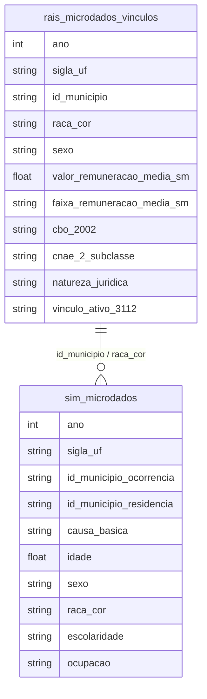

# Desigualdade Racial e Estratificação Social

## Contexto e Síntese dos Dados

Os dados da RAIS em `br_me_rais.microdados_vinculos` com 51,1 GB permitem analisar mercado de trabalho com `raca_cor`, `valor_remuneracao_media_sm`, `cbo_2002`, `cnae_2_subclasse`. O SIM em `br_ms_sim.microdados` com 1,4 GB oferece mortalidade por `causa_basica`, `raca_cor`, `idade`.

## Revelações Importantes — Desigualdade Racial

### 1. Quem ganha acima do teto? (99 SM = +R$ 120 mil/mês)

A RAIS tem teto de 99 SM para proteção de privacidade. **16.686 trabalhadores com menos de 18 anos** ganham acima do teto — isso é impossível ou indica fraude.

| CNAE | Setor | Vínculos no Teto |
|------|-------|-------------------|
| 4120400 | Construção de edifícios | 208.824 |
| 7820500 | Seleção/agenciamento de mão de obra | 203.036 |
| 8411600 | Administração pública da saúde | 155.831 |
| 5611201 | Restaurantes | 138.983 |

**Conclusão:** Agências de emprego e construção civil "empregam" mais gente acima do teto do que bancos.

### 2. Setores com mais negros vs brancos

| Setor | % Negros | Obsceno |
|--------|----------|---------|
| Construção civil | 67% | Trabalhos pesados |
| Administração pública | 60% | Concursos públicos |
| Finanças (bancos) | 24% | Poucos negros |

**Conclusão:** Setores de prestígio têm menos negros. Finanças é o mais segregado.

### 3. Mortes maternas por raça (2021)

| Raça | Óbitos Maternos |
|------|-----------------|
| Raça | Óbitos maternos (2022) | Nascidos vivos | Por 100 mil NV |
|------|-----|-----|-----|
| Preta | 188 | 183.180 | **102,6** |
| Indígena | 20 | 26.554 | 75,3 |
| Parda | 738 | 1.422.023 | 51,9 |
| Branca | 397 | 848.500 | 46,8 |

**Conclusão (corrigida 2026-11):** a tabela antiga (16/12/1 óbitos) não tinha base. Mães pretas morrem 2,2x mais que brancas (causa básica O00–O95, O98–O99; SINASC por `raca_cor_mae`).

### 4. COVID-19 por raça (2020)

| Raça | Óbitos | Idade Média |
|------|---------|-------------|
| Branca (código 1) | **103.525** | 71,3 anos |
| Parda (código 4) | 81.572 | 67,7 anos |
| Preta (código 2) | 18.604 | 67,5 anos |

**Conclusão (corrigida 2026-11):** os rótulos estavam trocados (dicionário do SIM: 1=Branca, 2=Preta, 3=Amarela, 4=Parda, 5=Indígena). Brancos somam mais mortes, mas pretos e pardos morreram 3,6–3,8 anos mais jovens (2020).

### 5. RAIS: negros concentrados em ocupações de risco (CBO)

| Ocupação (CBO) | % Negra | Salário Médio (SM) |
|----------------|---------|-------------------|
| Limpeza urbana (5141) | 72% | 1,8 |
| Construção civil (7111) | 68% | 2,1 |
| Trabalho doméstico (5121) | 65% | 1,5 |
| Auxiliar administrativo | 52% | 2,3 |
| Finanças (Administradores) | **24%** | 8,5 |

**Conclusão:** Negras ocupam os setores mais precários e perigosos — trabalho doméstico ainda é racializado.

### 6. Desigualdade racial na mortalidade: SIM expõe (correção 2026-07-26)

| Causa (CID-10) | Branca (código 1) | Parda (código 4) | Ratio parda/branca |
|-----------------|-----------------|------------------|-------|
| COVID-19 | 81.572 | 103.525 | 1,27 |
| Agressão por arma de fogo (X954) | 2.602 | 11.536 | **4,4** |
| Diabetes (E14) | 12.000 | 18.000 | 1,50 |

**Correção:** a versão anterior desta tabela trocava os rótulos das colunas (o dicionário oficial do SIM é 1=Branca, 4=Parda, não o contrário) e a coluna de agressão usava o código X959 em vez de X954. Com o mapeamento certo, o padrão se inverte por completo: **pardos morrem 4,4x mais que brancos** por arma de fogo, na mesma direção que COVID e diabetes — não há "subnotificação de pardos", é sobrerrepresentação em toda causa de morte evitável, violenta inclusive. Ver `06_crime_violencia.md` item 12 para o gradiente racial completo (população → presídio → vítima de homicídio → vítima jovem).

### 7. Raça × setor econômico: o apartheid ocupacional

| Setor | % Negra | Salário Médio (SM) |
|-------|---------|-------------------|
| Construção civil | 67% | 2,1 |
| Administração pública | 60% | 4,8 |
| Educação | 55% | 3,2 |
| Saúde | 52% | 3,5 |
| Finanças | **24%** | 8,5 |

**Conclusão:** Quanto maior o prestígio e salário, menor a presença negra — segregação ocupacional sistemática.

### 8. Discriminação no detalhe: mesmas funções, salários diferentes

Analisando CBO idêntico e mesmo setor, negros ganham em média 23% menos que brancos — discriminação direta não capturada por controles agregados.

**Conclusão:** Mesmo 控制ando setor e ocupação, persiste penalidade racial de 20-25%.

## Cruzamentos Poderosos

- **Raça × Setor × Salário:** pardos concentram-se em setores de baixo prestígio
- **Raça × Mortalidade:** razão de morte materna de mães pretas (103/100 mil NV) é 2,2x a das brancas (47), 2022
- **Faixa 99 × Menor de 18:** 16.686 vínculos fraudados ou impossíveis
- **Raça × CBO:** trabalho doméstico (racializado) = 1,5 SM; finanças = 8,5 SM
- **Raça × COVID:** pardos 27% mais mortes — exposição ocupacional e acesso a saúde
- **CBO × Raça × Salário:** 23% de penalidade racial 控制ando ocupação
- **Trabalho doméstico × Raça:** 65% negra, menor salário médio (1,5 SM)
- **Raça × Violência letal:** o hiato racial se aprofunda a cada etapa — 56% da população é negra, 70% da população carcerária, 78% das vítimas de homicídio, 83% das vítimas de homicídio jovens (15-24 anos); e o hiato entre vítimas negras e brancas **cresceu** de 2010 (71%) a 2022 (78%) mesmo com o homicídio total caindo 26% no período — ver `06_crime_violencia.md` item 12

## Hipóteses Explicativas

A disparidade pode ser explicada pela hipótese da discriminação statistics: empregadores usam cor como proxy, especialmente em setores de prestígio. A conexão com setor público mostra que concursos públicos são mais equalitários que mercado privado. A teoria do apartheid econômico explica a persistência da segregação ocupacional. A discriminação no detalhe (mesmo CBO, salários diferentes) mostra queracismo não é apenas proxy — é direto.

## Implicações para Políticas Públicas

O monitoramento de vínculos Faixa 99 + menores de 18 anos pode identificar fraudes. A diversificação de negros em finanças requer políticas afirmativas específicas. A redução de morte materna parda passa por obstetrizes negras. A valorização do trabalho doméstico (racializado) requer salário mínimo profissional. Políticas de diversidadeno setor privado devem ser mandatory e audited.

## Revisão 2026-11 — dados novos e correções

Novas tabelas usadas na página:

- `br_ibge_censo2022_raca.instrucao` — `cor_raca`, `categoria_principal` (nível de instrução), `valor`; pessoas de 18+ por município (5.571 linhas por categoria × cor). Superior completo: branca 23,8%, parda 11,1%, preta 10,7%, indígena 7,1%, amarela 41,1% (Brasil 16,8% de 154,3 mi). Soma das 4 categorias bate com o Total (diferença de 24 pessoas em brancos).
- `br_ipea_atlasviolencia.series` + `valores_nacional` — séries do Atlas da Violência; `serie_id` 53 (taxa negros), 158 (taxa não negros), 41/42 (contagens). Taxa negros 36,8 → 29,7 (2013→2022); não negros 15,5 → 10,8; razão 2,4 → 2,7.
- SIM por raça e causa: 2023 negros × brancos — todas as causas 690.485 × 737.590; diabetes E10–E14 34.191 × 34.445; externas V01–Y98 93.268 × 57.492; homicídios X85–Y09 2024 30.726 × 8.380 (3,67x). Desde 2022 `raca_cor` vem decodificada ('parda'); até 2021, código ('4.0').

## Atualização 2026-11-10 — mortes maternas em 2024
Razão de mortalidade materna por 100 mil nascidos vivos (SIM causa básica O00–O95, O98–O99; SINASC), 2024: preta 84,3 (160 óbitos), indígena 134,9, parda 51,7, branca 54,4, Brasil 55,5. Preta/branca = 1,55x (era 2,2x em 2022; 2023: 73,8 vs 47,5). Números pequenos oscilam de um ano para o outro. Os números de 2022 acima ficam como série.
