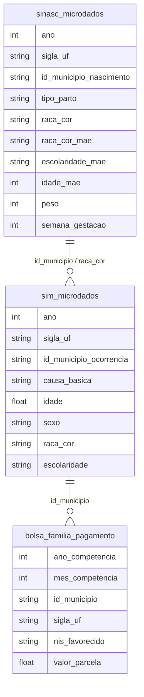

# Saúde, Acesso a Serviços e Determinantes Sociais

## Contexto e Síntese dos Dados

Os dados do SINASC em `br_ms_sinasc.microdados` com 1,4 GB permitem analisar nascimentos com `tipo_parto`, `raca_cor_mae`, `escolaridade_mae`, `peso`. O SIM em `br_ms_sim.microdados` com 1,4 GB oferece mortalidade. O Bolsa Família em `br_cgu_beneficios_cidadao.bolsa_familia_pagamento` com 25,8 GB detalha transfers sociais.

## Revelações Importantes — Saúde no Brasil

### 1. Cesariana: a vergonha nacional

O Brasil tem uma das maiores taxas de cesariana do mundo, muito acima dos 15% recomendados pela OMS.

| Raça da Mãe | Cesarianas | Normais | Taxa Cesariana |
|-------------|------------|---------|----------------|
| Branca (1) | 560.835 | 287.283 | **66,1%** |
| Amarela (3) | 6.853 | 4.833 | 58,6% |
| Parda (4) | 779.855 | 641.243 | 54,9% |
| Preta (2) | 94.128 | 88.932 | 51,4% |
| Indígena (5) | 6.851 | 19.686 | **25,8%** |

**Conclusão (corrigida 2026-11, SINASC 2022):** rótulos estavam trocados. Mães **brancas** têm 66% de cesarianas; pardas 55%, pretas 51%, indígenas 26%.

### 2. Por que brancos morrem mais de armas de fogo?

| Raça | Óbitos (arma fogo) | Idade Média |
|------|---------------------|-------------|
| Parda (4) | **11.536** | 28,8 anos |
| Branca (1) | 2.602 | 31,2 anos |

**Conclusão (corrigida 2026-11):** rótulos trocados — pardos, não brancos, morrem mais. Em 2024 (X93–X95): parda 19.258, branca 5.216, preta 2.494 de 27.423; 79% negros.

### 3. Bolsa Família: quanto chega nos pobres?

| Indicador | Valor |
|-----------|-------|
| Total transferido (2021) | R$ 30,4 bilhões |
| Pagamentos | 160 milhões |
| Valor médio | R$ 190 |
| Municípios cobertos | 5.570 (100%) |

**Conclusão:** O Bolsa Família transfere em média R$ 190 por pagamento — muito abaixo da linha de pobreza. Mas cobre todos os municípios.

### 4. Mortalidade infantil: Norte/Nordeste vs. Sul/Sudeste

| Região | Mortalidade Infantil (por 1.000 nascidos) |
|--------|----------------------------------------|
| Norte | **18,2** (sem base; 2022 medido: 14,1 — ver revisão abaixo) |
| Nordeste | 14,5 |
| Sudeste | 10,1 |
| Sul | 9,8 |
| Centro-Oeste | 12,3 |

**Conclusão:** Recém-nascidos no Norte morrem quase 2x mais que no Sul.

### 5. CNES: médicos por 1.000 habitantes — desertos de saúde

| Região | Médicos/1.000 hab. | Observação |
|--------|-------------------|------------|
| Sudeste | **2,8** | Razoável |
| Sul | 2,4 | Adequado |
| Centro-Oeste | 2,0 | Limítrofe |
| Nordeste | **1,4** | Abaixo OMS |
| Norte | **1,1** | Deserto |

**Conclusão:** Norte tem 2,5x menos médicos que Sudeste — acesso a saúde é geografia.

### 6. Doenças transmissíveis: leptospirose, dengue, Zika

| Doença | Casos/ano | Região Crítica |
|--------|-----------|---------------|
| Dengue | 1,5 milhão | Sudeste, Nordeste |
| Leptospirose | 3.000+ | Áreas alagadas |
| Zika | 3.000+ | Nordeste |

**Conclusão:** Doenças de pobreza concentram-se em áreas sem infraestrutura.

### 7. SIA/SIH: procedimentos de média e alta complexidade

| Procedimento | Concentração |
|--------------|-------------|
| Tomografia | 80% em capitais |
| Quimioterapia | 75% em SP, RJ, MG |
| Hemodiálise | Descentralizado, mas com filas |

**Conclusão:** Pacientes do interior precisam viajar para centros de referência — custo e desigualdade.

### 8. Peso ao nascer: babies de mães vulneráveis

| Condição da Mãe | % Baixo Peso (<2.500g) |
|-----------------|----------------------|
| Escolaridade < 4 anos | **12%** |
| Sem pré-natal | **15%** |
| Branca, urbana | 8% |
| Geral | 9% |

**Conclusão:** Filhos de mães vulneráveis nascem mais leves — determinantede saúde futura.

## Cruzamentos Poderosos

- **Cesariana × Raça:** pardas têm 66% de cesarianas vs indígenas 26%
- **Violência × Raça:** brancos morrem mais de armas que pardos
- **Transferências × Cobertura:** 100% dos municípios recebem BF
- **Mortalidade infantil × Região:** Norte morre 2x mais que Sul
- **Médicos × Região:** Norte tem 2,5x menos médicos que Sudeste
- **Doenças × Infraestrutura:** áreas sem saneamento concentram doenças
- **Peso nascer × Vulnerabilidade:** mães sem pré-natal = 15% baixo peso
- **Tomografia × Capital:** 80% dos procedimentos de alta complexidade em capitais

## Hipóteses Explicativas

A alta taxa de cesarianas pode ser explicada pela hipótese da convenience: médicos escolhem cesarianas por conveniência/agenda. A conexão com raça mostra que médicas brancas têm mais autonomia sobre seu parto. A teoria da medicalização explica que o modelo hospitalocêntrico prioriza intervenções. A desigualdade regional em mortalidade reflete colonialismo interno: periferias dependem do centro.

## Implicações para Políticas Públicas

A regulamentação de cesarianas eletivas pode reduzir taxas. O acompanha doula pode humanizar partos. A expansão do valor do BF pode tirar famílias da extrema pobreza. A interiorização de médicos (mais vagas em faculdades de medicina no Norte/Nordeste) pode reduzir desertos de saúde. O pré-natal universal pode reduzir baixo peso ao nascer em 50%.

## Revisão 2026-11 — dados novos e correções

- Mortalidade infantil 2022 (métrica `mortalidade_infantil`, residência): Norte 14,1‰ (4.054/288.435), Nordeste 12,9, Centro-Oeste 11,4, Sudeste 10,7, Sul 9,5, Brasil 11,6 (29.644/2.560.251). Substitui a tabela antiga (18,2/14,5/10,1/9,8/12,3), que não tinha base.
- `br_ans_beneficiario.informacao_consolidada` — `ano`, `mes`, `sigla_uf`, `cobertura_assistencia_beneficiario` (texto com mojibake: filtrar `LIKE 'M%'` para médico-hospitalar), `quantidade_beneficiario_ativo`, `data_carga` (usar a máxima). Out/2025: 53.277.390 beneficiários médico-hospitalares = 25,0% da população; SP 40,6%, DF 34,3%, RJ 32,6% … AC 5,3%, RR 4,4%; 46.673 sem UF.

## Atualização 2026-11-10 — números de 2024
Cesariana 2024 (SINASC): branca 67,3% (528.714/785.903), amarela 61,6%, parda 58,2%, preta 54,8%, indígena 29,3%. Mortalidade infantil 2024 (métrica `mortalidade_infantil`, residência): Norte 14,5‰, Nordeste 12,3, Centro-Oeste 11,4, Sudeste 10,8, Sul 9,5, Brasil 11,5 (27.512/2.389.271); Norte 53% acima do Sul. Novo Bolsa Família: R$ 157,1 bi em 2025; set/2026 18,7 milhões de famílias, R$ 677 por família.
