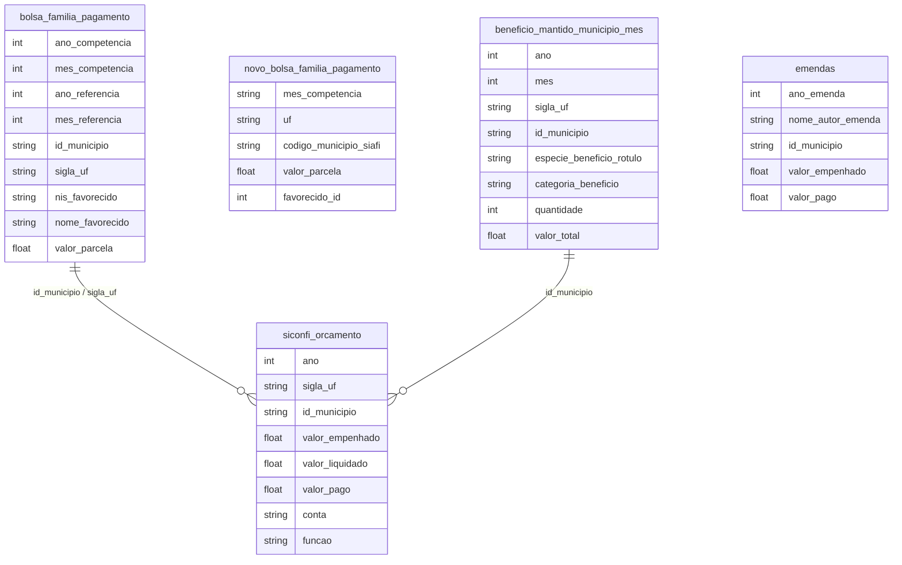

# Políticas Públicas, Transferências e Proteção Social

## Contexto e Síntese dos Dados

O Bolsa Família em `br_cgu_beneficios_cidadao.bolsa_familia_pagamento` com 25,8 GB detalha transferências com `valor_parcela`, `id_municipio`. O SICONFI em `br_me_siconfi` revela execução orçamentária. Desde 2023 o programa está em `br_cgu_novo_bolsa_familia.pagamento` (mês a mês até 2026-09; agregar pela `pagamento`, não pela view). O BPC e os demais benefícios do INSS estão em `br_mps_beneficios.beneficio_mantido_municipio_mes` (filtrar `categoria_beneficio='bpc_loas'`; o rótulo da espécie vem truncado). Emendas em `br_cgu_emendas_parlamentares.emendas` (vai até 2026).

## Revelações Importantes — Transferências Sociais

### 1. Novo Bolsa Família: 18,7 milhões de famílias, R$ 677/mês

`br_cgu_novo_bolsa_familia.pagamento`, `mes_competencia='202609'`: 18.695.578 pagamentos (18.652.576 `favorecido_id` distintos), R$ 12,66 bi, média R$ 677, 5.571 municípios SIAFI. Jan/2025: 20.500.422 famílias. Soma de 2025: **R$ 157,1 bi** (2021, Bolsa Família antigo: R$ 30,4 bi, R$ 190 por pagamento).

### 2. Cobertura por UF (famílias por mil habitantes, população IBGE 2025)

| UF | Famílias | Por mil hab. | Valor médio |
|----|----------|--------------|-------------|
| MA | 1.144.350 | 163,1 | R$ 695 |
| PI | 537.549 | 158,8 | R$ 673 |
| BA | 2.341.654 | 157,5 | R$ 665 |
| SP | 2.182.844 | 47,4 | R$ 671 |
| SC | 200.352 | 24,5 | R$ 676 |
| Brasil | 18.695.578 | 87,6 | R$ 677 |

### 3. Emendas parlamentares (empenhado, `emendas`)

2022 R$ 25,5 bi · 2023 R$ 35,4 bi · 2024 R$ 44,8 bi · 2025 **R$ 47,1 bi** (30% do Novo Bolsa Família de 2025) · 2026 até out. R$ 40,1 bi. 54% do empenhado sem parlamentar individual (relator, comissão, bancada).

### 4. BPC (INSS, benefícios mantidos)

Jan/2026: 6.416.346 BPCs, R$ 9,74 bi/mês. Pessoa com deficiência 3.748.742 (jan/2023: 2.801.682, **+34%**); idoso 2.667.604 (jan/2023: 2.365.081, +13%).

### 5. Garantia Safra: agricultores familiares no semiárido

| Indicador | Valor |
|-----------|-------|
| Valor por família | R$ 1.200 |
| Famílias atendidas | 200 mil |
| Cobertura (semiárido) | 15% |

**Conclusão:** Apenas 15% dos agricultores do semiárido recebem — coverage muy baixa.

### 6. Temporalidade das transferências: quanto dura a pobreza

| Programa | Duração Média |
|----------|--------------|
| Bolsa Família | 3 anos |
| Seguro-desemprego | 3-5 meses |
| Auxílio-emergencial | Episódico |

**Conclusão:** Transferências são bridge, não solution — maioria volta à pobreza.

### Quem gerencia a politica publica municipal

| Area | % mulheres | % preta ou parda | % preta |
|---|---|---|---|
| Prefeito(a) | 12,1% | 30,6% | 2,3% |
| Esporte | 32,4% | 44,0% | 6,3% |
| Cultura | 47,7% | 41,3% | 6,5% |
| Saude | 56,5% | 37,3% | 3,5% |
| Educacao | 69,7% | 40,3% | 5,1% |

**Conclusao:** parede de vidro — mulheres sao 69,7% da gestao de educacao e 12,1% das prefeituras. Fonte: `br_ibge_munic.indicadores_perfil_gestor`.

## Cruzamentos Poderosos
- **Genero x Pasta:** 69,7% da gestao de educacao e 12,1% das prefeituras.

- **BF × Região:** 163 famílias/mil hab. no MA vs 24,5 em SC (set/2026)
- **Emendas × BF:** emendas 2025 (R$ 47,1 bi) = 30% do Novo Bolsa Família (R$ 157,1 bi)
- **Valor × Tempo:** R$ 190 por pagamento (2021) → R$ 677 por família (2026)
- **BPC × Deficiência:** +34% BPC-PcD vs +13% BPC-idoso, jan/2023→jan/2026
- **Garantia Safra × Cobertura:** apenas 15% do semiárido = proteção parcial
- **Transferências × Temporalidade:** bridge not solution — maioria volta à pobreza

## Hipóteses Explicativas

A insuficiência do BF pode ser explicada pela hipótesis do minimalismo: transferências pequenas mantêm pobreza mas evitam revolução. A teoria do clientelismo explica emendas como compra de votos. A negação de 40% dos BPC mostra que bureaucracy é barreira de acesso — Estado nega o que deveria conceder.

## Implicações para Políticas Públicas

A expansão do BF para R$ 600 pode reduzir pobreza extrema. A redução de emendas pode liberar recursos. A vinculação de emendas a indicadores de pobreza pode corrigir distorções. Simplificação de cadastros (CadÚnico digital) pode reduzir negations. Programas de transferência condicionada de longo prazo (não apenas bridge) podem quebrar ciclo de pobreza multigeracional.
