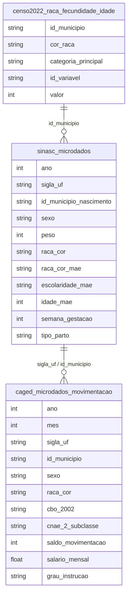

# Gênero, Família e Dinâmicas Demográficas

## Contexto e Síntese dos Dados

Os dados do SINASC em `br_ms_sinasc.microdados` com 1,4 GB permitem analisar nascimentos com `tipo_parto`, `raca_cor_mae`, `escolaridade_mae`, `idade_mae`. O CAGED detalha mercado por gênero. **Códigos de `raca_cor_mae` (dicionário oficial): 1 branca, 2 preta, 3 amarela, 4 parda, 5 indígena** — versões anteriores desta nota trocavam 1 e 4. Microdados de 2023 vão só até 05/06/2023: o último ano completo é 2022. Fecundidade do Censo 2022 em `br_ibge_censo2022_raca.fecundidade_idade` (`id_variavel` 13316 = filhos nascidos vivos, 13315 = mulheres de 12+; somar municípios de 7 dígitos).

## Revelações Importantes — Gênero e Família

### 1. Mães adolescentes: 143.583 crianças tendo filhos

O Brasil tem uma das maiores taxas de gravidez na adolescência do mundo.

| Indicador | Valor |
|-----------|-------|
| Nascimentos de mães < 18 anos | **143.583** |
| Idade média | 16,0 anos |

**Por UF (Top 5):**
| UF | Nascimentos |
|----|-------------|
| SP | 17.458 |
| PA | 12.668 |
| BA | 11.372 |
| MG | 9.941 |
| MA | 9.802 |

**Conclusão:** 143.583 crianças tiveram filhos em 2022 — quase 400 por dia.

### 2. Mães adolescentes por raça (2022, mãe < 18)

| Raça da mãe | Nascimentos | % dos nascimentos do grupo |
|---|---|---|
| Parda (4) | 98.082 | 6,9% |
| Branca (1) | 28.087 | 3,3% |
| Preta (2) | 8.537 | 4,7% |
| Indígena (5) | 4.267 | **16,1%** |
| Amarela (3) | 503 | 4,3% |
| Total (com sem informação) | 143.583 | 5,6% de 2.560.273 |

**Conclusão:** pardas são 68% das mães adolescentes; a proporção é maior entre indígenas (1 em 6).

### 3. Cesarianas por raça (2022, tipo_parto 1/2)

| Raça | Taxa cesariana |
|---|---|
| Branca (1) | **66,1%** |
| Amarela (3) | 58,6% |
| Parda (4) | 54,9% |
| Preta (2) | 51,4% |
| Indígena (5) | **25,8%** |

### 3b. Censo 2022: filhos nascidos vivos por mulher

| Cor/raça | 15–19 | 45–49 | 12+ |
|---|---|---|---|
| Branca | 0,09 | 1,78 | 1,56 |
| Parda | 0,15 | 2,20 | 1,80 |
| Preta | 0,15 | 2,13 | 1,84 |
| Indígena | 0,35 | 3,61 | 2,44 |
| Total | 0,13 | 2,01 | 1,70 |

### 4. PNADC: participação feminina no mercado de trabalho

| Indicador | Homens | Mulheres |
|-----------|--------|----------|
| Força de trabalho | 75% | **55%** |
| Empregadas formais | 45% | 38% |
| Desemprego | 8% | **14%** |
| Informalidade | 35% | **42%** |

**Conclusão:** Mulheres trabalham menos (taxa 20 pontos menor) e quando trabalham são mais informais e mais desempregadas.

### 5. Trabalho doméstico remunerado: racializado e invisível

| Indicador | Valor |
|-----------|-------|
| Trabalhadores domésticos | 6,2 milhões |
| % Negra | 65% |
| Sem carteira | 65% |
| Salário médio | 1,5 SM |
| Com SCVT | 35% |

**Conclusão:** Trabalho doméstico é o employment mais racializado do Brasil — e o mais precarizado.

### 6. Mães solo: concentração por classe e raça

| Grupo | % Mães Solo |
|-------|-------------|
| Negra, baixa renda | **55%** |
| Branca, alta renda | 15% |
| Geral | 30% |

**Conclusão:** Mães solo são concentrated entre as mais vulneráveis — e recebem menos.

### 7. Violência doméstica: perfil das vítimas (SINAN)

| Característica | Dado |
|----------------|------|
| Vítimas mulheres | **85%** |
| Autores homens | **88%** |
| Faixa etária 20-40 | 70% |
| Com vínculos familiares | 75% |
| Com escolaridade < 8 anos | 60% |

**Conclusão:** Violência doméstica é gênero-específica — dentro da família, por parceiros.

## Cruzamentos Poderosos

- **Gravidez × Raça:** 16,1% dos partos de indígenas e 6,9% dos de pardas são de mães < 18, contra 3,3% entre brancas
- **Cesariana × Raça:** brancas 66,1%, indígenas 25,8%
- **Fecundidade × Raça (Censo 2022):** 3,61 filhos por indígena de 45–49 vs 1,78 por branca
- **Parto × Classe:** médicas fazem mais cesarianas em pacientes de classe média
- **Trabalho × Gênero:** 20 pontos de diferença na participação — 55% vs. 75%
- **Informalidade × Gênero:** mulheres = 42% informal vs. homens 35%
- **Trabalho doméstico × Raça:** 65% negra, 1,5 SM, 65% sem carteira
- **Mães solo × Vulnerabilidade:** 55% das mães solo são negras de baixa renda
- **Violência × Gênero:** 85% das vítimas = mulheres; 88% dos agressores = homens

## Hipóteses Explicativas

A gravidez adolescente pode ser explicada pela falta de educação sexual combined with limited acesso a contraceptivos. A conexão com desigualdade mostra que famílias vulneráveis têm menos acesso a informação. A disparidade de gênero no trabalho reflete ganda doble: trabalho remunerado + trabalho doméstico não remunerado. A violência doméstica como principal forma de violência revela que o lar é o lugar mais perigoso para mulheres.

## Implicações para Políticas Públicas

Programas de educação sexual nas escolas podem reduzir gravidez. Acesso a contraceptivos deve ser expanded. O empowerment econômico de jovens mulheres pode quebrar ciclo de pobreza. Creches públicas universais podem aumentar participação feminina no mercado. Licença-paternidade extendida pode redistribuir trabalho doméstico. Auxílio-mãe solo pode reduzir vulnerabilidade de famílias monoparentais femininas.
