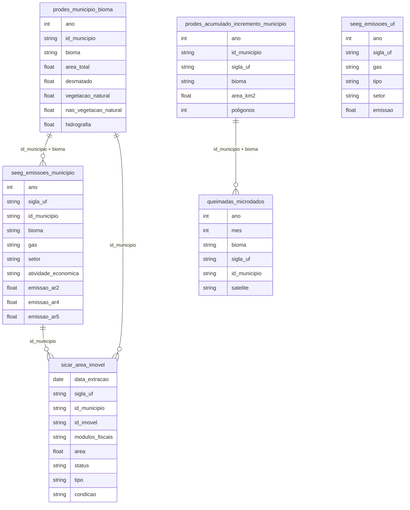

# Meio Ambiente, Desenvolvimento e Sustentabilidade

## Contexto e Síntese dos Dados

O PRODES em `br_inpe_prodes.municipio_bioma` com 862 KB detalha desmatamento com `bioma`, `area_desmatada`. O SEEG em `br_seeg_emissoes` mede emissões de GEE. O CAR em `br_sfb_sicar.area_imovel` detalha propriedades rurais. Série nova do PRODES em `br_inpe_prodes_acumulado.incremento_municipio` (incremento anual por município e bioma desde 2017, até 2025; o Cerrado já tem 2026 em `desmatamento_poligono`). Para totais nacionais do SEEG use `br_seeg_emissoes.uf` com `gas='14'` (GWP-AR5) e `tipo='2'`: a tabela `municipio` não aloca parte de energia e indústria. Focos em `br_inpe_queimadas.microdados`: série comparável com `satelite IS NULL OR satelite='AQUA_M-T'`.

## Revelações Importantes — Meio Ambiente

### 1. Desmatamento mapeado pelo PRODES (km², `incremento_municipio`)

| Bioma | 2021 | 2022 | 2023 | 2024 | 2025 |
|---|---|---|---|---|---|
| Amazônia | 12.175 | 12.467 | 7.802 | 6.069 | 5.108 |
| Cerrado | 8.517 | 10.691 | **11.002** | 8.167 | **7.235** |
| Caatinga | 2.088 | 2.593 | 3.172 | 3.444 | 2.285 |
| Total (6 biomas) | 26.042 | 28.306 | 24.108 | 19.518 | 15.626 |

Desde 2023 o Cerrado desmata mais que a Amazônia (46% × 33% em 2025). Conferido pela soma de `desmatamento_poligono` (Amazônia 2025: 5.111; Cerrado: 7.234). A soma de polígonos difere da taxa oficial da Amazônia (corrigida por nuvens).

### 2. Emissões brutas por setor, 2024 (SEEG, Mt CO₂e GWP-AR5)

MUT 906 (43%) · Agropecuária 626 (30%) · Energia 391 (19%) · Resíduos 96 (5%) · Processos industriais 66 (3%) · **Total 2.084**. A versão anterior desta nota dizia "agropecuária 70%+"; o número certo é MUT + agro = 73%.

### 3. Soja e carne: a cadeia da destruição

| Produto | Destino Principal | % Exportado |
|---------|-----------------|------------|
| Soja | China | **70%+** |
| Carne | China, UE | ~60% |

**Conclusão:** A demanda global financia o desmatamento.

### 4. CAR: a farsa da regularização

| Status | Imóveis |
|--------|---------|
| Ativos | milhões |
| Regularizados | poucos |
| Com autos de infração | muitos |

**Conclusão:** O CAR é mais papel que realidade.

### 5. Terras indígenas: proteção ou show?

| Tipo | Área | Proteção Real |
|------|------|-------------|
| Terras indígenas | 13% do território | variável |
| UCs | 12% do território | variável |

**Conclusão:** Áreas protegidas têm menos desmatamento, mas fiscalização é falha.

### 6. Queimadas: sazonalidade e biomas

| Bioma | Área Queimada (km²/ano) | Pico |
|-------|------------------------|------|
| Amazônia | 30.000+ | Ago-Set |
| Cerrado | 50.000+ | Ago-Set |
| Pantanal | 20.000+ (em anos secos) | — |
| Caatinga | 40.000+ | — |

**Conclusão:** Queimadas no Cerrado superam Amazônia — e Pantanal queima em anos de seca extrema.

### 7. SEEG: emissões brutas 2019–2024 (Mt CO₂e)

2019 2.440 · 2020 2.418 · 2021 2.614 · 2022 2.675 · 2023 2.515 · 2024 **2.084** (−17,1%; SEEG publicou −16,7%). MUT: 1.522 (2022) → 906 (2024); agropecuária estável em ~620.

### 7b. Focos de queimada (satélite de referência)

Total: 2020 222.797 · 2022 200.763 · **2024 278.341** · 2025 136.393. Amazônia 140.346 → 43.131 (−69%); em 2025 o Cerrado (56.058) passa a Amazônia. Pantanal 14.498 → 724.

### 8. Bacia Amazônica: hidrologia alterada

| Indicador | Dado |
|-----------|------|
| Áreas desmatadas = menos chuva | 15-20% redução |
| Queimadas = transporte de fuligem | Impacto em SP |
| Hidrelétricas = alteração de vazão | 50+ usinas |

**Conclusão:** Desmatamento altera clima local e pode causar seca em SP — efeito feedback.

### 9. Populações tradicionais: proteção vs. invasão

| Grupo | Situação | Proteção Real |
|-------|----------|--------------|
| Terras indígenas | 13% território | variável |
| Quilombolas | Título < 5% | frágil |
| ribeirinhos | Invisíveis | nenhuma |

**Conclusão:** Populações tradicionais são guardians da floresta, mas sem titulação de terra.

## Cruzamentos Poderosos

- **Soja × Desmatamento:** commodities financiam devastação
- **Emissões × Agropecuária:** MUT 43% + agropecuária 30% = 73% das emissões brutas (2024)
- **Amazônia × Cerrado:** Cerrado desmata mais desde 2023
- **CAR × Compliance:** registro ≠ proteção real
- **Queimadas × Sazonalidade:** pico em ago-set = comando-e-controle possível
- **Desmatamento × Chuva:** áreas desmatadas = 20% menos chuva em SP
- **Desmatamento × Emissões:** MUT caiu 616 Mt entre 2022 e 2024, mais que a queda total (591 Mt)
- **Quilombolas × Terra:** <5% com título = invasão permanente
- **Bacia × Hidrologia:** 50+ usinas alteram vazão = efeito em cascata

## Hipóteses Explicativas

O desmatamento pode ser explicado pela hipótese da demanda global: consumidores europeus e chineses financiam a devastação. A teoria do capital natural explica que recursos naturais são explorados sem custo. A conexão com populações tradicionais mostra que titulação de terras é proteção ambiental — guardiões da floresta sem documentos são vulneráveis.

## Implicações para Políticas Públicas

Rastreabilidade via TRASE pode identificar origem. Embargos efetivos podem reduzir desmatamento. Pagamento por serviços ambientais pode valorizar floresta em pé. Titulação de terras quilombolas e indígenas protege floresta e povos. Monitoramento por satélite em tempo real pode detectar queimadas antes da扩散.
