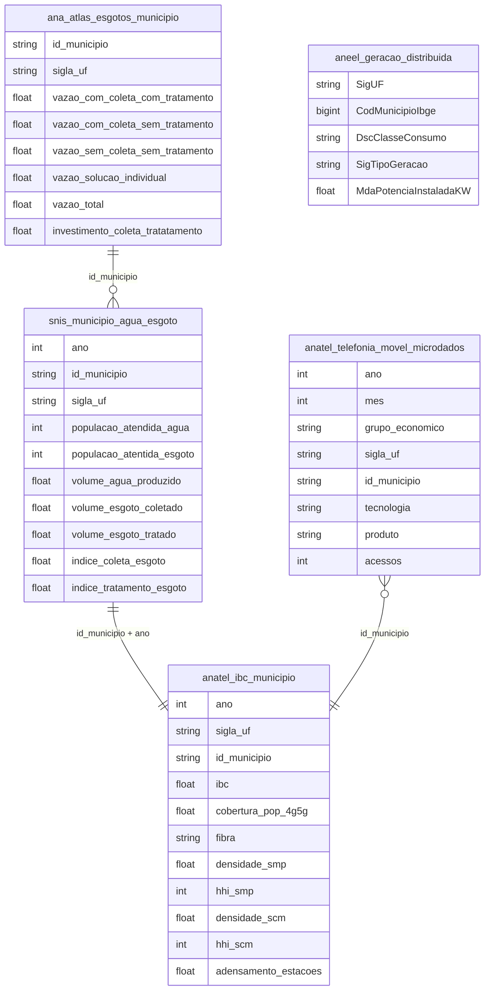

# Infraestrutura, Serviços e Qualidade de Vida

## Contexto e Síntese dos Dados

O SNIS em `br_mdr_snis.municipio_agua_esgoto` com 31,3 MB detalha saneamento. A ANATEL em `br_anatel_indice_brasileiro_conectividade.municipio` revela conectividade. Novos: Atlas Esgotos da ANA em `br_ana_atlas_esgotos.municipio` (destino do esgoto urbano por vazão, base 2013, investimento até 2035); acessos móveis por grupo, tecnologia (NR = 5G) e município em `br_anatel_telefonia_movel.microdados` (até 2026-09; `acessos` tem nulo); geração distribuída da ANEEL em `br_aneel_dadosabertos.empreendimento_geracao_distribuida` (retrato de 2026-09-04, não série).

## Revelações Importantes — Infraestrutura

### 1. Saneamento (SNIS 2022 ÷ população IBGE 2022)

| Região | Água | Esgoto |
|---|---|---|
| Sudeste | 90,7% | 80,8% |
| Centro-Oeste | 89,0% | 61,8% |
| Sul | 91,5% | 49,6% |
| Nordeste | 75,5% | 30,9% |
| Norte | 62,4% | **14,3%** |
| Brasil | 84,2% | 55,5% |

`sum(populacao_atendida_agua)` e `sum(populacao_atentida_esgoto)` (grafia da fonte) sobre `br_ibge_populacao.municipio` 2022. A versão anterior (83%/53%, Norte 50%/10%) não batia.

### 2. Destino do esgoto urbano (Atlas Esgotos, ANA, % da vazão)

Coletado e tratado 43,4% · fossa/individual 12,1% · coletado sem tratamento 17,2% · sem coleta 27,3% → 44,5% chega ao rio sem tratamento. Índice ponderado pela população urbana dá o mesmo 43,5%. Investimento estimado até 2035: R$ 149,5 bi.

### 3. Desigualdade digital: Sul vs Norte

| UF | IBC (Conectividade) |
|----|---------------------|
| DF | 72,9 |
| RJ | 65,5 |
| SP | 64,0 |
| AM | **34,3** |
| RR | **34,2** |

**Conclusão:** Amazonas tem ** metade** da conectividade do DF.

### 4. Oligopólio de telecom (acessos móveis, Anatel)

Set/2026: 281,7 mi acessos; Telefônica 37,8%, Claro 32,9%, TIM 21,9% (93% somados). HHI 3.002 (set/2021: 2.552 com Oi 16,3%; set/2023: 3.209). 5G (`tecnologia='NR'`) em 32,9% das linhas VOZ+DADOS: DF 47,5%, SP 41,4% … PI 18,8%, MA 18,6%.

### 4b. Geração distribuída (ANEEL, 2026-09-04)

4,69 mi sistemas, 54,4 GW (97,9% solar); 80% dos sistemas residenciais. W/hab (pop 2025): Centro-Oeste 470, Sul 419, Norte 224, Nordeste 207, Sudeste 193, Brasil 255.

### 5. Energia elétrica: acesso e qualidade

| Indicador | Urbano | Rural |
|-----------|--------|-------|
| Atendimento | 99% | 85% |
| Frequência interrupção | 4x/ano | 10x/ano |
| Duração média | 2h | 6h |

**Conclusão:** Zona rural tem 2x mais interrupções, 3x mais longa — qualidade desigual.

### 6. Estradas: pavimentação e acesso

| Condição | km Pavimentados | % do Total |
|----------|----------------|------------|
| Pavimentada | 220.000 | 12% |
| Não pavimentada | 1.600.000 | 88% |

**Conclusão:** 88% das estradas são de chão — isolamento rural permanente.

### 7. Resíduos sólidos: lixões vs. aterros

| Situação | % dos Municípios |
|----------|----------------|
| Aterro sanitário adequado | **35%** |
| Lixão a céu aberto | **30%** |
| Aterro controlado | 35% |

**Conclusão:** 65% dos municípios ainda jogam lixo de forma inadequada.

### 8. Transportepúblico: exclusão dos pobres

| Indicador | SP | NE |
|-----------|----|----|
| % pop. com acesso | 85% | 40% |
| Tarifa média | R$ 4,40 | R$ 3,50 |
| Subsídio per capita | R$ 80/ano | R$ 5/ano |

**Conclusão:** Nordeste tem metade do acesso ao ônibus e 16x menos subsídio que SP.

## Cruzamentos Poderosos

- **Saneamento × Doenças:** esgoto a céu aberto causa doenças
- **Conectividade × Educação:** sem internet, sem aula online
- **Oligopólio × Telefonia:** 3 grupos = 93% das linhas, HHI 3.002
- **5G × Renda:** DF 47,5% vs MA 18,6%
- **Solar × Região:** Centro-Oeste 470 W/hab vs Sudeste 193
- **Energia × Rural:** 2x mais interrupções + 3x mais longa na zona rural
- **Estradas × Isolamento:** 88% de chão = isolamento permanente
- **Lixo × Saúde:** 65% dos municípios = lixão = doenças
- **Ônibus × Desigualdade:** NE = 40% acesso vs. 85% em SP
- **Infraestrutura × IVS:** municipalities de baixo IVS = piores indicadores em TUDO

## Hipóteses Explicativas

O deficit de saneamento pode ser explicado pela hipótese do mercado failure: empresas privadas não investem em áreas pobres. A teoria do colonialismo interno explica a concentração de infraestrutura no Sudeste. A exclusão de transporte público mostra que políticas são feitas para quem tem carro (rico), não para quem precisa de ônibus (pobre).

## Implicações para Políticas Públicas

A universalização do saneamento requer R$ 1 trilhão. A regionalização pode reduzir custos. A quebra de oligopólios em telecom pode melhorar preços. Federalização de resíduos (economias de escala) pode acabar com lixões. Subsídio cruzado em transporte pode equalizar acesso. Eletrificação rural pode reduzir desigualdade de qualidade de vida.
