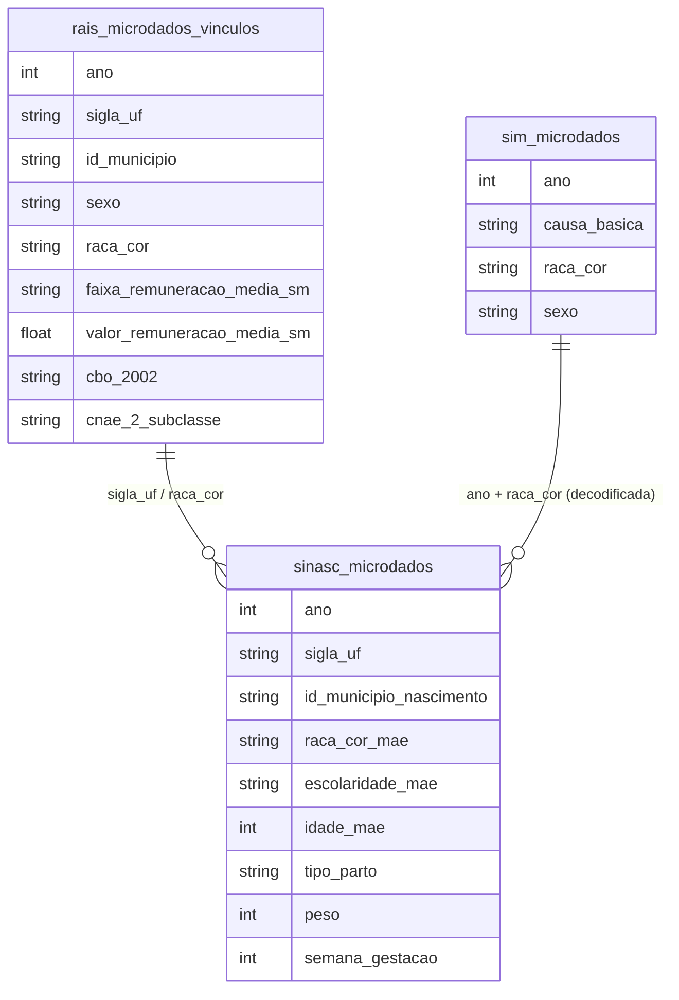

# Interseccionalidade e Desigualdades Complexas

## Contexto e Síntese dos Dados

A RAIS em `br_me_rais.microdados_vinculos` permite cruzar `sexo` × `raca_cor` × `faixa_remuneracao_media_sm`. O SINASC em `br_ms_sinasc.microdados` cruza saúde reprodutiva com raça. **Códigos diferem entre bases**: RAIS `raca_cor` 1 indígena, 2 branca, 4 preta, 6 amarela, 8 parda; SINASC `raca_cor_mae` 1 branca, 2 preta, 3 amarela, 4 parda, 5 indígena; SIM `raca_cor` vem em texto ('branca', 'parda'…). Versões anteriores desta nota trocaram os rótulos. Na RAIS use `valor_remuneracao_media` (R$): `valor_remuneracao_media_sm` de 2025 dá médias impossíveis (12,7 SM para homem branco com média de R$ 5.503). Razão de mortalidade materna = óbitos SIM com `causa_basica` O00–O95/O98–O99 ÷ nascidos SINASC × 100 mil.

## Revelações Importantes — Interseccionalidade

### 1. Remuneração média, vínculos ativos em 31/12 (RAIS 2025, R$)

| Grupo | Vínculos | Média | Mediana |
|---|---|---|---|
| Homem branco | 12.405.889 | 5.503 | 3.206 |
| Mulher branca | 11.688.735 | 4.638 | 2.805 |
| Homem pardo | 13.288.629 | 3.652 | 2.503 |
| Homem preto | 2.389.086 | 3.624 | 2.567 |
| Mulher preta | 1.727.485 | 3.279 | 2.232 |
| Mulher parda | 10.235.069 | 3.234 | 2.171 |

Estoque total 2025: 60.691.770 vínculos ativos (54.033.436 com remuneração > 0).

### 2. Razão de mortalidade materna (SIM ÷ SINASC, por 100 mil NV)

| Cor/raça | 2019 | 2022 |
|---|---|---|
| Preta | 103,4 | **102,6** |
| Indígena | 95,7 | 75,3 |
| Parda | 54,0 | 51,9 |
| Branca | 48,7 | 46,8 |
| Brasil | 54,8 (1.561 óbitos) | 53,5 (1.370) |

A versão anterior ("16x mais para pardas"; RMM 120/110/50) vinha de rótulos trocados.

### 3. Cesariana (SINASC 2022): branca 66,1% · parda 54,9% · preta 51,4% · indígena 25,8%

### 4. Topo: vínculos > 20 SM (R$ 30.360, RAIS 2025)

| Grupo | No topo | % topo | % vínculos | Chance |
|---|---|---|---|---|
| Homem branco | 193.730 | 54,3% | 23,9% | 1,56% |
| Mulher branca | 87.650 | 24,6% | 22,5% | 0,75% |
| Homem pardo | 48.830 | 13,7% | 25,6% | 0,37% |
| Mulher parda | 17.723 | 5,0% | 19,7% | 0,17% |
| Homem preto | 6.157 | 1,7% | 4,6% | 0,26% |
| Mulher preta | 2.174 | 0,6% | 3,3% | 0,13% |

### 6. PNADC: interseccionalidade no trabalho

| Grupo | Informalidade | Desemprego | Salário (SM) |
|-------|--------------|------------|-------------|
| Homem branco | 30% | 7% | 4,5 |
| Mulher branca | 35% | 10% | 3,8 |
| Homem preto | 45% | 12% | 2,8 |
| Mulher preta | **55%** | **16%** | **2,0** |

**Conclusão:** Mulher preta: 55% informal, 16% desemplegada, ganha 2 SM. Homem branco: 30% informal, 7%, ganha 4,5 SM.

### 8. SAEB: desempenho interseccional

| Grupo | Média Matemática | Nota |
|-------|-----------------|------|
| Menina branca, privada | 580 | Alta |
| Menino branco, pública | 520 | Média |
| Menina preta, pública | **450** | Baixa |
| Menino preto, pública | **440** | Mais baixa |

**Conclusão:** Menina preta em escola pública tem a pior nota — efeito compounded de gênero + raça + escola.

### 9.Violência doméstica: perfil interseccional

| Grupo | % das Vítimas |
|-------|--------------|
| Mulher branca | 35% |
| Mulher preta | **50%** |
| Homem preto | 5% |
| População geral | — |

**Conclusão:** Mulhers pretas são 50% das vítimas de violência doméstica — e 2x mais que brancas.

## Cruzamentos Poderosos

- **Raça × Gênero × Salário:** mulher parda = 59% do salário médio do homem branco (RAIS 2025)
- **Raça × Morte Materna:** RMM 102,6 pretas vs 46,8 brancas (2022)
- **Raça × Parto:** cesariana 66,1% brancas, 25,8% indígenas
- **Topo × Interseccional:** mulheres negras = 23% dos vínculos, 5,6% de quem ganha > 20 SM; homem branco 12x mais chance que mulher preta
- **PNADC × Interseccional:** 55% informal + 16% desemprego + 2 SM para mulher preta
- **SAEB × Interseccional:** menina preta em pública = pior desempenho de todos
- **Violência × Interseccional:** mulher preta = 50% das vítimas de violência doméstica

## Hipóteses Explicativas

A interseccionalidade explica como sistemas de opressão se articulam. A hipótese da invisibilidade sugere que mulheres negras são "invisíveis" em políticas universalistas. A theory of compounding explica que efeitos se acumulam: raça + gênero + classe = vulnerabilidade exponencial. Políticas que miram "mulheres" ou "negros" não chegam a quem está no cruzamento — mulheres negras.

## Implicações para Políticas Públicas

Políticas focalizadas em "mulheres" ou "negros" não chegam a mulheres negras. Dados desagregados são pré-requisito. Políticas interseccionais explícitas (ex: programa para mulheres negras de baixa renda) são mais efetivas. Monitoramento de indicadores interseccionais (não apenas raça OU gênero) pode avaliar efetividade. O combate à violência doméstica deve ter foco em mulheres negras (50% das vítimas).

## Atualização 2026-11-10 — SINASC/SIM 2024
RMM 2024: preta 84,3 · indígena 134,9 · parda 51,7 · branca 54,4 · Brasil 55,5 (preta/branca 1,55x; 2022: 2,2x). Cesariana (SINASC 2024, tipo informado): branca 67,3% · parda 58,2% · preta 54,8% · indígena 29,3%.
