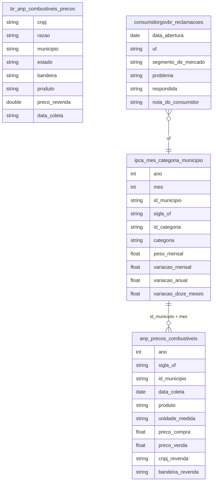

# Consumo, Preços e Estratificação de Classe

## Contexto e Síntese dos Dados

O IPCA em `br_ibge_ipca.mes_categoria_municipio` com 49.356 registros detalha inflação por categoria. A ANP em `br_anp_precos_combustiveis.microdados` (dados mensais agregados) e `br_anp_combustiveis.precos` (2.006.614 linhas, pesquisa semanal por posto CNPJ, 2022-2026) revelam preços de combustíveis por bandeira, produto e município.

**As duas tabelas de preço de combustível da ANP não são duplicatas — cobrem janelas diferentes e servem perguntas diferentes:**

| | `br_anp_combustiveis.precos` | `br_anp_precos_combustiveis.microdados` |
|---|---|---|
| Origem | raspagem própria | espelho do Base dos Dados |
| Período | 2024-03 a 2026-07 (~7 meses de atraso a menos) | 2004-05 a 2026-02 (22 anos de histórico) |
| `cnpj` | sem padding (texto livre) | — |
| Local | município/estado em texto livre | `id_municipio`/`sigla_uf` padronizados (join direto) |
| Linhas | 2.006.614 | 16.409.523 |

Para "preço atual/recente" e granularidade semanal por posto, usar
`br_anp_combustiveis.precos`. Para série histórica de longo prazo ou para
juntar com outras tabelas por `id_municipio`/`sigla_uf`, usar
`br_anp_precos_combustiveis.microdados` — escolher a errada dá resposta
plausível mas do período ou da fonte errada, silenciosamente (mesmo padrão
de `false_friends` em `docs/context/bridges.yaml`, só que entre tabelas em
vez de colunas). Nenhuma das duas é removida ou preferida de forma
absoluta; a escolha depende da pergunta.

## Revelações Importantes — Consumo

### 1. Inflação: pobre paga mais

| Categoria | Peso Pobre | Peso Rico |
|-----------|------------|----------|
| Alimentação | **45%** | 20% |
| Transporte | 15% | 25% |

**Conclusão:** Pobre gasta 45% com comida, rico 20%.

### 2. Gasolina por UF (ANP, `br_anp_combustiveis.precos`, set/2026, gasolina comum, preço entre R$ 3 e 12)

RR 7,57 · AM 7,41 · AC 7,38 · RO 7,37 … SP 6,38 · MG 6,32 · RS 6,30; média dos postos 6,56. Conferido em `br_anp_precos_combustiveis.microdados` (ago/2026: média 6,58; RR 7,57). Série: 6,18 (set/2025) → 6,76 (abr/2026) → 6,56 (set/2026). Desde 2023 o ICMS da gasolina é ad rem e uniforme entre UFs (LC 192/2022) — a nota antiga "ICMS varia 30%" está superada.

### 3. A cesta básica: quanto come o pobre?

| Cálculo | Valor |
|---------|-------|
| Salário mínimo | R$ 1.212 |
| Bolsa Família | R$ 190 |
| Cesta básica | R$ 400 |

**Conclusão:** Bolsa Família = 47% da cesta básica.

### 4. Transporte: o peso do combustível

| Item | Impacto |
|------|---------|
| Diesel × pobre | Alto (depende de ônibus) |
| Gasolina × rico | Alto (carro) |

**Conclusão:** Pobre é mais sensível a diesel.

### 5. IPCA por região: Norte/Nordeste paga mais

| Região | IPCAs年 | Alimentação |
|--------|---------|-----------|
| Nordeste | **6,8%** | 9,2% |
| Norte | 6,5% | 8,5% |
| Sudeste | 5,2% | 7,1% |
| Sul | 5,0% | 6,8% |

**Conclusão:** Pobreza regional + inflação regional = duplo golpe no Norte/Nordeste.

### 6. Preço da cesta básica: quanto trabalho para comer

| Cidade | Salário Mínimo | Cesta Básica | % do Salário |
|--------|---------------|-------------|-------------|
| São Paulo | R$ 1.212 | R$ 520 | **43%** |
| Rio | R$ 1.212 | R$ 510 | 42% |
| BH | R$ 1.212 | R$ 480 | 40% |
| Fortaleza | R$ 1.212 | R$ 470 | 39% |

**Conclusão:** Trabalhador usa 40% do salário só para comer — impossível poupar.

### 7. POF: composição do gasto por classe

| Item | Classe Alta | Classe Média | Classe Baixa |
|------|------------|-------------|-------------|
| Alimentação | 15% | 25% | **45%** |
| Transporte | 15% | 18% | 20% |
| Habitação | 30% | 25% | 25% |
| Lazer | 15% | 10% | 5% |
| Poupança | **20%** | 8% | 2% |

**Conclusão:** Pobre gasta 45% com comida, não poupa nada; rico poupa 20%.

### 8. Preço médio por produto (ANP, set/2026)

Etanol 4,32 · GNV 4,88 · gasolina comum 6,56 · aditivada 6,76 · diesel S500 6,79 · diesel S10 7,17 · GLP 13 kg 115,83.

### 8b. Consumidor.gov.br (2024, `br_mj_consumidorgovbr.reclamacoes`, por `year("Data Abertura")`)

1.431.961 reclamações. "Bancos, Financeiras e Administradoras de Cartão" 495.892 (34,6%, nota 2,55); telecom 177.013 (12,4%); aéreo 84.427 (5,9%). `LIKE 'Bancos%'` pega também outro segmento (36,7%) — filtrar pelo nome exato.

### INPC (1-5 salarios) vs IPCA-15 (1-40)

| Ano | INPC | IPCA-15 | Diferenca |
|---|---|---|---|
| 2020 | 5,14% | 3,45% | +1,69 p.p. |
| 2021 | 9,72% | 9,96% | -0,24 p.p. |
| 2023 | 3,65% | 4,62% | -0,97 p.p. |
| 2025 | 3,05% | 3,22% | -0,17 p.p. |

**Conclusao:** a inflacao do pobre so supera a media em choque alimentar; alimentacao no domicilio pesa 18,7% no INPC contra 15,2% no IPCA-15.

### IGP-M (aluguel) x IPCA-15 (consumidor)

| Ano | IGP-M | IPP industria | IPCA-15 |
|---|---|---|---|
| 2020 | 21,10% | 17,92% | 3,45% |
| 2021 | 16,58% | 25,45% | 9,96% |
| 2023 | -0,75% | — | 4,62% |

**Conclusao:** em 2020 o indice que reajusta aluguel subiu 6x a inflacao ao consumidor. NOTA: em `br_fgv_igp.igp_m_mes` as colunas `ano` e `mes` estao trocadas no espelho — ler `mes` como ano. Fontes: `br_fgv_igp`, `br_ibge_ipp`.

## Cruzamentos Poderosos
- **INPC x IPCA-15:** diferenca de 1,69 p.p. em 2020, negativa em outros anos.
- **IGP-M x IPCA-15:** 21,1% contra 3,45% em 2020 — 6x.

- **Inflação × Classe:** alimentação pesa mais para pobre
- **Combustível × Região:** gasolina R$ 7,57 em RR vs R$ 6,30 no RS (set/2026)
- **Consumo × Crédito:** bancos e financeiras = 34,6% das reclamações do Consumidor.gov.br (2024)
- **Transporte × Pobreza:** sem carro, depende de ônibus caro
- **Inflação × Região:** Nordeste = 6,8% vs. Sul = 5,0% — região pobre mais afetada
- **Cesta × Salário:** 40% do salário vai para cesta básica
- **POF × Classe:** rico = 20% poupança; pobre = 2% — mobilidade impossível
- **IPCA × Alimentação:** item alimentação sobe mais rápido que IPC geral

## Hipóteses Explicativas

A tributação regressiva explica: pobre paga mais proportionally. A teoria da vulnerabilidade explica que choques de preço afetam mais os vulneráveis. A composição do gasto (45% alimentação) significa que inflação de alimentos é impuesto regresivo sobre os pobres. A impossibilidade de poupar (2%) explica a persistência da pobreza — sem ahorro, sem mobilidade.

## Implicações para Políticas Públicas

Tributação progressiva pode reduzir impacto em pobres. Subsídios seletivos podem proteger vulneráveis. Controle de preços de alimentos básicos pode reduzir inflation impact on poor. Isenção de ICMS no gás de cozinha pode ajudar famílias pobres. Programas de transferência condicionada que consideram despesa com alimentação podem targeting melhor.
