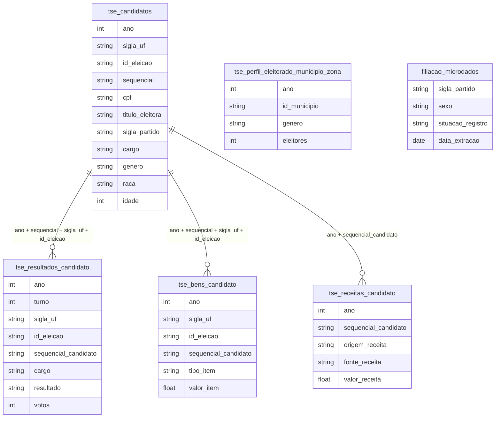

# Poder, Elite e Reprodução Social

## Tabelas usadas

- `br_tse_eleicoes.candidatos`
- `br_tse_eleicoes.resultados_candidato`
- `br_tse_eleicoes.bens_candidato`
- `br_tse_eleicoes.receitas_candidato`
- `br_tse_eleicoes.perfil_eleitorado_municipio_zona`
- `br_tse_filiacao_partidaria.microdados`

## Contexto e Síntese dos Dados

A Câmara eleita em 2026 tem 21% de mulheres e 73% de brancos; a mediana do patrimônio declarado pelos eleitos é de R$ 1,4 milhão, dezessete vezes a dos candidatos que perderam.

O Tribunal Superior Eleitoral registra, para cada eleição, quem se candidatou, com partido, gênero, raça, idade e a lista de bens declarados, além do resultado e de cada real que entrou nas campanhas. O cadastro de filiação partidária soma 16,7 milhões de filiados regulares. Com a eleição de 2026 já apurada, dá para seguir o mesmo funil do eleitorado até a Câmara dos Deputados. A cada etapa a composição se afasta mais da população: em gênero, em raça e, sobretudo, em patrimônio.

## Revelações Importantes

### 1. A Câmara de 2026: 109 mulheres em 513 cadeiras

Em 2026 foram eleitas 109 deputadas federais, 21,2% da Câmara. É o maior número da série recente: 77 em 2018 e 91 em 2022. O avanço, porém, é lento. Nesse ritmo, de 16 cadeiras por eleição, faltariam dez eleições para chegar às 271 cadeiras que espelhariam um eleitorado 52,8% feminino, ou seja, só por volta de 2066.

*Deputadas e deputados federais eleitos, por gênero (TSE)*

| Eleição | Mulheres | Homens | % mulheres |
|---|---|---|---|
| 2018 | 77 | 436 | 15,0% |
| 2022 | 91 | 422 | 17,7% |
| 2026 | 109 | 404 | 21,2% |

**Conclusão:** Em oito anos a bancada feminina cresceu de 77 para 109 cadeiras, mas a Câmara segue quatro quintos masculina num eleitorado de maioria feminina.

### 2. O funil: onde as mulheres ficam pelo caminho

As mulheres são maioria no eleitorado e quase metade dos filiados a partidos. A queda acontece em dois degraus. O primeiro é a candidatura: a cota legal exige 30% de candidatas por partido, e em 2026 elas foram 36,8% das chapas para deputado federal. O segundo, mais íngreme, é a eleição, onde a participação cai de 37% para 21%. A cota garante o nome na urna, mas não o voto.

*Participação feminina em cada etapa, eleição de 2026 (TSE)*

| Etapa | Total | Mulheres | % |
|---|---|---|---|
| Eleitorado apto | 158,7 milhões | 83,9 milhões | 52,8% |
| Filiados regulares a partidos (ago/2026) | 16,7 milhões | 7,7 milhões | 46,3% |
| Candidaturas a deputado federal | 7.803 | 2.871 | 36,8% |
| Eleitos deputados federais | 513 | 109 | 21,2% |

**Conclusão:** Entre a candidatura e a cadeira, a participação feminina cai de 37% para 21%. Garantida a vaga na chapa, ainda falta o dinheiro e a estrutura para vencer.

### 3. Raça: uma Câmara 73% branca num país 44% branco

Segundo a autodeclaração dos próprios candidatos ao TSE, 374 dos 513 deputados eleitos em 2026 são brancos (72,9%). Pardos somam 106 (20,7%) e pretos, 29 (5,7%). No Censo 2022 do IBGE a população é 45,3% parda, 43,5% branca e 10,2% preta. Pardos e pretos, a maioria da população, ocupam pouco mais de um quarto das cadeiras, e a proporção quase não se moveu desde 2018.

*Deputados federais eleitos por raça declarada (TSE) e população (Censo 2022)*

| Raça/cor | Eleitos 2018 | Eleitos 2022 | Eleitos 2026 | % em 2026 | % da população |
|---|---|---|---|---|---|
| Branca | 387 | 369 | 374 | 72,9% | 43,5% |
| Parda | 102 | 108 | 106 | 20,7% | 45,3% |
| Preta | 21 | 27 | 29 | 5,7% | 10,2% |
| Indígena | 1 | 5 | 3 | 0,6% | 0,6% |
| Amarela | 2 | 3 | 1 | 0,2% | 0,4% |

**Conclusão:** Pardos e pretos são 55% da população e 26% da Câmara. A sub-representação racial é maior que a de gênero.

### 4. Patrimônio: quem se elege declara dezessete vezes mais

Todo candidato entrega ao TSE a lista dos seus bens. Entre os 7.803 candidatos a deputado federal em 2026, a mediana do patrimônio dos 513 eleitos é de R$ 1,39 milhão. A dos 7.290 que não se elegeram é de R$ 83 mil, contando como zero quem não declarou bem nenhum. Dos eleitos, 306 (60%) declararam R$ 1 milhão ou mais. Entre os derrotados, foram 1.133 (16%).

*Patrimônio declarado pelos candidatos a deputado federal, 2026 (TSE)*

| Grupo | Candidatos | Mediana do patrimônio | Média | Declaram R$ 1 milhão ou mais |
|---|---|---|---|---|
| Eleitos | 513 | R$ 1,39 milhão | R$ 3,68 milhões | 306 (59,6%) |
| Não eleitos | 7.290 | R$ 83 mil | R$ 0,93 milhão | 1.133 (15,5%) |

**Conclusão:** Seis em cada dez deputados eleitos em 2026 são milionários no papel. Entre os candidatos derrotados, a proporção é de um em seis.

### 5. Quem financia as campanhas: o dinheiro público passa pelos partidos

Desde 2015 empresas não podem doar a campanhas. Em 2022, a última eleição com prestação de contas fechada, os candidatos receberam R$ 6,63 bilhões. Desse total, 81% (R$ 5,39 bilhões) vieram dos partidos, que repassam sobretudo o Fundo Especial de Financiamento de Campanha: R$ 4,90 bilhões só dessa fonte. As doações de pessoas físicas somaram R$ 826 milhões (12,5%), e o dinheiro do próprio bolso, R$ 196 milhões. Quem decide quanto cada candidato recebe é, na prática, a direção partidária.

*Receitas de campanha dos candidatos por origem, eleição de 2022 (TSE)*

| Origem | Valor | % do total |
|---|---|---|
| Partidos políticos (inclui Fundo Especial) | R$ 5,39 bi | 81,3% |
| Pessoas físicas | R$ 826 mi | 12,5% |
| Outros candidatos | R$ 197 mi | 3,0% |
| Recursos próprios | R$ 196 mi | 3,0% |
| Financiamento coletivo | R$ 21 mi | 0,3% |

**Conclusão:** Quatro de cada cinco reais de campanha vêm do partido, e três de cada quatro são dinheiro público do Fundo Especial. Quem controla a sigla controla a chance de eleição.

### 6. Partidos: seis siglas ficam com 70% das cadeiras

Em 2026, 28 partidos lançaram candidatos a deputado federal e 20 elegeram ao menos um. A distribuição, porém, é concentrada. O PL elegeu 121 deputados e o PT, 70. Somando União, PSD, Republicanos e PP, os seis maiores ficam com 362 das 513 cadeiras (70,6%).

*Cadeiras na Câmara dos Deputados por partido, eleição de 2026 (TSE)*

| Partido | Eleitos | % das cadeiras |
|---|---|---|
| PL | 121 | 23,6% |
| PT | 70 | 13,6% |
| União | 46 | 9,0% |
| PSD | 43 | 8,4% |
| Republicanos | 41 | 8,0% |
| PP | 41 | 8,0% |
| Seis maiores | 362 | 70,6% |

**Conclusão:** Vinte partidos têm cadeira, mas seis concentram sete em cada dez votos em plenário.

### 7. Reeleição: 57% da Câmara de 2026 já estava lá

Dos 513 eleitos em 2026, 294 (57,3%) também tinham sido eleitos deputados federais em 2022, identificados pelo título de eleitor. Em 2022, ao menos 277 dos eleitos (54%) vinham da legislatura anterior; o número é um piso, porque oito eleitos daquele ano não têm CPF no registro. A renovação de cada eleição fica perto de 43% a 46% das cadeiras, e parte dela é de ex-deputados, vereadores e prefeitos que trocam de cargo.

*Deputados federais eleitos que já tinham sido eleitos na eleição anterior (TSE)*

| Eleição | Eleitos | Vinham da legislatura anterior | % |
|---|---|---|---|
| 2022 | 513 | 277 (piso) | 54,0% |
| 2026 | 513 | 294 | 57,3% |

**Conclusão:** Mais da metade da Câmara se reelege a cada quatro anos. Com patrimônio alto e acesso ao fundo partidário, quem já tem mandato larga na frente.

## Cruzamentos Poderosos

- **Gênero × funil eleitoral:** as mulheres são 53% do eleitorado, 37% das candidaturas e 21% dos eleitos para a Câmara em 2026.
- **Raça × Câmara:** 73% dos deputados eleitos em 2026 se declaram brancos, contra 43,5% da população.
- **Patrimônio × eleição:** a mediana dos eleitos (R$ 1,39 milhão) é 17 vezes a dos derrotados.
- **Partido × dinheiro público:** 81% das receitas de campanha de 2022 vieram dos partidos, sobretudo do Fundo Especial.
- **Partido × cadeiras:** seis siglas ficaram com 70,6% da Câmara em 2026.
- **Reeleição × renovação:** 57% dos eleitos em 2026 já eram deputados federais.
- **Filiação × gênero:** as mulheres são 46% dos 16,7 milhões de filiados, mas a proporção encolhe a cada etapa do funil.

## Hipóteses explicativas

A teoria da reprodução social explica parte do quadro: quem já está na elite política tende a perpetuar a própria posição, por vantagem de recursos ou de rede. Desde a proibição das doações empresariais, o canal principal desse poder mudou de lugar. O dinheiro de campanha passou a ser majoritariamente público e é distribuído pelas direções partidárias, de modo que a disputa decisiva acontece dentro do partido, antes da urna. O patrimônio pessoal pesa duas vezes: financia a pré-campanha e sinaliza ao partido quem é um candidato viável. Somadas, as duas coisas explicam por que a cota de candidaturas aumentou o número de mulheres nas chapas muito mais do que nas cadeiras, e por que mais da metade da Câmara se reelege.

## Implicações para políticas públicas

Cotas de candidatura, isoladas, têm efeito limitado. A regra de destinar às candidatas ao menos 30% do Fundo Especial precisa de fiscalização por candidata, não só pelo total do partido. Critérios transparentes de partilha do fundo dentro de cada partido reduziriam o poder das direções de escolher antecipadamente os vencedores. Reserva de cadeiras, adotada em outros países, ataca o degrau em que as mulheres mais perdem: o da eleição. Para a sub-representação racial, a distribuição proporcional do fundo e do tempo de propaganda a candidatos negros, já decidida pelo TSE, também precisa de verificação candidatura a candidatura.
