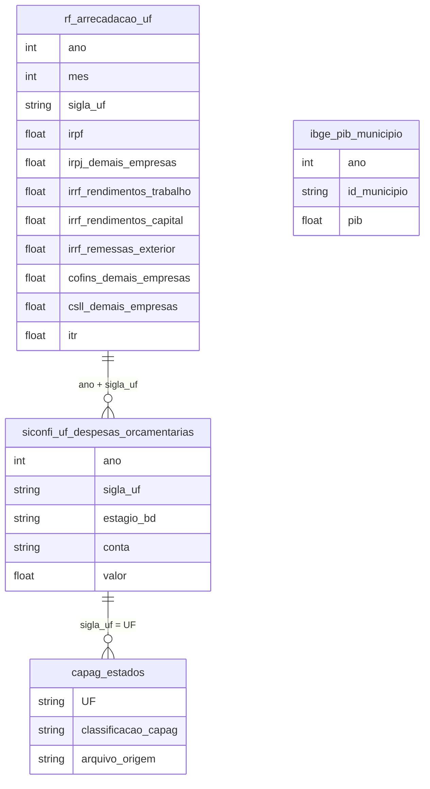

# Economia Política e Desenvolvimento

## Tabelas usadas

- `br_rf_arrecadacao.uf`
- `br_me_siconfi.uf_despesas_orcamentarias`
- `br_tesouro_capag.estados`
- `br_ibge_pib.municipio`

## Contexto e Síntese dos Dados

Em 2023 a Receita Federal reteve R$ 246 bilhões de imposto de renda sobre o trabalho e R$ 122 bilhões sobre aplicações financeiras, enquanto o imposto sobre a terra rural rendeu R$ 3,2 bilhões. Nos estados, a folha consome 53% da despesa e o investimento, 6%.

A Receita Federal publica, mês a mês e por estado, quanto arrecada de cada tributo: imposto de renda das pessoas e das empresas, retenções na fonte sobre salário, aplicações e remessas ao exterior, contribuições sobre o faturamento e o imposto territorial rural. O SICONFI, do Tesouro Nacional, mostra como cada estado gasta, e a Capacidade de Pagamento (CAPAG) dá a nota da saúde fiscal de cada um. Juntas, as três fontes descrevem um Estado que tributa sobretudo o consumo e o salário, quase não tributa o patrimônio e, nos estados, dedica a maior parte do orçamento à folha.

## Revelações Importantes

### 1. Imposto de renda: o salário paga mais que o capital

Em 2023 o imposto de renda retido na fonte sobre salários somou R$ 187,6 bilhões. Com mais R$ 58,6 bilhões do ajuste anual das pessoas físicas, a renda do trabalho respondeu por R$ 246 bilhões. A retenção sobre rendimentos de capital (juros, aplicações e fundos) somou R$ 121,7 bilhões, metade disso. Os lucros e dividendos distribuídos a pessoas físicas ficaram isentos de 1996 até a reforma aprovada em 2025. As empresas pagaram R$ 300,3 bilhões de IRPJ e R$ 156,8 bilhões de CSLL sobre o lucro, mas a renda que chega aos sócios como dividendo não aparece em nenhuma linha desta tabela.

*Arrecadação federal de imposto sobre a renda e o lucro, 2023 (Receita Federal)*

| Tributo | R$ bilhões |
|---|---|
| IR retido na fonte sobre salários | 187,6 |
| IRPF (ajuste anual e carnê-leão) | 58,6 |
| IR retido na fonte sobre rendimentos de capital | 121,7 |
| IR retido sobre remessas ao exterior | 60,5 |
| IRPJ (empresas) | 300,3 |
| CSLL (empresas) | 156,8 |

**Conclusão:** Para cada real de imposto de renda sobre aplicações financeiras, o assalariado e o contribuinte pessoa física pagaram dois reais sobre o próprio trabalho.

### 2. Consumo contra patrimônio: R$ 552 bilhões contra R$ 3 bilhões

As contribuições e impostos federais que incidem sobre o faturamento e o consumo (COFINS, PIS/PASEP, IPI e IOF) somaram R$ 551,6 bilhões em 2023, embutidos no preço de tudo o que se compra. O único imposto federal sobre patrimônio, o Imposto Territorial Rural, rendeu R$ 3,2 bilhões. É menos de 0,6% do que rendeu a tributação do consumo. Herança e imóveis urbanos são tributados por estados e municípios, e o imposto sobre grandes fortunas, previsto na Constituição de 1988, nunca foi regulamentado.

*Arrecadação federal sobre consumo e sobre patrimônio rural, 2023 (Receita Federal)*

| Tributo | R$ bilhões |
|---|---|
| COFINS | 335,8 |
| PIS/PASEP | 92,9 |
| IPI | 61,7 |
| IOF | 61,2 |
| Subtotal consumo e faturamento | 551,6 |
| ITR (imposto territorial rural) | 3,2 |

**Conclusão:** A União arrecada 170 vezes mais sobre o consumo do que sobre a terra rural. O imposto que mais pesa no bolso de quem ganha pouco é o que vem embutido no preço.

### 3. São Paulo paga 36% do IRPF e produz 31% do PIB

Em 2023 os contribuintes paulistas recolheram R$ 21,1 bilhões de IRPF, 36% do total do país. Minas Gerais (10,1%) e Rio de Janeiro (9,7%) vêm em seguida, com menos de um terço disso cada um. A participação de São Paulo no IRPF é maior que no PIB, que o IBGE estima em 31,5% dos R$ 10,9 trilhões de 2023. A diferença mostra que a renda tributável alta, de profissionais liberais, executivos e quem declara grandes ganhos, é ainda mais concentrada que a produção.

*IRPF arrecadado por UF, 2023 (Receita Federal)*

| UF | R$ bilhões | % do total |
|---|---|---|
| SP | 21,1 | 36,0% |
| MG | 5,9 | 10,1% |
| RJ | 5,7 | 9,7% |
| RS | 4,3 | 7,4% |
| PR | 4,2 | 7,2% |

**Conclusão:** A renda tributável alta é mais concentrada que a produção: São Paulo produz 31,5% do PIB e paga 36% do IRPF.

### 4. Estados: 53% da despesa vai para a folha, 6% para investimento

Em 2024 os 27 governos estaduais liquidaram R$ 1,37 trilhão em despesas. R$ 726 bilhões (53,1%) foram para pessoal e encargos, incluindo aposentados e pensionistas, e R$ 84 bilhões (6,2%) para investimentos. No Rio Grande do Norte a folha leva 72,9% da despesa, no Rio Grande do Sul 69,3% e em Minas Gerais 66,4%; nesses três estados o investimento fica entre 2% e 5%. No outro extremo, Amazonas (39,5%) e São Paulo (40,8%) comprometem menos de 41%.

*Despesa com pessoal e com investimento como parte da despesa liquidada, 2024 (SICONFI/Tesouro Nacional)*

| UF | Pessoal | Investimentos | Despesa total (R$ bi) |
|---|---|---|---|
| RN | 72,9% | 4,2% | 21,0 |
| RS | 69,3% | 2,1% | 76,7 |
| MG | 66,4% | 4,7% | 114,4 |
| RJ | 60,2% | 4,5% | 107,3 |
| SP | 40,8% | 4,4% | 353,3 |
| AM | 39,5% | 4,6% | 33,9 |
| 27 estados | 53,1% | 6,2% | 1.367,1 |

**Conclusão:** Em Rio Grande do Norte, Rio Grande do Sul e Minas Gerais, de cada dez reais gastos sete vão para a folha e menos de meio real para investimento.

### 5. CAPAG: os estados mais presos à folha têm as piores notas

A Capacidade de Pagamento, calculada pelo Tesouro Nacional, classifica estados de A+ a D pelo endividamento, pela poupança corrente e pela liquidez; só quem tira A ou B pode tomar empréstimo com garantia da União. Na avaliação de 2025, 21 dos 27 estados ficaram entre A+ e B. Os seis com nota C ou D são Acre, Distrito Federal, Rio Grande do Norte e Rio Grande do Sul (C), e Minas Gerais e Rio de Janeiro (D). Os três estados com a maior parte da despesa presa à folha (RN, RS e MG) estão todos nesse grupo.

*Estados por nota da CAPAG, avaliação de 2025 (Tesouro Nacional)*

| Nota | Estados | Quais |
|---|---|---|
| A+ | 7 | CE, ES, MT, PB, PR, RO, SC |
| A | 4 | — |
| B+ | 9 | — |
| B | 1 | — |
| C | 4 | AC, DF, RN, RS |
| D | 2 | MG, RJ |

**Conclusão:** Os seis estados com nota C ou D incluem os três em que a folha consome mais de dois terços da despesa.

## Cruzamentos Poderosos

- **Trabalho × capital:** R$ 246 bi de IR sobre salário e declaração anual contra R$ 122 bi sobre aplicações financeiras (2023).
- **Consumo × patrimônio:** R$ 552 bi de COFINS, PIS, IPI e IOF contra R$ 3,2 bi de ITR.
- **Dividendos × isenção:** lucros distribuídos a sócios ficaram fora do IR de 1996 até a reforma de 2025.
- **São Paulo × renda alta:** 31,5% do PIB e 36% do IRPF.
- **Folha × investimento:** os estados gastaram 53% com pessoal e 6% com investimento em 2024.
- **Folha × CAPAG:** RN, RS e MG, com mais de 66% da despesa em pessoal, têm nota C ou D.

## Hipóteses explicativas

A estrutura tributária brasileira reflete a economia política da sua construção. Tributos sobre o consumo e retenções na fonte são fáceis de cobrar e invisíveis para quem paga; tributar patrimônio e dividendos exige enfrentar quem tem mais voz no Congresso. Por isso o sistema pesa mais, proporcionalmente, sobre quem ganha menos. Nos estados, a rigidez da folha, com estabilidade, vinculações e regimes próprios de previdência deficitários, explica por que a despesa de pessoal avança sobre o espaço do investimento sempre que a receita encolhe. A nota baixa na CAPAG fecha o ciclo: sem acesso a crédito garantido, os estados mais endividados também ficam sem como investir.

## Implicações para políticas públicas

A tributação de dividendos aprovada em 2025 e a reforma do consumo, que começa em 2026 a transição de PIS, COFINS, IPI, ICMS e ISS para dois tributos sobre valor agregado, são as primeiras mudanças estruturais em décadas, e o seu efeito precisa ser medido na própria série da Receita. Atualizar o valor da terra declarado ao ITR, hoje autodeclarado e defasado, aumentaria a arrecadação sem criar imposto novo. Nos estados, reformas da previdência dos servidores e limites à criação de despesa obrigatória são condição para liberar espaço ao investimento, e a CAPAG pode ser usada para condicionar ajuda federal a metas de folha.
