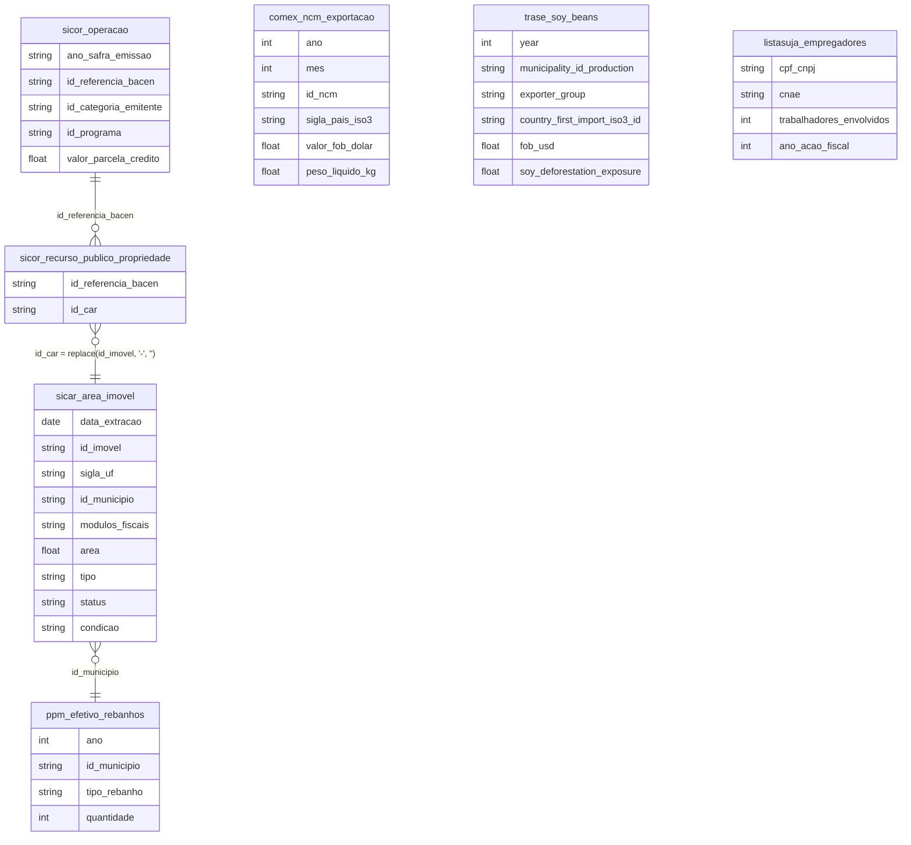

# Agropecuária, Estrutura Fundiária e Agronegócio

## Tabelas usadas

- `br_sfb_sicar.area_imovel`
- `br_bcb_sicor.operacao`
- `br_bcb_sicor.recurso_publico_propriedade`
- `br_me_comex_stat.ncm_exportacao`
- `br_ibge_ppm.efetivo_rebanhos`
- `br_trase_supply_chain.soy_beans`
- `br_mte_listasuja.empregadores`

## Contexto e Síntese dos Dados

Os imóveis rurais com mais de 15 módulos fiscais são 1,5% do Cadastro Ambiental Rural e somam 45% da área declarada. Na safra 2024/25, os grandes produtores ficaram com 53% do crédito rural em 6% dos contratos.

O Cadastro Ambiental Rural (CAR), do Serviço Florestal Brasileiro, reúne o perímetro declarado de 7,6 milhões de imóveis rurais ativos. O SICOR, do Banco Central, registra cada contrato de crédito rural, com o porte do tomador e o programa. O Comex Stat mostra o que sai pelos portos, e a Pesquisa Pecuária Municipal do IBGE conta os rebanhos município a município. Juntas, essas fontes mostram a mesma concentração em três camadas: a da terra, a do crédito que financia a terra e a da exportação, que vende o produto quase sem processamento a um único comprador.

## Revelações Importantes

### 1. Terra: 1,5% dos imóveis declaram 45% da área

Na foto de outubro de 2025 do CAR, 7,58 milhões de imóveis rurais ativos declaravam 470,6 milhões de hectares. Os 112.870 imóveis grandes, com mais de 15 módulos fiscais, são 1,5% do total e somam 212,5 milhões de hectares, 45,2% da área. Os 7,13 milhões de imóveis pequenos (até 4 módulos) são 94% do cadastro e ocupam um terço. Ordenando os imóveis por tamanho, o 1% maior concentra 42,9% da área e os 10% maiores, 77%.

*Imóveis rurais ativos no CAR por porte, foto de out/2025 (Serviço Florestal Brasileiro)*

| Porte (módulos fiscais) | Imóveis | % dos imóveis | Área (milhões de ha) | % da área |
|---|---|---|---|---|
| Pequeno (até 4) | 7.130.822 | 94,0% | 156,9 | 33,4% |
| Médio (4 a 15) | 338.736 | 4,5% | 101,1 | 21,5% |
| Grande (mais de 15) | 112.870 | 1,5% | 212,5 | 45,2% |

**Conclusão:** Um em cada cem imóveis rurais declara quase metade da terra cadastrada. O CAR é autodeclarado e os perímetros se sobrepõem, mas a concentração aparece da mesma forma em qualquer corte.

### 2. Crédito rural: os grandes levam 53% em 6% dos contratos

Na safra 2024/25 o crédito rural somou R$ 383,3 bilhões em 2,33 milhões de contratos. Os contratos de grandes produtores foram 5,7% do total e levaram R$ 204,4 bilhões (53,3%), com valor mediano de R$ 608 mil. Os pequenos produtores assinaram 80,8% dos contratos e receberam 20,1% do dinheiro, com mediana de R$ 12 mil. O Pronaf, linha da agricultura familiar, respondeu por 17,1% do valor, e 57,9% foram contratados sem vínculo a programa nenhum, em geral a juros livres ou com recursos de Letras de Crédito do Agronegócio.

*Crédito rural por porte do tomador, safra 2024/25 (SICOR/Banco Central)*

| Porte | Contratos | % dos contratos | Valor (R$ bi) | % do valor | Contrato mediano |
|---|---|---|---|---|---|
| Pequeno produtor | 1.878.089 | 80,8% | 77,0 | 20,1% | R$ 12 mil |
| Médio produtor | 314.020 | 13,5% | 101,9 | 26,6% | R$ 198 mil |
| Grande produtor | 133.333 | 5,7% | 204,4 | 53,3% | R$ 608 mil |

**Conclusão:** O contrato mediano de um grande produtor vale 50 vezes o de um pequeno. O crédito rural repete, em dinheiro, a concentração da terra.

### 3. Soja: 108 milhões de toneladas, 79% para a China e quase nada processado

Em 2025 o Brasil exportou 108,2 milhões de toneladas de soja em grão, por US$ 43,8 bilhões; 79,4% do valor foi para a China. O farelo, primeiro estágio do processamento, rendeu US$ 8,1 bilhões e não teve a China como compradora, porque ela importa o grão para esmagar nas próprias fábricas. O óleo de soja, que vale US$ 1.061 por tonelada, foi só US$ 1,5 bilhão. De cada cinco dólares do complexo soja, quatro saíram como grão bruto.

*Exportações do complexo soja, 2025 (Comex Stat/MDIC)*

| Produto | US$ bilhões | Milhões de toneladas | US$ por tonelada | % para a China |
|---|---|---|---|---|
| Soja em grão | 43,8 | 108,2 | 404 | 79,4% |
| Farelo de soja | 8,1 | 23,9 | 340 | 0% |
| Óleo de soja | 1,5 | 1,4 | 1.061 | 6,9% |

**Conclusão:** A China compra o grão e deixa o esmagamento, e o emprego industrial que vem com ele, do lado de lá do Pacífico.

### 4. Mesmo volume de soja, o dobro de desmatamento: a pegada varia por trader

A base Trase rastreia cada tonelada de soja exportada do município de origem até o porto e o país de destino, associando a ela uma exposição a desmatamento — a área derrubada nos municípios que abastecem aquele fluxo. Em 2020 foram US$ 34,0 bilhões exportados com 416.578 hectares de exposição. O dado revelador não é o total, e sim a comparação entre traders de porte semelhante: Bunge e Cargill exportaram praticamente o mesmo valor (US$ 4,42 e 4,46 bilhões), mas a exposição a desmatamento da Bunge foi 2,4 vezes maior — 60.337 hectares contra 25.655. Como o volume é equivalente, a diferença está em de onde cada uma compra: originar em municípios de fronteira agrícola recente, e não em áreas consolidadas, é uma escolha de fornecedor, não uma fatalidade do mercado.

*Soja exportada e exposição a desmatamento por trader (Trase, 2020)*

| Trader | Exportação (US$ bi) | Desmatamento (ha) | Hectares por US$ bi |
|---|---|---|---|
| Bunge | 4,42 | 60.337 | 13.651 |
| ADM | 4,11 | 31.196 | 7.590 |
| COFCO | 1,97 | 12.623 | 6.407 |
| Louis Dreyfus | 2,68 | 16.756 | 6.252 |
| Cargill | 4,46 | 25.655 | 5.752 |
| Amaggi | 1,63 | 9.142 | 5.608 |

**Conclusão:** A Bunge derruba 13.651 hectares por bilhão de dólares exportado; a Cargill, 5.752 — com volume de exportação praticamente idêntico.

### 5. Há mais bois do que brasileiros, e 62% deles estão na fronteira agrícola

A Pesquisa Pecuária Municipal de 2025 contou 234,3 milhões de cabeças de gado bovino, mais que os 203 milhões de habitantes do Censo 2022. Mato Grosso lidera com 31,6 milhões, seguido por Pará (25,6 milhões) e Goiás (22,5 milhões). Somados os estados da Amazônia Legal, Goiás e Mato Grosso do Sul, ficam ali 62,2% do rebanho, justamente onde a pastagem avança sobre a floresta e o Cerrado. As galinhas chegaram a 293,3 milhões, 13% a mais que em 2023.

*Efetivo dos rebanhos brasileiros, 2025 (PPM/IBGE)*

| Rebanho | Cabeças |
|---|---|
| Galináceos — galinhas | 293.326.317 |
| Bovino | 234.251.041 |
| Suíno | 43.993.601 |
| Ovino | 22.308.942 |
| Codornas | 16.787.157 |
| Caprino | 13.524.707 |
| Equino | 5.563.326 |

**Conclusão:** Seis em cada dez bois brasileiros estão na Amazônia Legal ou no Centro-Oeste, onde a pecuária é a principal porta de entrada do desmatamento.

### 6. Trabalho escravo: mais da metade da Lista Suja está no campo

O Cadastro de Empregadores que submeteram trabalhadores a condições análogas à de escravo, a Lista Suja do Ministério do Trabalho, tinha 507 registros na versão de outubro de 2026, envolvendo 3.969 trabalhadores resgatados em ações fiscais de 2020 a 2026. Do total, 267 empregadores (52,7%) e 2.310 trabalhadores (58,2%) são da agropecuária e da produção florestal. Os maiores contingentes estão em lavouras temporárias, no café, na criação de bovinos, nos serviços de apoio à agricultura e no carvão vegetal.

*Lista Suja do trabalho escravo por setor, versão de out/2026 (MTE)*

| Setor | Empregadores | Trabalhadores envolvidos |
|---|---|---|
| Agropecuária e produção florestal | 267 | 2.310 |
| Serviço doméstico | 61 | 71 |
| Outros setores | 179 | 1.588 |
| Total | 507 | 3.969 |

**Conclusão:** Seis em cada dez trabalhadores resgatados da escravidão contemporânea na lista atual estavam no campo.

## Cruzamentos Poderosos

- **Terra × porte:** 1,5% dos imóveis do CAR, os de mais de 15 módulos fiscais, declaram 45% da área.
- **Crédito × porte:** grandes produtores levaram 53% do crédito rural 2024/25 com 6% dos contratos.
- **Crédito × CAR:** desde 2019 quase todo contrato de crédito rural com recurso público traz o código do imóvel no CAR, o que permite cruzar financiamento com desmatamento.
- **Soja × China:** 79% da soja em grão exportada em 2025 foi para a China, que não compra o farelo.
- **Soja × trader:** com volume parecido, a Bunge teve 2,4 vezes a exposição a desmatamento da Cargill (Trase, 2020).
- **Boi × fronteira:** 62% do rebanho bovino está na Amazônia Legal, em Goiás e em Mato Grosso do Sul.
- **Campo × trabalho escravo:** 58% dos trabalhadores da Lista Suja atual estavam na agropecuária.

## Hipóteses explicativas

A concentração fundiária é herança colonial que nenhuma reforma agrária de escala nacional reverteu, e o crédito rural a reproduz: quem tem terra tem garantia, e quem tem garantia tem crédito. A especialização exportadora em grão bruto responde à demanda chinesa e às regras tarifárias dos importadores, que protegem o processamento no país de destino. Na fronteira agrícola, o boi ocupa a terra recém-desmatada antes da lavoura, o que explica por que o rebanho se desloca para a Amazônia e o Cerrado. O trabalho escravo concentra-se nas atividades sazonais e isoladas, como colheita, roçagem de pasto e carvão, onde a fiscalização chega pouco.

## Implicações para políticas públicas

A ligação entre o contrato de crédito rural e o imóvel no CAR, já presente em quase todas as operações com recurso público desde 2019, permite condicionar o crédito subsidiado à ausência de desmatamento recente imóvel por imóvel. A análise do CAR, que segue pendente na maior parte dos imóveis, é condição para que essa trava funcione. Rever o peso dos recursos sem programa e das Letras de Crédito do Agronegócio, que têm isenção fiscal, mudaria quem se beneficia do subsídio implícito. Na cadeia da soja e da carne, rastreabilidade por imóvel de origem e exigência de devida diligência pelos compradores, como a lei europeia contra desmatamento, reduzem o espaço para o fornecedor de área recém-aberta. E a Lista Suja só tem efeito se bancos e compradores a cruzarem com o próprio cadastro de clientes e fornecedores.
