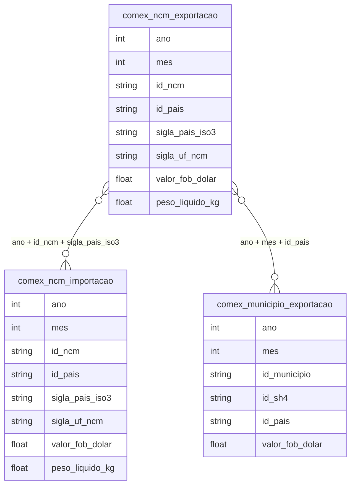

# Comércio Exterior, Integração Global e Cadeias de Valor

## Tabelas usadas

- `br_me_comex_stat.ncm_exportacao`
- `br_me_comex_stat.ncm_importacao`
- `br_me_comex_stat.municipio_exportacao`

**Armadilha (medida em 2026-11-03):** em `ncm_exportacao` e `ncm_importacao`, maio de 2025 está duplicado (cada linha aparece duas vezes; maio soma US$ 60,3 bi de exportação contra ~US$ 30 bi nos meses vizinhos). Os números de 2025 abaixo usam `SELECT DISTINCT *` antes de somar.

## Contexto e Síntese dos Dados

Em 2025 o Brasil exportou 869 milhões de toneladas a US$ 404 por tonelada e importou 188 milhões a US$ 1.497. O superávit de US$ 70 bilhões convive com um déficit de US$ 75 bilhões em máquinas, eletrônicos e veículos.

O Comex Stat, do Ministério do Desenvolvimento, Indústria, Comércio e Serviços, registra cada mercadoria que entra ou sai do país, com o código do produto, o país de origem ou destino, o peso e o valor em dólares. Os números de 2025 mostram uma pauta de exportação de produtos básicos concentrada num único comprador, a China, e uma pauta de importação de bens industriais que vale quase quatro vezes mais por tonelada.

## Revelações Importantes

### 1. Balança comercial: superávit de US$ 70 bilhões

Em 2025 as exportações somaram US$ 351,2 bilhões e as importações, US$ 281,3 bilhões. O saldo de US$ 69,9 bilhões é menor que o de 2024 (US$ 77,3 bilhões) porque as importações cresceram 7%, mais que as exportações (3%).

*Balança comercial brasileira, 2024 e 2025 (Comex Stat/MDIC)*

| Ano | Exportações (US$ bi) | Importações (US$ bi) | Saldo (US$ bi) |
|---|---|---|---|
| 2024 | 339,7 | 262,4 | 77,3 |
| 2025 | 351,2 | 281,3 | 69,9 |

**Conclusão:** O superávit vem dos produtos básicos e paga o déficit industrial. Quando o preço das commodities cai, o saldo encolhe junto.

### 2. Pauta: petróleo, soja e minério são um terço de tudo

Três produtos sem processamento, petróleo bruto (US$ 45,1 bilhões), soja em grão (US$ 43,8 bilhões) e minério de ferro (US$ 28,8 bilhões), responderam por 33,5% das exportações de 2025. Somando café, carne bovina, açúcar, celulose, carne de frango, farelo de soja, milho e algodão, os onze principais produtos básicos chegam a 57,2% da pauta.

*Principais produtos exportados, 2025 (Comex Stat/MDIC)*

| Produto | US$ bilhões | % das exportações | % para a China |
|---|---|---|---|
| Petróleo bruto | 45,1 | 12,9% | 46,3% |
| Soja em grão | 43,8 | 12,5% | 79,4% |
| Minério de ferro | 28,8 | 8,2% | 67,0% |
| Café | 14,9 | 4,2% | 3,1% |
| Carne bovina congelada | 14,4 | 4,1% | 61,2% |
| Açúcar | 14,2 | 4,0% | 13,7% |
| Derivados de petróleo | 11,4 | 3,2% | 1,8% |
| Celulose | 9,2 | 2,6% | 45,0% |

**Conclusão:** Mais da metade do que o Brasil vende ao mundo sai da terra ou do subsolo quase do jeito que foi extraída.

### 3. China: 29% das exportações, 87% delas em cinco produtos

A China comprou US$ 100,9 bilhões do Brasil em 2025, 28,7% das exportações, quase três vezes o que compraram os Estados Unidos (US$ 37,6 bilhões, 10,7%). Do lado das importações, a China vendeu US$ 71,0 bilhões (25,2%). O saldo com a China foi positivo em US$ 29,9 bilhões; com os Estados Unidos, negativo em US$ 7,7 bilhões. Cinco produtos (soja, petróleo, minério de ferro, carne bovina e celulose) somam 87,1% de tudo o que a China compra do Brasil.

*Principais parceiros comerciais, 2025 (Comex Stat/MDIC)*

| País | Exportações (US$ bi) | % das exportações | Importações (US$ bi) | % das importações |
|---|---|---|---|---|
| China | 100,9 | 28,7% | 71,0 | 25,2% |
| Estados Unidos | 37,6 | 10,7% | 45,3 | 16,1% |
| Argentina | 18,2 | 5,2% | 13,0 | 4,6% |
| Países Baixos | 11,6 | 3,3% | — | — |
| Alemanha | — | — | 14,5 | 5,2% |

**Conclusão:** Para a China o Brasil vende cinco produtos. Para a Argentina, o comprador industrial mais próximo, vende de tudo um pouco.

### 4. Valor por tonelada: o que entra vale 3,7 vezes o que sai

Em 2025 o Brasil embarcou 869 milhões de toneladas de mercadorias, a US$ 404 por tonelada em média, e desembarcou 188 milhões de toneladas, a US$ 1.497. A tonelada importada vale 3,7 vezes a exportada. É a forma mais simples de medir o conteúdo tecnológico da pauta: o país despacha volume e compra valor.

*Volume e valor médio por tonelada, 2025 (Comex Stat/MDIC)*

| Fluxo | Milhões de toneladas | US$ por tonelada |
|---|---|---|
| Exportação | 869 | 404 |
| Importação | 188 | 1.497 |

**Conclusão:** Para pagar cada tonelada importada, o Brasil precisa embarcar quase quatro.

### 5. Indústria: déficit de US$ 75 bilhões em máquinas, eletrônicos e veículos

Máquinas e equipamentos mecânicos lideram as importações de 2025, com US$ 47,4 bilhões (16,8%), seguidos por combustíveis (US$ 30,6 bilhões), equipamentos elétricos e eletrônicos (US$ 30,2 bilhões), veículos (US$ 23,5 bilhões) e fertilizantes (US$ 15,5 bilhões). Nos cinco capítulos de bens industriais de maior conteúdo tecnológico (máquinas, eletrônicos, veículos, aeronaves e instrumentos), o Brasil importou US$ 115,2 bilhões e exportou US$ 40,2 bilhões: déficit de US$ 75,0 bilhões, maior que todo o superávit da balança.

*Principais capítulos de importação, 2025 (Comex Stat/MDIC)*

| Capítulo | US$ bilhões | % das importações |
|---|---|---|
| 84 — Máquinas e equipamentos mecânicos | 47,4 | 16,8% |
| 27 — Combustíveis e óleos minerais | 30,6 | 10,9% |
| 85 — Máquinas e aparelhos elétricos | 30,2 | 10,7% |
| 87 — Veículos e partes | 23,5 | 8,3% |
| 31 — Fertilizantes | 15,5 | 5,5% |
| 29 — Químicos orgânicos | 15,0 | 5,3% |

**Conclusão:** O agronegócio exportador depende de fertilizante importado: US$ 15,5 bilhões em 2025, um terço do que rendeu a soja em grão.

## Cruzamentos Poderosos

- **Commodities × pauta:** petróleo, soja e minério são 33,5% das exportações de 2025.
- **China × concentração:** 28,7% das exportações vão para a China, 87% delas em cinco produtos.
- **Valor × tonelada:** a tonelada importada vale 3,7 vezes a exportada.
- **Indústria × déficit:** déficit de US$ 75 bi em máquinas, eletrônicos, veículos, aeronaves e instrumentos.
- **Soja × fertilizante:** US$ 15,5 bi de fertilizante importado contra US$ 43,8 bi de soja exportada.
- **EUA × saldo:** superávit de US$ 29,9 bi com a China e déficit de US$ 7,7 bi com os Estados Unidos.

## Hipóteses explicativas

A teoria da deterioração dos termos de troca, de Prebisch e da CEPAL, descreve a armadilha: países que exportam matéria-prima e importam manufatura precisam vender cada vez mais volume para comprar a mesma quantidade de bens industriais. A abertura comercial dos anos 1990, o câmbio valorizado durante o ciclo das commodities e a demanda chinesa reforçaram a especialização em produtos básicos, nos quais o Brasil tem vantagem natural, enquanto a indústria de transformação perdia peso. A dependência de fertilizantes importados mostra que até a vantagem agrícola se apoia em insumos de fora.

## Implicações para políticas públicas

Diversificar a pauta exige política industrial ligada às próprias cadeias de commodities: esmagamento de soja, siderurgia, celulose de maior valor, refino e química. Acordos comerciais que reduzam a escalada tarifária sobre produtos processados, aplicada por vários importadores, ampliariam o espaço para vender farelo, óleo e carne em vez de grão. Reduzir a dependência de fertilizantes importados é questão de segurança produtiva. E a concentração em um único comprador recomenda abrir mercados na Ásia, no Oriente Médio e na África para os mesmos produtos.
