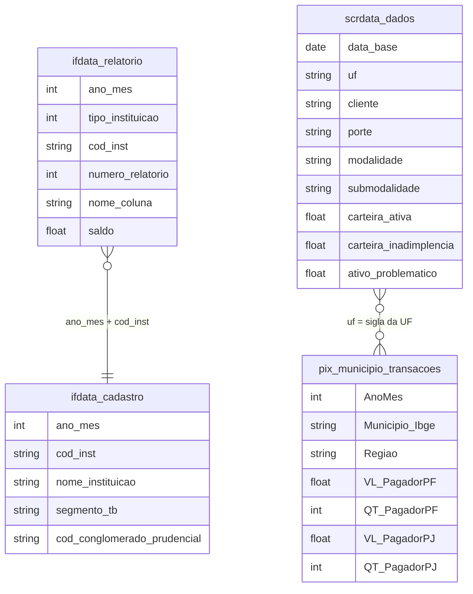

# Mercado Financeiro, Fundos de Investimento e Estrutura de Capital

## Tabelas usadas

- `br_bcb_ifdata.relatorio`
- `br_bcb_ifdata.cadastro`
- `br_bcb_scrdata.dados`
- `br_bcb_pix_municipio.transacoes`

## Contexto e Síntese dos Dados

Cinco bancos detêm 59% dos ativos e 65% do crédito do sistema financeiro. Quem ganha até um salário mínimo atrasa 9,3% do que deve, e quem usa o cheque especial, 15,7%.

O Banco Central publica três retratos do sistema financeiro. O IF.data traz o balanço de cada um dos cerca de 1.400 conglomerados e instituições. O SCR.data mostra a carteira de crédito do país por modalidade, renda do tomador e atraso. As estatísticas do Pix contam, município a município, quanto as pessoas e as empresas transferem. Juntos, eles mostram um mercado bancário concentrado, um crédito às famílias que pesa mais sobre quem ganha menos e uma infraestrutura de pagamento pública que mudou o dia a dia do país em cinco anos.

## Revelações Importantes

### 1. Concentração bancária: cinco conglomerados, 59% dos ativos

Em junho de 2026 o sistema financeiro somava R$ 18,9 trilhões em ativos. Itaú, Banco do Brasil, Caixa, Bradesco e Santander concentravam 58,9% desse total, 64,7% da carteira de crédito e 63,6% das captações. Dois dos cinco são públicos. O BNDES vem em sexto lugar, e o maior banco digital, o Nubank, tem 1,9% dos ativos.

*Maiores conglomerados prudenciais por ativo total, jun/2026 (IF.data/Banco Central)*

| Conglomerado | Ativo total (R$ tri) | % do sistema |
|---|---|---|
| Itaú | 2,85 | 15,0% |
| Banco do Brasil | 2,58 | 13,6% |
| Caixa Econômica Federal | 2,39 | 12,6% |
| Bradesco | 2,02 | 10,6% |
| Santander | 1,31 | 6,9% |
| BNDES | 1,06 | 5,6% |
| BTG Pactual | 0,86 | 4,5% |
| Nubank | 0,36 | 1,9% |

**Conclusão:** Entre 1.400 instituições, cinco ficam com quase dois terços do crédito. A concorrência dos bancos digitais ainda é medida em pontos percentuais de um dígito.

### 2. Crédito às famílias: o consignado atrasa 3,7%, o cheque especial 15,7%

Em julho de 2026 a carteira de crédito somava R$ 7,58 trilhões, R$ 4,67 trilhões com pessoas físicas e R$ 2,91 trilhões com empresas. A inadimplência das famílias (atraso acima de 90 dias) era de 5,8%, quase o dobro da das empresas (3,0%). A diferença entre modalidades é muito maior. No consignado, com desconto em folha, o atraso é de 3,7%; no crédito pessoal sem consignação, de 11,3%; no cheque especial, de 15,7%; no rotativo do cartão, de 14,1%. No financiamento imobiliário, com o imóvel em garantia, fica em 1,3%.

*Carteira de crédito a pessoas físicas e inadimplência por modalidade, jul/2026 (SCR.data/Banco Central)*

| Modalidade | Carteira (R$ bi) | Inadimplência (+90 dias) |
|---|---|---|
| Financiamento imobiliário | 1.410,6 | 1,3% |
| Crédito pessoal consignado | 779,0 | 3,7% |
| Crédito pessoal sem consignação | 373,2 | 11,3% |
| Cartão: fatura parcelada ou saque financiado | 95,7 | 10,7% |
| Cheque especial | 37,4 | 15,7% |
| Rotativo do cartão de crédito | 22,7 | 14,1% |
| Total pessoas físicas | 4.665,9 | 5,8% |

**Conclusão:** As linhas mais caras são as que mais atrasam. Quem recorre ao cheque especial ou ao rotativo em geral já não tem acesso a crédito mais barato.

### 3. Renda e atraso: quem ganha menos atrasa mais

O mesmo cadastro separa o crédito pela renda do tomador. Entre quem ganha até um salário mínimo, 9,3% da dívida está em atraso de mais de 90 dias; entre quem ganha de 1 a 2 salários, 7,7%. A partir de 5 salários mínimos, o atraso fica entre 4% e 6%. Entre os tomadores registrados sem rendimento, chega a 20,3%. A faixa acima de 20 salários mínimos tem a maior carteira, R$ 986 bilhões, mais que as duas faixas até 2 salários somadas (R$ 910 bilhões).

*Carteira de crédito a pessoas físicas e inadimplência por faixa de renda, jul/2026 (SCR.data/Banco Central)*

| Renda do tomador | Carteira (R$ bi) | Inadimplência (+90 dias) |
|---|---|---|
| Sem rendimento | 29,9 | 20,3% |
| Até 1 salário mínimo | 292,2 | 9,3% |
| De 1 a 2 salários mínimos | 618,0 | 7,7% |
| De 2 a 3 salários mínimos | 483,5 | 5,8% |
| De 3 a 5 salários mínimos | 692,9 | 5,1% |
| De 5 a 10 salários mínimos | 858,3 | 4,3% |
| De 10 a 20 salários mínimos | 609,5 | 4,1% |
| Acima de 20 salários mínimos | 985,6 | 5,7% |

**Conclusão:** Quem ganha até um salário mínimo atrasa mais que o dobro do que quem ganha de 5 a 20, e paga juros mais altos justamente por esse risco.

### 4. Pix: de R$ 4,5 trilhões a R$ 29,5 trilhões em quatro anos

Criado pelo Banco Central no fim de 2020, o Pix movimentou R$ 29,5 trilhões em 71,1 bilhões de transações em 2025, considerando só as transações com município identificado. Em 2021, primeiro ano completo, foram R$ 4,5 trilhões. As pessoas físicas fizeram 62,0 bilhões de pagamentos, com valor médio de R$ 189. As empresas fizeram 9,1 bilhões, com valor médio de R$ 1.960, e responderam por 60% do valor.

*Pagamentos via Pix com município identificado, por ano (Banco Central)*

| Ano | Valor (R$ tri) | Transações (bilhões) |
|---|---|---|
| 2021 | 4,52 | 8,0 |
| 2022 | 9,47 | 20,4 |
| 2023 | 14,45 | 36,1 |
| 2024 | 22,12 | 56,3 |
| 2025 | 29,48 | 71,1 |

**Conclusão:** Em quatro anos o número de transações via Pix se multiplicou por nove. Uma infraestrutura pública e gratuita para pessoas físicas tirou dos bancos boa parte da receita com TED, DOC e boleto.

### 5. Pix por região: o Norte paga mais vezes por habitante

Divididos pela população do Censo 2022, os pagamentos de pessoas físicas via Pix em 2025 dão 379 transações por habitante no Norte, 322 no Centro-Oeste, 319 no Nordeste, 298 no Sudeste e 248 no Sul. Nas regiões com menos agências e menos uso de cartão, o Pix virou o meio de pagamento do dia a dia.

*Pagamentos via Pix de pessoas físicas por habitante, 2025 (Banco Central e Censo 2022)*

| Região | Pagamentos PF (bilhões) | Por habitante |
|---|---|---|
| Norte | 6,57 | 379 |
| Centro-Oeste | 5,24 | 322 |
| Nordeste | 17,43 | 319 |
| Sudeste | 25,32 | 298 |
| Sul | 7,41 | 248 |

**Conclusão:** O Pix inverteu o mapa da inclusão financeira: as regiões com menos agências são as que mais o usam por habitante.

## Cruzamentos Poderosos

- **Bancos × concentração:** cinco conglomerados têm 58,9% dos ativos e 64,7% do crédito (jun/2026).
- **Modalidade × atraso:** consignado com 3,7% de inadimplência, cheque especial com 15,7%.
- **Renda × atraso:** 9,3% de inadimplência até 1 salário mínimo, 4,3% de 5 a 10.
- **Famílias × empresas:** inadimplência de 5,8% para pessoas físicas e 3,0% para empresas.
- **Pix × crescimento:** de 8,0 bilhões de transações em 2021 para 71,1 bilhões em 2025.
- **Pix × região:** 379 pagamentos por habitante no Norte, 248 no Sul.

## Hipóteses explicativas

A concentração bancária brasileira resulta de décadas de fusões e da privatização dos bancos estaduais, com a proteção de bancos públicos grandes que nunca disputaram preço com os privados. Com pouca concorrência, o spread se mantém alto e o crédito mais caro chega a quem tem menos garantia. A diferença de inadimplência entre o consignado e o crédito sem garantia mostra que o risco é cobrado de quem não tem folha de pagamento a oferecer. O Pix funciona como contraexemplo: uma infraestrutura pública, aberta a qualquer instituição, derrubou o custo de transferir dinheiro e trouxe concorrentes que o mercado de crédito, sozinho, não trouxe.

## Implicações para políticas públicas

O modelo do Pix, uma infraestrutura pública aberta, pode ser estendido ao crédito: o Open Finance e a portabilidade facilitada permitem que o cliente leve seu histórico de pagamento para outra instituição e consiga juros menores. Limites ao custo do cheque especial e do rotativo, já adotados, precisam de acompanhamento para que o tomador não seja empurrado para modalidades ainda mais caras. Programas de renegociação como o Desenrola aliviam o estoque de dívida, mas não mudam o fluxo; para isso é preciso educação financeira e crédito com garantia acessível às faixas de renda mais baixa.
