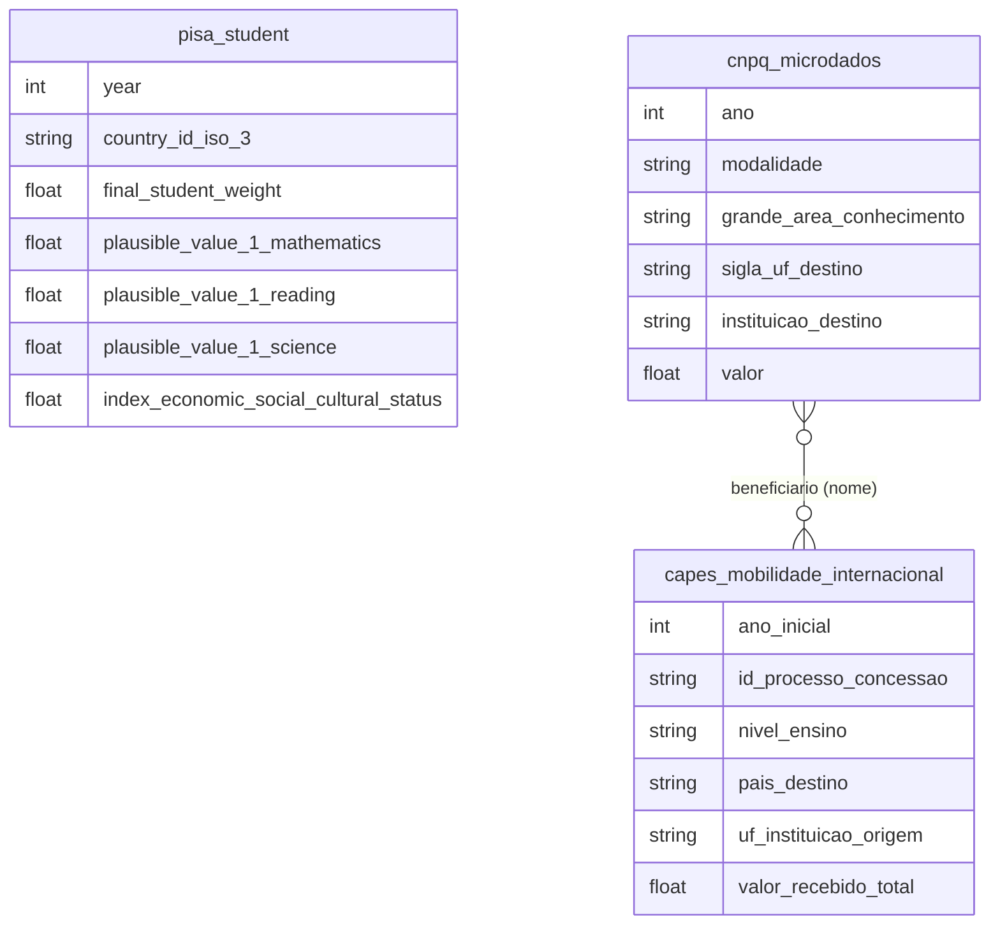

# Ciência, Tecnologia, Bolsas de Estudo e Produção Acadêmica

## Tabelas usadas

- `world_oecd_pisa.student`
- `br_cnpq_bolsas.microdados`
- `br_capes_bolsas.mobilidade_internacional`

## Contexto e Síntese dos Dados

No PISA 2025, 72% dos estudantes brasileiros de 15 anos ficaram abaixo do nível básico em matemática, a mesma média de dez anos atrás. Entre 2015 e 2021 o valor pago em bolsas do CNPq caiu à metade, mesmo sem descontar a inflação.

O PISA, da OCDE, avalia a cada três ou quatro anos estudantes de 15 anos de quase cem países e economias em matemática, leitura e ciências. O CNPq publica cada bolsa de pesquisa paga, com área, instituição e estado. A CAPES registra as bolsas de mobilidade internacional, inclusive as do Ciência sem Fronteiras. Juntas, as três fontes mostram uma educação básica estagnada no fundo da escala internacional e um financiamento à pesquisa que encolheu, se concentrou no Sudeste e oscilou ao sabor de programas que começam e acabam.

## Revelações Importantes

### 1. PISA: dez anos no mesmo lugar

A média brasileira em matemática foi de 377 pontos em 2015, 383 em 2018, 379 em 2022 e 377 em 2025. Leitura e ciências seguem o mesmo padrão, com oscilações de poucos pontos, dentro da margem de erro da prova. A pandemia, que derrubou as notas de muitos países em 2022, quase não mexeu na do Brasil, que já estava perto do piso.

*Médias do Brasil no PISA (OCDE, microdados ponderados)*

| Edição | Matemática | Leitura | Ciências |
|---|---|---|---|
| 2015 | 377 | 407 | 401 |
| 2018 | 383 | 413 | 404 |
| 2022 | 379 | 410 | 403 |
| 2025 | 377 | 408 | 409 |

**Conclusão:** Em dez anos e quatro edições, o Brasil não saiu do lugar em matemática.

### 2. 72% abaixo do básico em matemática, 71º lugar entre 90

O nível 2 de matemática é o patamar que a OCDE considera mínimo para resolver problemas simples do dia a dia. Em 2025, 71,6% dos estudantes brasileiros ficaram abaixo dele (73,4% em 2022, 70,0% em 2015). Na média de matemática, o Brasil ficou em 71º entre 90 países e economias, atrás de Uruguai (404), Chile (403), México (388), Peru (382) e Colômbia (381), e à frente da Argentina (367).

*Média em matemática no PISA 2025, países selecionados (OCDE)*

| País | Média |
|---|---|
| Singapura | 563 |
| Coreia do Sul | 523 |
| Estados Unidos | 463 |
| Portugal | 460 |
| Uruguai | 404 |
| Chile | 403 |
| México | 388 |
| Peru | 382 |
| Colômbia | 381 |
| Brasil | 377 |
| Argentina | 367 |

**Conclusão:** Sete em cada dez brasileiros de 15 anos não chegam ao mínimo em matemática. A ciência do país recruta seus pesquisadores entre os três restantes.

### 3. Bolsas do CNPq: metade do valor em seis anos

O CNPq pagou R$ 2,64 bilhões em bolsas em 2015. Em 2019 foram R$ 1,37 bilhão, e em 2021, R$ 1,18 bilhão: uma queda de 55% em valores nominais, sem descontar a inflação do período. O valor voltou a subir em 2022, para R$ 1,70 bilhão, ainda 36% abaixo de 2015.

*Valor pago em bolsas pelo CNPq, valores nominais (CNPq)*

| Ano | R$ bilhões |
|---|---|
| 2015 | 2,64 |
| 2016 | 2,07 |
| 2017 | 1,48 |
| 2018 | 1,46 |
| 2019 | 1,37 |
| 2020 | 1,30 |
| 2021 | 1,18 |
| 2022 | 1,70 |

**Conclusão:** Em seis anos o principal financiador de bolsas de pesquisa do país passou a pagar menos da metade, e isso antes de descontar a inflação.

### 4. Onde vai o dinheiro: 52% para o Sudeste, 3,6% para o Norte

Em 2022 as instituições do Sudeste receberam 52,2% do valor das bolsas do CNPq, para 41,8% da população. O Norte, com 8,5% da população e a maior biodiversidade do país, ficou com 3,6%. O Nordeste, com 26,9% da população, recebeu 15,5%. A distribuição acompanha a localização das universidades e dos programas de pós-graduação mais antigos.

*Valor das bolsas do CNPq por região da instituição de destino, 2022 (CNPq e Censo 2022)*

| Região | R$ milhões | % das bolsas | % da população |
|---|---|---|---|
| Sudeste | 886,2 | 52,2% | 41,8% |
| Sul | 315,5 | 18,6% | 14,7% |
| Nordeste | 263,3 | 15,5% | 26,9% |
| Centro-Oeste | 130,5 | 7,7% | 8,0% |
| Norte | 60,8 | 3,6% | 8,5% |

**Conclusão:** Por habitante, o Sudeste recebe três vezes mais em bolsas do CNPq que o Norte.

### 5. Por área: biológicas, exatas e engenharias levam mais da metade

Em 2022 as ciências biológicas receberam 19,6% do valor das bolsas, as exatas e da terra 17,6% e as engenharias 16,9%. Somadas a saúde (13,2%) e as agrárias (11,1%), as áreas de ciência natural e tecnologia ficaram com 78%. Humanas, sociais aplicadas e letras somaram 15,8%.

*Valor das bolsas do CNPq por grande área do conhecimento, 2022 (CNPq)*

| Grande área | R$ milhões | % |
|---|---|---|
| Ciências biológicas | 333,4 | 19,6% |
| Ciências exatas e da terra | 298,9 | 17,6% |
| Engenharias | 287,5 | 16,9% |
| Ciências da saúde | 224,7 | 13,2% |
| Ciências agrárias | 188,9 | 11,1% |
| Ciências humanas | 152,7 | 9,0% |
| Ciências sociais aplicadas | 77,1 | 4,5% |
| Linguística, letras e artes | 38,4 | 2,3% |

**Conclusão:** Quatro de cada cinco reais das bolsas do CNPq vão para ciências naturais, saúde e engenharia.

### 6. Ciência sem Fronteiras: de 28 mil bolsas a 2 mil em dois anos

As bolsas de mobilidade internacional da CAPES passaram de 3.010 iniciadas em 2010 para 28.564 em 2014, no auge do programa Ciência sem Fronteiras, e caíram para 2.301 em 2016, uma queda de 92% em dois anos. Entre 2005 e 2019 foram 98 mil bolsas, 56,5% delas de graduação sanduíche. Os Estados Unidos receberam 32,5% dos bolsistas, seguidos por França (14,4%), Alemanha (8,1%) e Portugal (6,7%).

*Bolsas de mobilidade internacional da CAPES por ano de início (CAPES)*

| Ano | Bolsas iniciadas |
|---|---|
| 2010 | 3.010 |
| 2012 | 9.398 |
| 2013 | 19.259 |
| 2014 | 28.564 |
| 2015 | 14.586 |
| 2016 | 2.301 |
| 2019 | 4.034 |

**Conclusão:** Em dois anos o país passou de quase 29 mil bolsas de intercâmbio para pouco mais de 2 mil. Política científica feita por programa, não por carreira.

## Cruzamentos Poderosos

- **PISA × estagnação:** 377 pontos em matemática em 2015 e em 2025.
- **PISA × nível básico:** 71,6% abaixo do nível 2 em matemática em 2025.
- **PISA × América Latina:** o Brasil fica atrás de Uruguai, Chile, México, Peru e Colômbia.
- **CNPq × orçamento:** de R$ 2,64 bi em 2015 para R$ 1,18 bi em 2021, em valores nominais.
- **CNPq × região:** Sudeste com 52% das bolsas e 42% da população; Norte com 3,6% e 8,5%.
- **CAPES × descontinuidade:** bolsas de mobilidade caíram 92% entre 2014 e 2016.

## Hipóteses explicativas

O desempenho no PISA reflete a desigualdade da escola básica brasileira: a média nacional mistura redes estaduais e municipais com recursos muito diferentes, e a pouca mudança em dez anos sugere que as reformas não chegaram à sala de aula. No financiamento à pesquisa, o teto de gastos aprovado em 2016 e os contingenciamentos seguintes caíram sobre despesas discricionárias como bolsas, sem proteção legal. A concentração regional acompanha a distribuição histórica das universidades e dos programas mais bem avaliados, que atraem mais bolsas e reforçam a vantagem. O Ciência sem Fronteiras mostra o risco de políticas de grande escala sem orçamento garantido: cresceu rápido e foi cortado de uma vez.

## Implicações para políticas públicas

Na educação básica, metas de aprendizagem por rede e apoio técnico às redes com pior desempenho atacam o ponto em que a média nacional emperra. No financiamento à ciência, proteger as bolsas de contingenciamento e corrigir seus valores pela inflação daria previsibilidade a quem escolhe a carreira de pesquisador. Editais com cota regional e apoio à formação de grupos no Norte e no Nordeste reduzem a concentração sem tirar recursos dos centros consolidados. E programas de mobilidade internacional funcionam melhor quando são permanentes e ligados a programas de pós-graduação, não a ciclos de governo.
