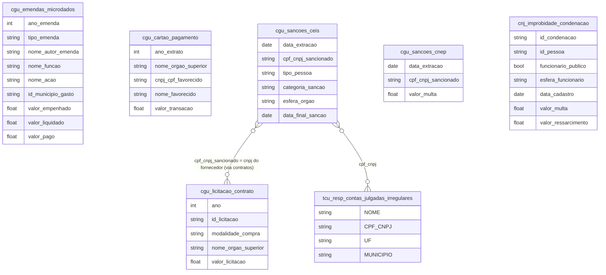

# Corrupção, Improbidade Administrativa e Controle Público

## Tabelas usadas

- `br_cgu_emendas_parlamentares.microdados`
- `br_cgu_cartao_pagamento.microdados_governo_federal`
- `br_cgu_licitacao_contrato.licitacao`
- `br_cgu_sancoes.ceis`
- `br_cgu_sancoes.cnep`
- `br_cgu_sancoes.acordos_leniencia`
- `br_cnj_improbidade_administrativa.condenacao`
- `br_tcu_inidoneos.resp_contas_julgadas_irregulares`
- `br_tcu_inidoneos.resp_contas_julgadas_irreg_implicacao_eleitoral`
- `br_tcu_inidoneos.inabilitados_funcao_publica`
- `br_tcu_inidoneos.empresas`

## Contexto e Síntese dos Dados

Até 2021, menos da metade do valor empenhado em emendas parlamentares era liquidado no próprio ano. Em 2025, R$ 7 bilhões foram em transferências especiais, as "emendas Pix", que chegam ao município sem destino definido. Hoje 14 mil pessoas e empresas estão proibidas de contratar com o poder público.

A Controladoria-Geral da União publica cada emenda parlamentar, com autor, função, ação e execução, e mantém os cadastros de empresas e pessoas punidas (CEIS e CNEP) e os acordos de leniência. O Tribunal de Contas da União lista quem teve as contas julgadas irregulares e as empresas declaradas inidôneas, e o Conselho Nacional de Justiça reúne as condenações por improbidade administrativa. Juntas, essas fontes mostram como o dinheiro público é decidido, onde a transparência falha e quanto da punição de fato chega a quem desviou.

## Revelações Importantes

### 1. Execução orçamentária: quanto sobra nos restos a pagar?

Ano após ano, o governo empenha muito mais do que efetivamente liquida. Em 2019, apenas 44% do valor empenhado virou despesa liquidada; mesmo nos anos mais recentes, com taxas de execução melhores, ainda sobra entre 30% e 40% do orçamento autorizado sem execução completa. Essa diferença não desaparece — ela se acumula como "restos a pagar", uma reserva de gasto que pode ser usada em anos seguintes sem passar de novo pelo crivo do Congresso.

*Execução orçamentária das emendas parlamentares, 2018-2025*

| Ano | Empenhado (R$ bi) | Liquidado (R$ bi) | Taxa de Execução |
|---|---|---|---|
| 2018 | 12,0 | 5,6 | 46% |
| 2019 | 13,9 | 6,1 | 44% |
| 2020 | 37,5 | 18,2 | 49% |
| 2021 | 33,4 | 16,0 | 48% |
| 2022 | 25,5 | 17,2 | 68% |
| 2023 | 35,4 | 22,1 | 62% |
| 2024 | 44,8 | 31,5 | 70% |
| 2025 | 47,1 | 31,7 | 67% |

**Conclusão:** Até 2021, menos da metade do valor empenhado em emendas era liquidado no próprio ano. O restante vira restos a pagar e é executado depois, fora do ciclo de votação do orçamento.

### 2. Concentração das emendas: quem controla o Orçamento?

Três comissões parlamentares e o relator geral do Orçamento, juntos, decidem o destino de mais de R$ 30 bilhões em emendas. Só a Comissão da Saúde, com apenas 10 emendas, movimenta R$ 9,6 bilhões — quase R$ 1 bilhão por emenda em média. Esse volume de recursos concentrado em pouquíssimas mãos supera o orçamento anual de vários estados brasileiros inteiros.

*Concentração de emendas por autor*

| Autor | Emendas | Valor Total (R$ bi) | Valor Médio |
|---|---|---|---|
| COM. DA SAÚDE | 10 | R$ 9,6 bi | R$ 956 mi |
| COM. DESENV. REGIONAL | 12 | R$ 8,6 bi | R$ 720 mi |
| RELATOR GERAL | 23 | R$ 8,6 bi | R$ 375 mi |
| COM. ASSUNTOS SOCIAIS | 8 | R$ 3,2 bi | R$ 399 mi |

**Conclusão:** Três comissões e um relator geral controlam sozinhos R$ 30 bilhões em emendas — mais do que todo o orçamento anual de diversos estados brasileiros.

### 3. Emendas do Relator Geral: saúde em primeiro

Uma única ação orçamentária — o incremento temporário à Atenção Primária, decidido pelo relator geral do Orçamento — recebe quase R$ 4 bilhões, valor próximo ao de um mês inteiro do Bolsa Família em todo o país. As demais ações financiadas pelo relator, como o SUAS e o desenvolvimento local integrado, ficam com frações bem menores desse montante, evidenciando o quanto uma única decisão individual pode direcionar somas orçamentárias colossais.

*Distribuição das emendas do Relator Geral por ação*

| Ação | Valor (R$ bi) |
|---|---|
| Incremento temporário à Atenção Primária | R$ 3,98 bi |
| Fortalecimento SUAS | R$ 0,96 bi |
| Desenvolvimento local integrado | R$ 0,17 bi |
| Infraestrutura educação básica | R$ 0,15 bi |
| Rede de Atenção Primária | R$ 0,12 bi |

**Conclusão:** Uma única ação de saúde decidida pelo relator geral recebe cerca de R$ 4 bilhões — quase o equivalente a um mês inteiro de Bolsa Família para todo o país.

### 4. Emendas Pix: R$ 7 bilhões sem destino definido

Em 2025 as emendas parlamentares empenharam R$ 47,1 bilhões. As emendas individuais com finalidade definida somaram R$ 17,3 bilhões, as de bancada R$ 11,6 bilhões e as de comissão R$ 11,2 bilhões. Outros R$ 7,0 bilhões foram em transferências especiais, as chamadas emendas Pix: o dinheiro cai direto no caixa do município ou do estado, sem convênio e sem projeto vinculado. O Supremo Tribunal Federal passou a exigir plano de trabalho e conta específica para essas transferências a partir de 2024, porque o caminho do dinheiro se perdia depois do repasse.

*Valor empenhado em emendas parlamentares por tipo, 2025 (CGU)*

| Tipo de emenda | R$ bilhões | % |
|---|---|---|
| Individual, transferência com finalidade definida | 17,3 | 36,7% |
| De bancada | 11,6 | 24,6% |
| De comissão | 11,2 | 23,8% |
| Individual, transferência especial ("emenda Pix") | 7,0 | 14,9% |
| Total | 47,1 | 100% |

**Conclusão:** Um em cada sete reais de emenda em 2025 foi transferido sem projeto vinculado. Fiscalizar esse dinheiro depende de cada prefeitura prestar contas.

### 5. Concentração setorial das emendas

Mais da metade de todo o valor de emendas parlamentares — 51,8%, ou R$ 79,2 bilhões — vai para a função Saúde. Assistência Social, área que atende diretamente a população mais vulnerável, recebe apenas 2,6% do total, cerca de quinze vezes menos que Encargos Especiais. A distribuição por função revela onde o Congresso escolhe concentrar poder de barganha político, e essa escolha nem sempre reflete as áreas de maior carência social.

*Distribuição das emendas parlamentares por função orçamentária*

| Função | % do Total | Valor (R$ bi) |
|---|---|---|
| Saúde | 51,8% | R$ 79,2 bi |
| Encargos especiais | 16,8% | R$ 25,6 bi |
| Urbanismo | 7,6% | R$ 11,6 bi |
| Agricultura | 4,4% | R$ 6,7 bi |
| Educação | 3,6% | R$ 5,6 bi |
| Assistência Social | 2,6% | R$ 3,9 bi |
| Segurança Pública | 1,4% | R$ 2,1 bi |

**Conclusão:** Mais da metade de todas as emendas parlamentares vai para a saúde; Assistência Social, que atende os mais vulneráveis, recebe quinze vezes menos do que Encargos Especiais.

### 6. Metade do valor do cartão corporativo é gasta sem dizer para quem

O Portal da Transparência publica cada transação do Cartão de Pagamento do Governo Federal desde 2013: 1.666.696 operações somando R$ 820,1 milhões. Publicar, porém, não é o mesmo que revelar. Em 18,9% das transações o campo de favorecido vem preenchido como "Sigiloso" — e como as transações sigilosas são muito maiores que a média, elas representam 49,5% de todo o valor gasto. Ou seja, metade do dinheiro do cartão corporativo federal é publicada sem que se saiba quem recebeu. A opacidade não está distribuída: Presidência da República (98,6% do valor sigiloso) e Ministério da Justiça e Segurança Pública (86,0%) concentram quase tudo, enquanto Educação, Saúde, Planejamento e Agricultura declaram 0,0%.

*Cartão de Pagamento do Governo Federal por órgão superior (CGU, 2013-2025)*

| Órgão superior | Valor total | % do valor sigiloso |
|---|---|---|
| Presidência da República | R$ 227,8 mi | 98,6% |
| Ministério da Justiça e Segurança Pública | R$ 205,1 mi | 86,0% |
| Ministério da Fazenda | R$ 20,4 mi | 22,3% |
| Ministério da Defesa | R$ 71,6 mi | 0,2% |
| Ministério do Planejamento e Orçamento | R$ 81,6 mi | 0,0% |
| Ministério da Educação | R$ 78,4 mi | 0,0% |
| Ministério da Saúde | R$ 20,4 mi | 0,0% |

**Conclusão:** Os dois maiores gastadores do cartão corporativo respondem por metade do valor e ocultam o favorecido em quase toda ele — enquanto ministérios que gastam quantias comparáveis publicam 100% dos destinatários.

### 7. Três em cada quatro compras dispensam licitação — mas somam 4% do dinheiro

Contar processos de compra pública e contar dinheiro de compra pública produzem retratos opostos, e usar só o primeiro leva a conclusão errada. Entre 2020 e 2023, 60,5% dos processos federais foram dispensa de licitação e 14,6% inexigibilidade — ou seja, três em cada quatro compras foram feitas sem disputa. O alarme, porém, se dissolve no valor: dispensa e inexigibilidade somadas movimentaram R$ 154,4 bilhões, contra R$ 3,69 trilhões dos pregões. Traduzido, 75,1% dos processos correspondem a 4,0% do dinheiro. A dispensa é o instrumento da compra pequena e recorrente; o pregão eletrônico, com disputa aberta, é por onde passa 95,4% do gasto. Quem quiser auditar risco deve olhar o valor, não a contagem.

*Compras do governo federal por modalidade, 2020-2023 (CGU)*

| Modalidade | % dos processos | Valor | % do valor |
|---|---|---|---|
| Dispensa de licitação | 60,5% | R$ 83,0 bi | 2,1% |
| Inexigibilidade | 14,6% | R$ 71,4 bi | 1,8% |
| Pregão — registro de preço | 14,6% | R$ 3.619,8 bi | 93,5% |
| Pregão | 9,7% | R$ 71,5 bi | 1,8% |
| Concorrência e demais | 0,5% | R$ 25,2 bi | 0,7% |

**Conclusão:** Dispensa e inexigibilidade dominam a contagem de processos e quase somem no valor — o dinheiro grande passa por pregão com disputa aberta.

### 8. Sanções: 14 mil punidos proibidos de contratar com o poder público

O Cadastro de Empresas Inidôneas e Suspensas (CEIS) reunia, em outubro de 2026, 19.151 sanções contra 7.277 empresas e 6.982 pessoas físicas. Três em cada quatro são impedimentos de contratar por prazo determinado, aplicados sobretudo por estados (8.931) e pela União (6.442). O Cadastro Nacional de Empresas Punidas (CNEP), da Lei Anticorrupção, tinha 1.630 sanções e R$ 2,74 bilhões em multas. O cadastro registra ainda 52 acordos de leniência com empresas que confessaram atos lesivos.

*Sanções vigentes no CEIS por categoria, out/2026 (CGU)*

| Categoria | Sanções |
|---|---|
| Impedimento de contratar, com prazo | 14.373 |
| Suspensão | 2.008 |
| Inidoneidade sem prazo determinado | 1.383 |
| Inidoneidade com prazo determinado | 1.147 |
| Impedimento de contratar, sem prazo | 152 |
| Demissão | 61 |
| Total (inclui outras categorias) | 19.151 |

**Conclusão:** A punição mais comum é temporária: três em cada quatro sanções vencem, e a empresa volta a poder disputar contratos.

### 9. Improbidade: 53 mil condenações, R$ 9,3 bilhões a ressarcir

O Cadastro Nacional de Condenações por Improbidade Administrativa, do CNJ, reunia 53.342 condenações de 41.558 pessoas cadastradas entre 2009 e fevereiro de 2024. O registro cresceu de cerca de 1.400 por ano até 2015 para mais de 9 mil em 2023. Das condenações, 20.069 (38%) atingiram servidores públicos, 83% deles municipais. As sentenças somam R$ 9,27 bilhões em ressarcimento ao erário, R$ 3,77 bilhões em multas e R$ 1,13 bilhão em perda de bens, depois de descartados valores de preenchimento impossíveis, como R$ 888 bilhões.

*Condenações por improbidade administrativa cadastradas por ano (CNJ)*

| Ano de cadastro | Condenações |
|---|---|
| 2015 | 1.562 |
| 2017 | 3.334 |
| 2019 | 4.487 |
| 2020 | 5.207 |
| 2021 | 4.630 |
| 2022 | 8.705 |
| 2023 | 9.136 |

**Conclusão:** Oito em cada dez servidores condenados por improbidade são municipais. É na prefeitura que o controle chega por último.

### 10. TCU: 48 mil contas julgadas irregulares

O Tribunal de Contas da União mantém 48.249 registros de responsáveis com contas julgadas irregulares, 9.340 deles com implicação eleitoral: quem está nessa lista pode ter a candidatura barrada pela Lei da Ficha Limpa. Outros 850 estão inabilitados para exercer cargo em comissão ou função de confiança, e 123 empresas foram declaradas inidôneas para licitar com a União.

*Listas de responsáveis e empresas punidos pelo TCU, out/2026 (TCU)*

| Lista | Registros |
|---|---|
| Contas julgadas irregulares | 48.249 |
| Contas irregulares com implicação eleitoral | 9.340 |
| Inabilitados para função pública | 850 |
| Empresas inidôneas | 123 |

**Conclusão:** A lista do TCU com implicação eleitoral é o elo entre o controle de contas e a urna: 9.340 nomes que a Justiça Eleitoral precisa conferir a cada registro de candidatura.

## Cruzamentos Poderosos

- **Emendas × Execução:** até 2021 menos da metade do empenhado era liquidado no ano; em 2024-2025, cerca de dois terços.
- **Relator × Concentração:** três comissões e o relator geral concentraram R$ 30 bilhões em emendas.
- **Emendas Pix × Rastreabilidade:** R$ 7,0 bi em transferências especiais em 2025, sem projeto vinculado.
- **Cartão corporativo × Sigilo:** 18,9% das transações são sigilosas, mas 49,5% do valor.
- **Processo × Valor:** 75,1% das compras dispensam licitação, mas correspondem a 4,0% do dinheiro.
- **Sanção × Prazo:** 75% das 19 mil sanções do CEIS são impedimentos temporários.
- **Improbidade × Município:** 83% dos servidores condenados por improbidade são municipais.
- **TCU × Eleição:** 9.340 responsáveis com contas irregulares e implicação eleitoral.

## Hipóteses explicativas

A expansão das emendas parlamentares, de R$ 12 bilhões em 2018 para R$ 47 bilhões em 2025, deslocou parte da decisão sobre o gasto do Executivo para o Congresso, e com ela a negociação política passou a se dar em torno de recursos executados nos municípios. As transferências especiais e as emendas de relator mostram que, quando o desenho reduz a rastreabilidade, o dinheiro cresce mais depressa que o controle. Na ponta da punição, a maior parte das sanções é temporária e as condenações por improbidade se concentram em servidores municipais, onde a fiscalização dos tribunais de contas e do Ministério Público chega primeiro, mas onde estão as menores somas.

## Implicações para políticas públicas

Exigir de cada emenda, inclusive as transferências especiais, um plano de trabalho público e conta bancária específica permite seguir o dinheiro até o fornecedor final. Cruzar o CEIS, o CNEP e as listas do TCU com os contratos e com os registros de candidatura, de forma automática e aberta, impede que empresas e pessoas punidas voltem a contratar ou a se candidatar por falta de checagem. Reduzir o sigilo do cartão corporativo às despesas de fato ligadas à segurança aproxima o que é publicado do que é revelado. E publicar o cadastro do CNJ com atualização contínua, já que a versão disponível termina em fevereiro de 2024, daria à sociedade o retrato atual de quem foi condenado.
