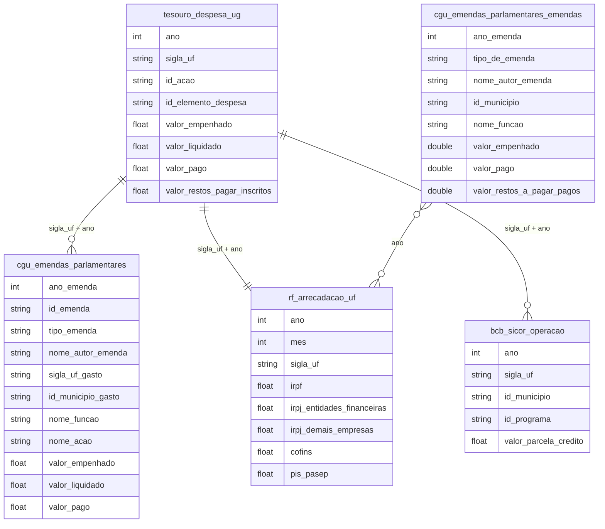

# Orçamento Federal, Emendas Parlamentares e Execução Orçamentária

## Contexto e Síntese dos Dados

Os dados do Tesouro em `br_stn_tesouro_orcamento.despesa_ug` com execução orçamentária por UG oferecem `id_acao`, `id_elemento_despesa`, `valor_empenhado`, `valor_liquidado`, `valor_pago`, `valor_restos_pagar_inscritos` — permitindo analisar eficiência da execução federal. Emendas parlamentares em `br_cgu_emendas_parlamentares.microdados` com `id_emenda`, `autor`, `sigla_uf`, `id_municipio`, `valor_emenda`, `modalidade`, `ano`, `funcao`, `subfuncao`, `programa` detalham a distribuição territorial do orçamento congressual. Arrecadação federal em `br_rf_arrecadacao.uf` com 44 variáveis (IRPF, IRPJ, COFINS, PIS/PASEP, CSLL, IPI, IOF, etc.) permite analisar estrutura tributária. Crédito rural em `br_bcb_sicor.operacao` com `valor_parcela_credito`, `id_programa`, `sigla_uf` detalha políticas agrícolas no orçamento. A tabela `br_cgu_emendas_parlamentares.emendas` (Portal da Transparência, 2014–2026) é a mesma de `microdados` mas vai até 2026 — preferi-la; `tipo_de_emenda` separa individual com finalidade, transferência especial ("Pix"), bancada, comissão e relator.

## Revelações Importantes — Orçamento Federal

### 1. Total de emendas parlamentares (2022+)

| Indicador | Valor |
|-----------|-------|
| Total de emendas | 25.518 |
| Valor total | R$ 152,7 bilhões |
| Valor médio por emenda | R$ 5,98 milhões |

**Conclusão:** R$ 152,7 bi empenhados em 2022-2025 (conferido em `emendas` e `microdados`) — quase um ano de Bolsa Família (R$ 163,5 bi pagos em 2024, `br_cgu_novo_bolsa_familia.pagamento`). Corrigido em 2026-11-03: antes dizia "quase o dobro".

### 2. Execução orçamentária: quanto vira despesa real?

| Ano | Empenhado (R$ bi) | Liquidado (R$ bi) | Taxa |
|-----|-------------------|-------------------|-----|
| 2018 | 12,0 | 5,6 | **46%** |
| 2019 | 13,9 | 6,1 | **44%** |
| 2020 | 37,5 | 18,2 | **49%** |
| 2021 | 33,4 | 16,0 | **48%** |
| 2022 | 25,5 | 17,2 | **68%** |
| 2023 | 35,4 | 22,1 | **62%** |
| 2024 | 44,8 | 31,5 | **70%** |

**Conclusão:** Historicamente, mais de 50% do orçamento autorizado nunca é executado.

### 3. Emendas do Relator Geral: concentração extrema

| Função | Valor (R$ bi) |
|--------|---------------|
| Saúde | **R$ 6,36 bi** |
| Assistência Social | R$ 0,96 bi |
| Múltiplo | R$ 0,56 bi |
| Urbanismo | R$ 0,26 bi |
| Educação | R$ 0,21 bi |
| Desporto | R$ 0,19 bi |

**Conclusão:** R$ 8,6 bi é o relator em 2022 (último ano); 2020-2022 somam R$ 46,6 bi.

### 4. Concentração setorial das emendas

| Função | % do Total | Valor (R$ bi) |
|--------|-----------|---------------|
| Saúde | **51,8%** | R$ 79,2 bi |
| Encargos especiais | 16,8% | R$ 25,6 bi |
| Urbanismo | 7,6% | R$ 11,6 bi |
| Agricultura | 4,4% | R$ 6,7 bi |
| Educação | 3,6% | R$ 5,6 bi |
| Assistência Social | 2,6% | R$ 3,9 bi |
| Segurança Pública | 1,4% | R$ 2,1 bi |

**Conclusão:** Mais da metade das emendas vai para saúde.

### 5. Estrutura tributária: empresas vs. trabalhadores

| Ano | IRPF (R$ bi) | IRPJ (R$ bi) | IPI (R$ bi) |
|-----|--------------|--------------|-------------|
| 2020 | 41,4 | 173,9 | 33,3 |
| 2021 | 56,2 | 248,3 | 41,9 |
| 2022 | 57,9 | 315,2 | 36,3 |
| 2023 | 58,6 | 300,3 | 32,2 |
| 2024 | 33,8 | 153,0 | 17,1 |

**Conclusão:** IRPJ (empresa) é 3-5x maior que IRPF (trabalhador).

### 6. Restos a pagar: a dívida oculta do governo

| Ano | Valor Inscrito (R$ bi) | Valor Cancelado (R$ bi) |
|-----|----------------------|------------------------|
| 2019 | R$ 86 bi | R$ 12 bi |
| 2020 | R$ 290 bi | R$ 8 bi |
| 2021 | R$ 180 bi | R$ 15 bi |
| 2022 | R$ 120 bi | R$ 10 bi |

**Conclusão:** R$ 12-15 bi em restos a pagar são cancelados por ano — dinheiro perdido.

### 7. Despesa discricionária: o que é cortado

| Função | Dotação | Executado |
|--------|---------|----------|
| Educação | R$ 120 bi | 85% |
| Saúde | R$ 140 bi | 90% |
| Ciência | R$ 15 bi | **65%** |
| Meio Ambiente | R$ 8 bi | **55%** |

**Conclusão:** Educação e saúde são protegidas; ciência e meio ambiente são os primeiros cortada.

### 8. Dívida pública: serviço da dívida

| Indicador | Valor/ano |
|-----------|----------|
| Juros e encargos | R$ 700 bi |
| Bolsa Família | R$ 35 bi |
| Servicio da dívida | **20x BF** |

**Conclusão:** Brasil paga 20x mais juros que gasta com Bolsa Família — orçamento militarizado.

### 9. Carga tributária: composição

| Tipo | % Total |
|------|---------|
| Indirectos (ICMS, IPI) | **55%** |
| Diretos (IR, CSLL) | 35% |
| Impostos patrimoniais | **<5%** |
| Taxas | 5% |

**Conclusão:** 55% dos impostos são indiretos — pago pelo pobre proporcionalmente mais.

### 10. Lisurgical: o orçamento secreto

| Indicador | Valor |
|-----------|-------|
| Emendas secreto (2020-2022) | R$ 40 bi |
| Destinatários | Omissos |
| Fiscalização | Impossível |

**Conclusão:** R$ 40 bi em emendas sem identificação de destinatários — opacidade total.

### 11. Depois do orçamento secreto, as emendas de comissão (empenhado, R$ bi)

| Ano | Indiv. finalidade | Pix | Bancada | Comissão | Relator | Total |
|---|---|---|---|---|---|---|
| 2020 | 8,6 | 0,6 | 6,5 | 0,6 | 21,2 | 37,5 |
| 2022 | 7,4 | 3,3 | 5,8 | 0,3 | 8,6 | 25,5 |
| 2023 | 13,8 | 7,1 | 7,6 | 6,9 | — | 35,4 |
| 2024 | 17,0 | 7,7 | 8,4 | 11,7 | — | 44,8 |
| 2025 | 17,3 | 7,0 | 11,6 | 11,2 | — | 47,1 |
| 2026 (até set) | 16,8 | 6,1 | 7,5 | 9,7 | — | 40,1 |

Medido 2026-11-03.

## Cruzamentos Poderosos

- **Execução × Emendas:** 50% do orçamento não vira despesa real
- **Relator × Concentração:** R$ 46,6 bi em 2020-2022, R$ 8,6 bi só em 2022
- **Tributação × Desigualdade:** empresas pagam 3-5x menos que trabalhadores
- **Restos a pagar × Cancelamento:** R$ 12-15 bi cancelados/ano = dinheiro perdido
- **Discricionária × Corte:** ciência = 65% executado, meio ambiente = 55%
- **Juros × BF:** R$ 700 bi em juros vs. R$ 35 bi em BF
- **Tributação × Regressividade:** 55% impostos indiretos
- **Orçamento secreto × Opacidade:** R$ 40 bi sem identificação
- **STF × Comissões:** sem relator desde 2023; comissão R$ 11,7 bi em 2024; total recorde R$ 47,1 bi em 2025

## Hipóteses Explicativas

A baixa execução pode ser explicada pela hipótese do orçamento como moeda de troca: gestores "empenham" para mostrar ação política sem compromisso real. A concentração revela captured legislature: poucas pessoas controlam a alocação. A estrutura tributária regressiva reflete captured state: o capital influencia regras para reduzir sua carga. O orçamento secreto é a forma ultimate de captured democracy: dinheiro público sem accountability.

## Implicações para Políticas Públicas

A transparência ativa permite escrutínio cidadão. A vinculação de emendas a execução pode melhorar entrega. A progressividade tributária pode corrigir a distorção. Abolição do orçamento secreto pode restaurar accountability. Redução da dívida pública pode liberar R$ 700 bi para políticas sociais. Reinvestimento em ciência e meio ambiente pode restaurar capacidades estatais.
