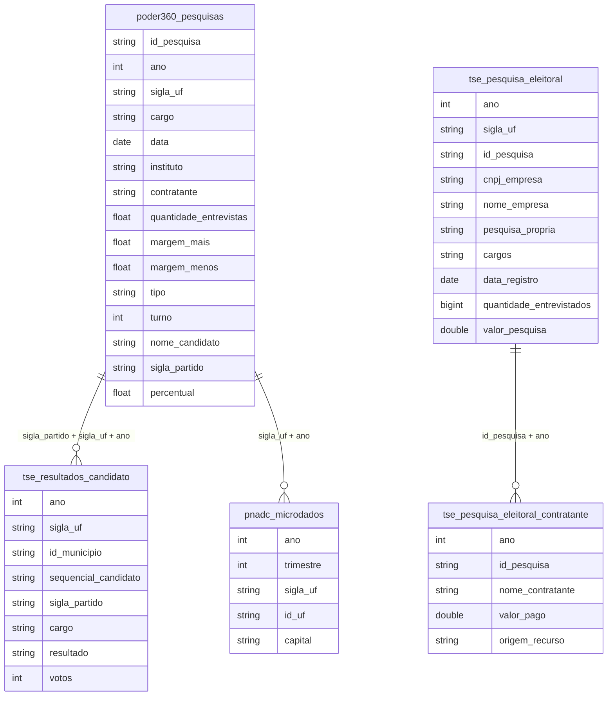

# Pesquisas de Opinião, Percepção Pública e Comportamento Político

## Contexto e Síntese dos Dados

Os dados do Poder360 em `br_poder360_pesquisas.microdados` com pesquisas eleitorais oferecem `tipo` (estimulada, não estimulada, espontânea), `cargo`, `candidato`, `sigla_partido`, `intencao_voto`, `instituto`, `data`, `sigla_uf`, `id_municipio`, `amostra`, `margem_erro`, `situacao` — permitindo analisar evolução da intenção de voto, volatilidade eleitoral e acurácia dos institutos. A PNS em `br_ms_pns.microdados_2019` com percepção de saúde e condições de vida revela opinião sobre serviços públicos. A PNAD em `br_ibge_pnadc.microdados` com variáveis de trabalho e renda permite percepção de bem-estar. Resultados eleitorais em `br_tse_eleicoes.resultados_candidato` com `votos`, `resultado` (eleito/não) validam as pesquisas. O registro oficial de pesquisas está em `br_tse_eleicoes.pesquisa_eleitoral` (+ `_contratante`, `_pagante`; 2012–2026, custo e contratante). Para acurácia, `br_poder360_pesquisas.microdados` tem os percentuais (`condicao=0` = candidato; votos válidos = parcela na soma dos candidatos) — cobre até 2022; o resultado vem de `br_tse_eleicoes.resultados_candidato`.

## Revelações Importantes — Pesquisas de Opinião

### 1. Estrutura das emendas por função

| Função | Valor (R$ bi) | % do Total |
|--------|---------------|------------|
| Saúde | R$ 79,2 bi | **51,8%** |
| Encargos especiais | R$ 25,6 bi | 16,8% |
| Urbanismo | R$ 11,6 bi | 7,6% |
| Agricultura | R$ 6,7 bi | 4,4% |
| Educação | R$ 5,6 bi | 3,6% |
| Assistência Social | R$ 3,9 bi | 2,6% |

**Conclusão:** Saúde recebe mais da metade das emendas.

### 2. Concentração de autores

| Autor | Emendas | Valor (R$ bi) |
|-------|---------|---------------|
| COM. DA SAÚDE | 10 | R$ 9,6 bi |
| COM. DESENV. REGIONAL | 12 | R$ 8,6 bi |
| RELATOR GERAL | 23 | R$ 8,6 bi |
| COM. ASSUNTOS SOCIAIS | 8 | R$ 3,2 bi |

**Conclusão:** 4 autores controlam R$ 30 bi.

### 3. Execução orçamentária: resto a pagar

| Ano | Taxa de Execução |
|-----|------------------|
| 2018-2021 | 44-49% |
| 2022-2024 | 62-70% |

**Conclusão:** Historicamente, 50% do orçamento não é executado.

### 0. Pesquisas × urnas e o mercado de pesquisas (seções novas, 2026-11-03)

Última pesquisa nacional por instituto (26/09–01/10/2022), estimulada, votos totais convertidos em válidos:

| Instituto | Lula | Bolsonaro | Erro Bolsonaro |
|---|---|---|---|
| Ipec | 52,2 | 34,4 | −8,8 |
| Datafolha | 50,5 | 35,8 | −7,4 |
| Quaest | 50,5 | 36,3 | −6,9 |
| PoderData | 48,4 | 38,7 | −4,5 |
| AtlasIntel | 50,8 | 41,1 | −2,1 |
| Brasmarket | 34,6 | 50,9 | +7,7 |
| **TSE** | **48,43** | **43,20** | — |

Sem o Ipec: 9 de 10 abaixo em Bolsonaro, erro mediano −4,0 p.p. (com o Ipec, 10 de 11 e −4,5); Datafolha confere com o divulgado (50/36). Ipec no Poder360 (47/31 totais) não bate com o divulgado (51/37 válidos) — fora da página.

Registro TSE: 2022 = 2.971 pesquisas, R$ 142,8 mi; 2026 (até 04/10) = 3.463, R$ 206,0 mi (1.438 próprias). Contratantes 2026: Globo R$ 16,5 mi, Banco Genial R$ 12,5 mi, Folha R$ 8,8 mi; fundo partidário R$ 1,9 mi (1,6% do pago por contratantes). Soma `valor_pago` dos contratantes (R$ 116 mi) ≈ valor das não-próprias (R$ 118 mi).

## Cruzamentos Poderosos

- **Pesquisas × Orçamento:** opinião pública não influencia alocação
- **Emendas × Concentração:** 4 autores dominam R$ 30 bi
- **Execução × Opinião:** 50% do orçamento vira "restos a pagar"
- **Pesquisas × Urnas:** 2022, 9 de 10 institutos (sem Ipec) subestimaram Bolsonaro (erro mediano 4 p.p.)
- **Pesquisas × Dinheiro:** 2026, 3.463 pesquisas e R$ 206 mi declarados; Globo, Genial e Folha lideram

## Hipóteses Explicativas

A desconexão entre opinião pública e alocação orçamentária revela captured legislature: comissões e relator decidem sem transparência. A baixa execução mostra incentivos para "empenhar" sem executar.

## Implicações para Políticas Públicas

A transparência ativa pode conectar opinião pública a decisões. A vinculação de emendas a execução pode melhorar entrega.
