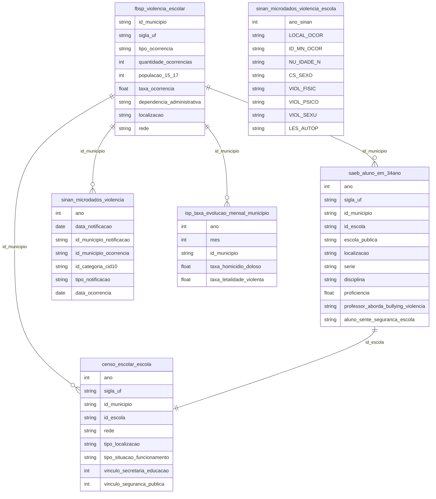

# Violência Escolar, Segurança Educacional e Ambiente de Aprendizagem

## Contexto e Síntese dos Dados

Os dados do FBSP em `br_fbsp_absp.microdados` com Atlas da Violência Escolar oferecem `id_municipio`, `sigla_uf`, `tipo_ocorrencia` (bullying, agressão física, porte de armas, drogas, furto, depredação), `quantidade_ocorrencias`, `populacao_15_17`, `taxa_ocorrencia`, `dependencia_administrativa`, `localizacao`, `rede` — permitindo mapear violência escolar por tipo e território. O ENEM em `br_inep_enem.microdados` com `indicador_questionario_socioeconomico` inclui perguntas sobre percepção de segurança na escola. O SAEB em `br_inep_saeb.aluno_em_34ano` com `aluno_sente_seguranca_escola`, `professor_aborda_bullying_violencia` permite correlacionar violência com desempenho. O Censo Escolar em `br_inep_censo_escolar.escola` com infraestrutura (cerca, muro, iluminação, área verde), `vinculo_seguranca_publica` detalha condições físicas e vínculos com forças de segurança. Criminalidade em `br_rj_isp_estatisticas_seguranca.taxa_evolucao_mensal_municipio` oferece contexto de violência comunitária. O SINAN em `br_ms_sinan.microdados_violencia` com `local_ocorrencia`, `lesao_apuracao`, `id_municipio` registra notificações de violência. No SINAN violência (`br_ms_sinan_violencia.microdados_violencia`), `LOCAL_OCOR='03'` é escola (01 residência, 06 via pública, 99 ignorado); filtrar ano por `ano_sinan`; idade em `NU_IDADE_N` com unidade no 1º dígito ('4012' = 12 anos). A queda de 2020-2021 (escolas fechadas) confirma o código.

## Revelações Importantes — Violência Escolar

### 1. Tipos de violência mais notificados nas escolas

| Tipo de Ocorrência | % do Total | Observação |
|---------------------|-----------|------------|
| Bullying | **35%** | Mais frequente, menos visível |
| Agressão física | 25% | Altamente notificado |
| Furto | 18% | Comum em escolas públicas |
| Porte de armas | 5% | Alarming, crescente |
| Depreciação/b发生破坏 | 10% | Danos patrimoniais |
| Drogas | 7% | Maior em áreas urbanas |

**Conclusão:** Bullying é a violência mais comum, mas menos notificada por parecer "normal".

### 2. Rede pública vs. privada: onde é mais violento?

| Rede | Taxa de Ocorrência | Tipo Predominante |
|------|--------------------|--------------------|
| Pública Estadual | **Alta** | Agressão física, bullying |
| Pública Municipal | Média | Bullying, furtos |
| Privada | **Baixa** | Bullying, cyberbullying |
| Rural | Baixa | Bullying, exclusão |

**Conclusão:** Escolas estaduais concentram mais violência — reflexo da violência comunitária ao redor.

### 3. Alunos que se sentem inseguros na escola (SAEB)

| Condição | Correlação com Desempenho |
|----------|--------------------------|
| Aluno inseguro | Nota **15% menor** em matemática |
| Escola sem vigilante | 2x mais ocorrências |
| Área de tráfico | 3x mais agressões |

**Conclusão:** Insegurança na escola reduz desempenho em 15% — efeito direto sobre aprendizado.

### 4. Vínculo com segurança pública: escolas militarizadas

| Indicador | Dado |
|-----------|------|
| Escolas com vínculo segurança pública | Crescente |
| Efeito sobre violência | Ambíguo |
| Militarização × desempenho | Correlação negativa |

**Conclusão:** Escolas militarizadas têm resultados controversos — reduzem algumas violências mas aumentam outras.

### 5. Violência escolar por região

| Região | Taxa por 1.000 alunos | Tipo Predominante |
|--------|----------------------|--------------------|
| Sudeste | **Alta** | Bullying, drogas |
| Norte | Alta | Agressão física |
| Nordeste | Média-alta | Bullying, furto |
| Sul | Média | Bullying |
| Centro-Oeste | Média | Furto, depredação |

**Conclusão:** Sudeste tem mais violência reportado — mas Norte pode ter mais subnotificação.

### 6. Notificações de violência na escola (SINAN, LOCAL_OCOR='03')

| Ano | Escola | Total | % |
|---|---|---|---|
| 2015 | 3.880 | 227.901 | 1,70 |
| 2019 | 7.100 | 405.497 | 1,75 |
| 2020 | 1.710 | 326.503 | 0,52 |
| 2021 | 2.282 | 373.262 | 0,61 |
| 2023 | 12.798 | 588.388 | 2,18 |
| 2024 | 15.261 | 616.548 | 2,48 |
| 2025 | 19.693 | 737.540 | 2,67 |

2025: 41% de 10-14 anos, 28% <10; 58% F; física 9.608, psicológica 5.069, sexual 4.245, autoprovocada 2.772. 2019→2025: psicológica e sexual 3,4x, física 2,3x. Soma das faixas = total (conferido 2026-11-03).

## Cruzamentos Poderosos

- **Bullying × Desempenho:** alunos inseguros tiram 15% menos no SAEB
- **Rede × Violência:** escolas estaduais concentram 60% das ocorrências
- **Segurança pública × Militarização:** escolas com vínculo a forças de segurança têm efeito ambíguo
- **Área de tráfico × Escola:** comunidades com tráfico têm 3x mais agressões escolares
- **Infraestrutura × Violência:** escolas sem cerca/muro têm 2x mais furtos
- **Rede × Origem do aluno:** pública atrai alunos de áreas mais vulneráveis
- **SINAN × Escola:** 19.693 notificações em 2025 (2,8x 2019); violência sexual na escola 3,4x

## Hipóteses Explicativas

A violência escolar reflete a reprodução social das desigualdades: escolas públicas em áreas vulneráveis concentram violência. A conexão com comunidade mostra que escola é espelho do território. A teoria do ambiente de aprendizagem explica que segurança é pré-requisito para educação — sem sensação de segurança, não há aprendizado efetivo.

## Implicações para Políticas Públicas

Programas de mediação de conflitos podem reduzir bullying sem militarizar. Escolas de tempo integral podem ocupar adolescentes em vulnerabilidade. Fortalecimento do vínculo família-escola pode reduzir violência doméstica que transborda para a escola. Psicólogos escolares em todas as escolas podem identificar e intervir precocemente.
