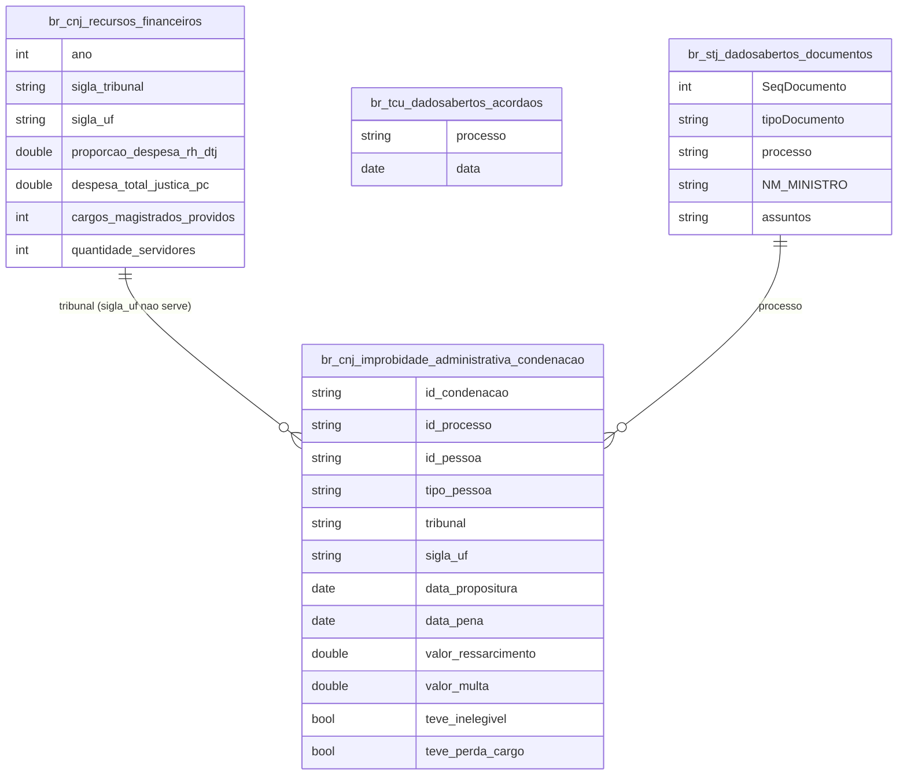

# Justiça, Tribunais de Contas e Custo do Judiciário

## Contexto e Sintese dos Dados

`br_cnj_estatisticas_poder_judiciario.recursos_financeiros` detalha, tribunal a tribunal, a estrutura de gasto do Judiciario: `proporcao_despesa_rh_dtj`, `despesa_total_justica_pc`, contagem de magistrados, servidores e terceirizados. Somado a `br_cnj_improbidade_administrativa`, `br_stj_dadosabertos` (549.243 documentos processuais do STJ, 2021-01-04 a 2022-01-17, com relator, tipo, processo e assunto), `br_tcu_dadosabertos` (36.499 acordaos 2024-2026) e aos tribunais de contas estaduais (`br_tce_rj` 179.409 rows, `br_tce_pi`, `br_tce_es`, `br_tce_sp`, `br_tce_to`).

## Revelacoes Importantes

### 1. Estrutura de despesa

| Indicador | Valor |
|---|---|
| Proporcao media de RH | 92,0% |
| Magistrados | 41.664 |
| Servidores | 526.770 |
| Terceirizados | 128.498 |

**Conclusao:** sobram ~8% para custeio e investimento.

### 2. Custo por habitante

| UF | R$ por habitante |
|---|---|
| Distrito Federal | 989 |
| Rondonia | 572 |
| Ceara | 143 |

**Conclusao:** variacao de 6,9x entre extremos.

### 3. Margem fora da folha

| UF | Gasto per capita | Sobra fora da folha |
|---|---|---|
| Distrito Federal | R$ 989 | 3,0% |
| Rondonia | R$ 572 | 14,1% |

**Conclusao:** quem mais gasta por habitante e quem menos investe.

### 4. Cadastro de improbidade (CNJ, ate fev/2024)

53.342 condenacoes transitadas em julgado, 41.558 `id_pessoa`, ressarcimento R$ 9,27 bi e multa R$ 3,77 bi (sentinelas >= 1e9 fora, ver gotcha), 27.733 com suspensao de direitos politicos (`teve_inelegivel`), 7.809 com perda de cargo. Propositura -> pena: mediana 3,9 anos (quartis 1,5 e 7,5; so `data_propositura >= 1992-06-02`).

| TJ | Condenacoes | Por 100 mil hab. |
|---|---|---|
| DF | 7.791 | 276,5 |
| SC | 7.616 | 100,1 |
| MG | 9.018 | 43,9 |
| SP | 7.945 | 17,9 |
| BA | 65 | 0,5 |

**Armadilha:** `sigla_uf` nao e a UF do tribunal — 28.600 linhas marcadas "AC" vem de TJMG, TJDFT, TJSC etc. Agrupar por `tribunal`. MG+SP+DF+SC = 60,7% das condenacoes com 37,1% da populacao. `proibicao_contratar_poder_publico` e falso em todas as linhas (nao usar).

## Cruzamentos Poderosos

- **Justica x Pessoal:** 92% da despesa e folha.
- **Custo x Territorio:** 6,9x de variacao entre DF e Ceara.
- **Magistrado x Servidor:** ~13 servidores por magistrado.
- **Gasto alto x Folha alta:** o DF deixa 3% fora da folha.
- **Densidade x Custo unitario:** a comarca minima nao encolhe com a populacao.

## Hipoteses Explicativas

Garantias constitucionais tornam a folha incompressivel no curto prazo, fazendo do investimento a unica variavel de ajuste. A variacao per capita reflete economia de escala em servico territorializado.

## Implicacoes para Politicas Publicas

Ganhos de eficiencia dependem de redesenho de processo — digitalizacao, unificacao de comarcas — mais que de aumento orcamentario.
