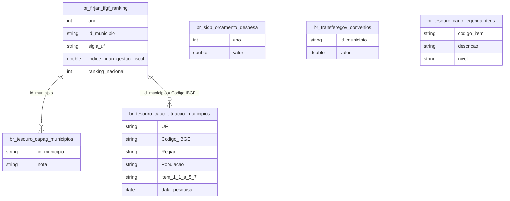

# Federalismo Fiscal e Capacidade Financeira dos Municípios

## Contexto e Sintese dos Dados

`br_firjan_ifgf.ranking` mede gestao fiscal nos 5.568 municipios com `indice_firjan_gestao_fiscal` e ranking nacional/estadual. `br_tesouro_capag` classifica capacidade de pagamento (cabecalho deslocado e sem a nota final, ver gotcha); `br_tesouro_cauc.situacao_municipios` e o retrato do CAUC (uma coluna por exigencia, "1.1" a "5.7"; valor "!" = pendencia, data = validade da comprovacao, "Desabilitado" = item fora de uso; descricao em `legenda_itens` com `nivel = 'municipios'`); `br_siop_orcamento` e `br_transferegov` detalham orcamento e convenios; IPTU municipal em BH, Fortaleza e Sao Paulo completa a base de arrecadacao propria.

## Revelacoes Importantes

### 1. Evolucao nacional

| Ano | Indice medio |
|---|---|
| 2020 | 0,546 |
| 2021 | 0,588 |
| 2022 | 0,625 |

**Conclusao:** melhora durante a pandemia, puxada por transferencia extraordinaria.

### 2. Extremos estaduais

| UF | Indice |
|---|---|
| Santa Catarina | 0,853 |
| Mato Grosso | 0,810 |
| Maranhao | 0,379 |
| Sergipe | 0,359 |

**Conclusao:** 2,4x de diferenca; os oito ultimos sao todos do Norte e Nordeste.

### 3. Escala municipal

| UF | Municipios | Indice |
|---|---|---|
| Minas Gerais | 853 | 0,700 |
| Bahia | 417 | 0,451 |
| Roraima | 15 | 0,544 |

**Conclusao:** 5.570 municipios replicam estrutura administrativa minima.

### 4. CAUC — pendencias que bloqueiam transferencia voluntaria (30/10/2026)

| Regiao | Municipios | Com pendencia | % |
|---|---|---|---|
| Norte | 450 | 377 | 83,8% |
| Nordeste | 1.793 | 1.315 | 73,3% |
| Centro-Oeste | 467 | 271 | 58,0% |
| Sudeste | 1.668 | 835 | 50,1% |
| Sul | 1.191 | 533 | 44,8% |
| Brasil | 5.569 | 3.331 | 59,8% |

Itens mais pendentes: 3.2.3 anexo 8 do RREO ao Siope (1.740), 1.5 regularidade perante o Poder Publico Federal (1.217), 1.1 tributos/previdencia/divida ativa (1.052), 3.2.4 anexo 12 ao Siops (1.015). Conferido por UNPIVOT e por `concat_ws('|', *COLUMNS('^[0-9]')) LIKE '%!%'` (mesmos 3.331). SE 92%, SC 38% — mesma ordem do IFGF.

## Cruzamentos Poderosos

- **SC x SE:** 2,4 vezes de diferenca.
- **Ranking x Regiao:** os oito ultimos sao do Norte e Nordeste.
- **Gestao fiscal x Pandemia:** indice subiu de 0,546 para 0,625.
- **Escala x Custo fixo:** 5.570 estruturas administrativas minimas.
- **Transferencia x Autonomia:** a melhora acompanha o repasse federal.
- **CAUC x Regiao:** 59,8% dos municipios com pendencia; 83,8% no Norte.
- **Firjan x CAUC:** SE (pior IFGF) 92% pendentes; SC (melhor) 38%.

## Hipoteses Explicativas

O indice mede menos competencia administrativa e mais base economica disponivel: onde ha atividade, ha ISS, IPTU e cota-parte de ICMS.

## Implicacoes para Politicas Publicas

Consorcios intermunicipais reduziriam custo fixo replicado sem mudanca constitucional. Condicionar transferencias voluntarias a indicadores de gestao criaria incentivo a eficiencia.
