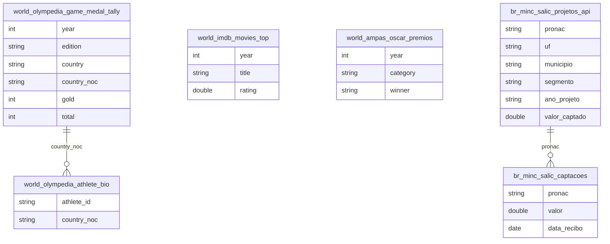

# Cultura, Esporte e Desempenho Internacional

## Contexto e Sintese dos Dados

`world_olympedia_olympics` traz o historico completo de medalhas desde 1896 com `gold`, `total` e `country_noc`, alem de biografia de atleta e resultado por prova. Somado a `world_sofascore_competicoes_futebol`, `mundo_transfermarkt_competicoes`, `world_imdb_movies` e `world_ampas_oscar`. O medalheiro vai ate Toquio 2020 (sem Paris 2024). Do lado domestico, `br_minc_salic` traz a Lei Rouanet: `projetos_api` (2019-2026, `valor_captado` por projeto, `uf`) e `captacoes` (recibo por doador); o legado 2000-2016 esta em `projetos`/`incentivos` e nao se soma (ver gotchas).

## Revelacoes Importantes

### 1. Quadro historico

| Pais | Ouros | Total |
|---|---|---|
| Estados Unidos | 1.195 | 3.009 |
| Uniao Sovietica | 473 | 1.204 |
| Alemanha | 355 | 1.098 |
| Brasil | 37 | 150 |

**Conclusao:** os EUA tem vinte vezes o acervo brasileiro.

### 2. Taxa de conversao em ouro

| Pais | % de ouro |
|---|---|
| Estados Unidos | 39,7% |
| Uniao Sovietica | 39,3% |
| Brasil | 24,7% |

**Conclusao:** o Brasil chega ao podio mas raramente ao topo.

### 3. Escala x resultado

**Conclusao:** Franca e Italia tem um terco da populacao brasileira e seis vezes mais medalhas.

### 4. Lei Rouanet por regiao (projetos 2019 a out/2026)

| Regiao | % pop. | Captacao (R$ bi) | % captacao | R$/hab |
|---|---|---|---|---|
| Sudeste | 41,8% | 11,47 | 73,6% | 135,15 |
| Sul | 14,7% | 2,20 | 14,1% | 73,61 |
| Centro-Oeste | 8,0% | 0,54 | 3,5% | 33,27 |
| Norte | 8,5% | 0,37 | 2,4% | 21,55 |
| Nordeste | 26,9% | 0,99 | 6,4% | 18,15 |

**Conclusao:** RJ capta R$ 190/hab, AL R$ 4,51 (42x); 1% dos 18.291 projetos com captacao fica com 25,7% do total. Conferido: `sum(captacoes.valor)` = `sum(projetos_api.valor_captado)` = R$ 15,578 bi. Populacao: `br_ibge_censo_2022.populacao_grupo_idade_uf` excluindo as faixas sobrepostas "15 a 17" e "18 e 19" (senao soma 217 mi em vez de 203 mi).

## Cruzamentos Poderosos

- **Brasil x EUA:** 3.009 contra 150 medalhas.
- **Conversao x Ouro:** 24,7% contra 39,7%.
- **Populacao x Podio:** um terco da populacao, seis vezes mais medalhas.
- **Talento x Estrutura:** o podio depende do atleta; o ouro, do sistema.
- **PIB x Resultado:** estar entre as dez maiores economias nao produz podio.
- **Rouanet x Regiao:** Sudeste com 42% da populacao e 74% da captacao.

## Hipoteses Explicativas

Acervo pequeno com baixa conversao sugere sistema que funciona por excecao individual, nao por processo institucional de deteccao e formacao continuada.

## Implicacoes para Politicas Publicas

Financiamento plurianual imune ao ciclo eleitoral e olimpico teria mais efeito que investimento concentrado as vesperas de competicao.
