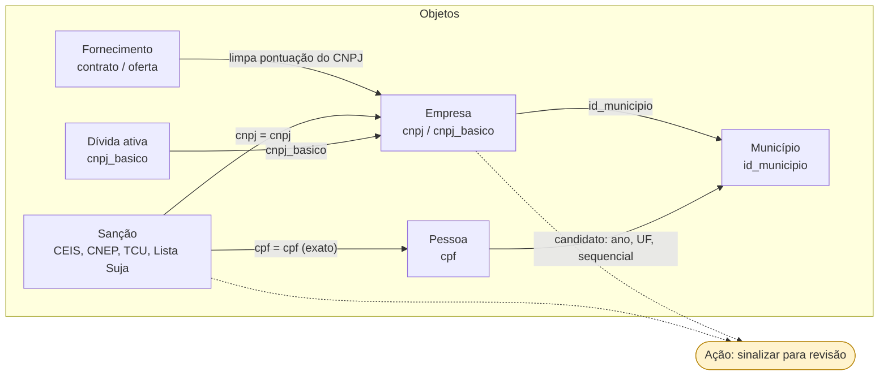

# Ontologia do rodado em termos do Foundry (recorte: empresa, contrato público, sanção)

Desenho de 2026-11-03. **Não é um deployment do Foundry**: é o recorte que um port levaria
primeiro, escrito a partir do que `docs/context/bridges.yaml` já guarda. O mapeamento camada
a camada em inglês está em `docs/tecnico/TECHNICAL.md` ("Palantir Foundry mapping"); este
arquivo é o diagrama que o plano de lá pedia e que não existia.

## Tipos de objeto

| Tipo de objeto | Chave primária | Tabelas de origem (rodado) | Observação medida |
|---|---|---|---|
| Empresa | `cnpj` (14 dígitos) / `cnpj_basico` (8) | `br_me_cnpj.estabelecimentos`, `.empresas` | `estabelecimentos` é o retrato do mês; o histórico fica em `*_historico` |
| Pessoa | `cpf` (11 dígitos) | `br_tse_eleicoes.candidatos`, `br_pgfn_dividaativa.divida` | fontes públicas trazem CPF mascarado (`***######**`): a máscara sozinha não identifica, exige nome igual |
| Município | `id_municipio` (7 dígitos, texto) | `br_bd_diretorios_brasil.municipio` | todas as variantes (`id_municipio_6`, TSE, RF, BCB, SIAFI) convertem para ele |
| Fornecedor / contrato | `cnpj_cpf_fornecedor`, `id_contrato` | `br_mgi_compras_publicas.*`, `br_cgu_licitacao_contrato.*` | `cnpj_cpf_fornecedor` vem com pontuação |
| Sanção | `cpf_cnpj` + tipo | `br_cgu_sancoes`, `br_tcu_inidoneos`, `br_mte_listasuja` | cada lista guarda o documento de um jeito |
| Dívida ativa | `cnpj_basico` | `br_pgfn_dividaativa.divida` | tabela ordenada por `cnpj_basico`: filtrar por essa coluna evita varrer tudo |

## Tipos de vínculo (link types) e o que cada um carrega

No Foundry o vínculo exige chaves iguais nos dois lados. No rodado, o vínculo
(`resolve_join`) devolve a expressão de normalização junto, e um port moveria essa expressão
para um transform antes do vínculo.

| De | Para | Expressão de junção (de `bridges.yaml`) | Conferido |
|---|---|---|---|
| Lista Suja (`empregadores`) | Empresa | `cnpj = e.cnpj` | 211 de 211 CNPJs achados, 2026-10-15 |
| Compras públicas (`pregao_item_oferta`) | Empresa | `regexp_replace(cnpj_cpf_fornecedor, '[^0-9]', '', 'g') = e.cnpj` | só casou 5 empresas da Lista Suja depois da limpeza |
| Internação (`br_ms_sih.aihs_reduzidas`) | Empresa | `lpad(cnpj_estabelecimento, 14, '0') = e.cnpj` | 37,1 mi de linhas chegam com 13 dígitos; os 5.059 CNPJs reais casaram 100% |
| Lista Suja (`empregadores`) | Pessoa | `cpf = c.cpf` | 46 candidatos, 113 filiados, 124 no SICOR |
| Rede social do candidato | Candidato | `ano`, `sigla_uf`, `sequencial_candidato = sequencial` | 98–99,98% por eleição, 2026-10-29 |

## Interface

`Localizável` (Foundry: interface): todo objeto com `id_municipio` sobe para UF e região pela
hierarquia (`docs/context/hierarchies.yaml`, rollup por prefixo do código, sem join).

## Diagrama

## Ação que o rodado não tem (e o Foundry teria)

**Sinalizar fornecedor para revisão**: entrada `cnpj` + motivo, regra de validação (o CNPJ
existe e tem sanção vigente ou dívida ativa), efeito de gravação em um objeto
`RevisaoFornecedor` e trilha de quem sinalizou. O rodado é somente leitura por construção
(sessão `-readonly`, diretórios restritos): fechar esse ciclo é o que um port acrescentaria.

## O que cada responsabilidade vira num port

| Hoje no rodado | No Foundry |
|---|---|
| expressão de normalização em `bridges.yaml` | transform no pipeline, antes do vínculo |
| campo `verified` de ponte, métrica e gotcha | expectativa de dados que falha o build (no rodado vira aviso ao agente) |
| `resolve_join` / `get_metric` | funções da ontologia |
| 18 ferramentas MCP, somente leitura | Ontology MCP; o lado que constrói seria o Palantir MCP |
